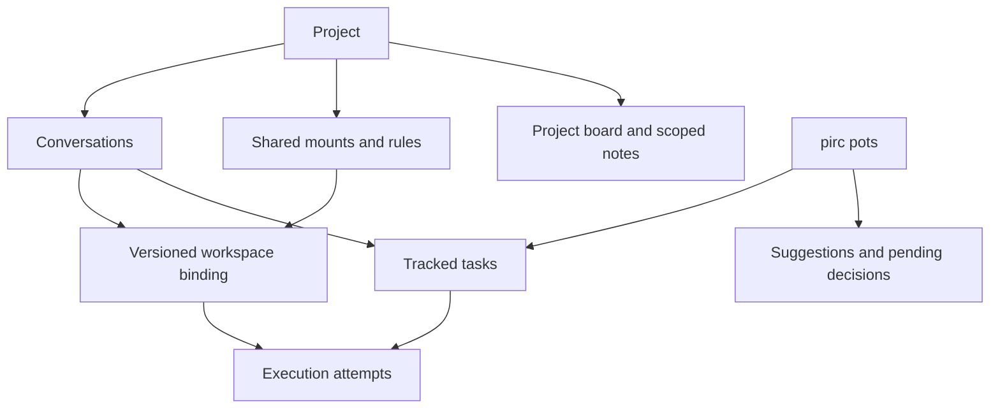

# Unified conversations, projects and an independent App

[Plans](README.md) · [Workspace modes](modes.md) · [Mobile](mobile.md) · [Assistant contracts](../docs/architecture/assistant-memory.md) · [Checkpoints](checkpoints.md) · [pots and Rust foundations](pots-and-library-extraction.md)

Status: architecture and workflow proposal, updated 2026-10-24. The user authorized
planning only. No implementation, schema migration, deployment, remote push or
release is authorized by this plan. Proposed defaults below are reviewable design
choices, not claims about shipped behavior or approval to change security policy.

## Agreed direction and priority

- Merge the user-facing Chat and Work experience. A conversation can be ordinary
  chat, research or work without asking the user to choose a separate product area.
- Organize conversations in projects; distinguish organization from execution.
- Make the App a complete, independent client of the backend. Normal use must
  not require a desktop Web session to remain open or approve routine actions.
- Give pirc a stable assistant entry point that can discover relevant matters,
  propose work and coordinate agents within the user's granted authority.
  Proactive suggestions are wanted; frequent, repetitive interruptions are not.
- Define the domain relationships and user journeys before designing new screens
  or expanding UI parity. Web and App should implement the same behavior contract.
- Keep Flutter Web as an evaluation option. Replacing the existing Web client,
  rewriting transport and changing the native-content requirement are not decided.

Security and data-loss fixes remain important. Existing mobile compatibility and
physical-device acceptance gaps remain recorded, not silently closed by this
architecture proposal. The initial App scope remains Android; iOS transport is
outside the previously agreed scope.

## Confirmed decisions: context and live switching (2026-10-24)

The user selected **A: preserve conversation context**. Leaving a project keeps
existing dialogue/history eligible as model context. It removes project-derived
mounts and new access to project folders, configuration, rules, board and notes.
Do not clear or sanitize the old conversation as a side effect of departure.
Previously read material may still be known; this is accepted, not an isolation
claim about information already obtained. Stop injecting the departed project's
rules as active configuration, even if their text remains in historical messages.

The user also specified the running-workflow behavior:

1. Switching/removing a workspace or mounted folder while an agent is running
   first shows a warning explaining affected resources and in-flight work.
2. Canceling leaves the workspace and execution unchanged. If the user proceeds,
   revoke the removed access and reject subsequent stale/unauthorized operations
   through enforced execution/sandbox boundaries; do not wait for task completion
   or for the agent to approve the change.
3. Deliver a trusted runtime event to the agent explaining that the **user**
   changed/removed the workspace or mounts, what is now available and why an
   affected operation was denied/interrupted. Deliver it at a safe event boundary
   before accepting further effects; model notification alone is not enforcement.
4. Keep the same visible conversation and its context. The agent may continue
   within the remaining grants or ask the user if it needs clarification. The
   application must not force a follow-up question or automatically restore the
   removed mount, expand rights, select another directory or retry an old write
   against the replacement workspace.

### Enforcement implications to design, not existing functionality

The requirement is authoritative revocation, not merely removing a UI item or
returning an error from the next cooperative file tool. Current Linux bubblewrap
mount plans and macOS sandbox-exec profiles are constructed for process launch
(`crates/pirc-node/src/sandbox/{linux,macos}.rs`). No dynamic per-mount revocation
mechanism was established by this review. Updating a policy object cannot be
assumed to revoke a running shell's open descriptors or its background children.

Proposed implementation contract, pending technical validation:

- Treat the confirmed request as a versioned access transition. Immediately fence
  new work under the old binding at the controlling service and execution host;
  stale queued commands and approval results cannot recreate the removed access.
- Stop/quiesce affected tool processes and descendants, retire their old sandbox
  authority, and rebuild the execution sandbox where live enforcement is not
  available. Preserve the conversation/model context and explain interrupted
  tool outcomes. A preserved agent identity does not require the same OS process.
- Publish the replacement binding only after its permissions are installed and
  revocation has been acknowledged. Revalidate every subsequent effect against
  the current generation and target; old proposals are not retargeted implicitly.
- Switching must preserve original files and already completed effects. An
  interrupted command may have partially changed files: record that uncertainty
  and expose relevant checkpoints; do not claim rollback or replay it blindly.
- An offline execution host cannot acknowledge immediate revocation. Show the
  transition as pending/blocked, fence Gateway dispatch, and keep reconnecting
  workers from resuming their old authority before reconciliation. Do not claim
  that a remote offline process stopped at the instant the user tapped Confirm.
- Show applying/completed/failed states and retain a durable transition identity
  through retries, crashes and concurrent device changes. Completion requires
  the actual revocation boundary; an agent-facing notice is not completion proof.

The intended UX takes effect on confirmation without asking the agent's consent.
The exact OS enforcement and remote acknowledgement strategy remains engineering
work; there is no zero-latency distributed revocation guarantee in this plan.

## Current behavior: evidence and constraints

These are implementation facts to account for, not the target architecture:

- [Workspace modes](../docs/guides/modes.md) currently place `assistant: full`
  workspaces in Chat and others in Work. Modes also determine prompt, tools,
  working-directory behavior and feature access; the split is more than navigation.
- `crates/pirc-protocol/src/mode.rs` rejects full assistant capability with a
  workspace working directory, and rejects a mode that is both delegator and
  delegation target. Do not remove those checks just to merge the tabs.
- Projects, directory workspaces and their links currently have different
  lifecycle and permission rules. Project links are preferences, not permissions.
- [Assistant contracts](../docs/architecture/assistant-memory.md) separate global
  assistant memory from repository handoffs and protect provenance. Moving a
  conversation must not rewrite memory origins or widen what an agent can read.
- Android's `lib/live/gateway.dart` calls a Kotlin bridge. Native `PircApi.kt`
  directly requests Gateway session snapshots and commands; `EventStream.kt`
  opens authenticated Gateway event streams. An open Web page is not a relay.
- `core/Pairing.kt` consumes a pairing link created through Web. Gateway
  `management.rs` requires a browser identity to approve native management grants.
  These are genuine Web-dependent setup/administration steps today.
- `GatewayRuntime.kt` refreshes snapshots and checks session control leases.
  Another device holding a lease, an unreachable Gateway and an offline Node are
  different conditions; the UI must distinguish them. Reported switching/connection
  problems have not been reproduced as part of this planning pass.
- Gateway `push.rs` supports browser and phone delivery. Transport implementation
  does not establish successful real-device background delivery; existing remote
  push acceptance remains open.

## Domain model: proposed relationships

The 2026-10-24 user clarification replaces the earlier organization-only project
proposal: project membership also supplies mounted resources and configuration;
leaving removes project-derived access. Implementation details remain proposals.

| Concept             | Responsibility                                                                                    | Relationship and lifetime                                                                                                            |
| ------------------- | ------------------------------------------------------------------------------------------------- | ------------------------------------------------------------------------------------------------------------------------------------ |
| Project             | Folder-like organization plus shared mounts, rules/configuration and proposed collaboration board | Contains conversations and one or more resource bindings; need not equal one physical directory                                      |
| Conversation        | Stable dialogue, attributed messages/results and a configured workspace                           | Optionally belongs to one project; has its own bindings plus currently authorized project bindings                                   |
| Workspace binding   | Resolve the selected Node, primary working directory and named read/write mounts                  | Configurable when creating a conversation; can use existing folders or an explicitly created server folder; versioned at transitions |
| Resource mount      | Describe a directory/configuration resource, its alias, host, permissions and grant source        | May derive from a project or explicit conversation configuration; not just a symlink or display label                                |
| Task                | Track an objective, dependencies, owner, progress, blocking reason and deliverables               | One originating conversation; can have child tasks and many attempts; pots links to the same identity                                |
| Execution attempt   | Run an agent turn/work against an explicit environment and authority generation                   | One conversation, optionally one task; its resource set cannot silently mutate mid-run                                               |
| Pending decision    | Durable proposal/confirmation with an authoritative outcome                                       | References task/attempt and revision; shared across devices                                                                          |
| pots responsibility | Track an ongoing user-authorized concern and when to observe or follow up                         | May create suggestions and authorized tasks; bounded by scopes, budget and pause controls                                            |

Boundaries:

1. Project membership supplies defined resource grants, not all host access.
   Conversation-specific mounts and project mounts have separate provenance.
   Aliases, overlapping roots, default cwd, read/write rights and grant precedence
   must be explicit. A mount must be enforced for shell/tools/children as well as UI.
2. Creating a new empty folder is permitted only under a configured server root
   and current user authority; validate paths, symlinks, collisions and ownership.
   Do not reuse a pre-existing nonempty path as if it were newly allocated.
3. Recommended initial execution: all direct filesystem mounts of one attempt
   resolve on the selected Node. Cross-Node resources need an explicit remote
   access/copy design; a folder on server B is not magically local on server A.
4. Leaving/moving a project is an access transition. Block new affected work,
   reconcile queued actions, quiesce/stop old workers and descendants, revoke old
   project grants, rebuild the execution sandbox while preserving conversation
   context, then resume under a new binding generation. Do not report success while old workers still hold project access.
   An offline Node or interrupted transition remains pending/blocked until resolved.
5. Changing a mount list does not close existing file descriptors or withdraw
   bytes already read. Decision A preserves existing conversation context and
   history; unmounting does not erase those. Previously copied files/summaries
   remain attributable and are not evidence of successful resource revocation.
   Never copy additional project content to bypass the user's removal.
6. Authority from unrelated mounts or broad host access may overlap the removed
   project path. Define explicit deny/grant precedence or disclose remaining
   independent access; revoking only a UI mount cannot prove the path is unreadable.
7. Keep memory authorship/deletion provenance and original filesystem data.
   Project board/notes reopen scoped collaboration design; automatic migration of
   existing global USER/MEMORY into project-only stores is not authorized.
8. Every task keeps a stable identity across attempts. Existing checkpoint recovery
   still opens an isolated workspace and blank recovery conversation; it does not
   inherit the source memory writer or overwrite later user changes.

### Drafts, tasks and execution states

- **Conversation:** configure workspace/mounts at creation → local draft → first
  accepted message → persisted conversation → archived or explicitly deleted.
  Proposed allocation policy: retain workspace choices in the draft and allocate
  managed storage at first send, unless the user explicitly invokes Create folder.
  Empty drafts still do not litter the session list; never delete a user-created
  folder merely because its draft was abandoned. Allocation timing needs review.
- A first-send request has a stable idempotency identity. Retries, uploads and
  interrupted creation must not create duplicate conversations or orphaned
  permanent attachments. An unsent message remains visibly a draft.
- **Task:** proposed → ready → running → waiting for user / resource / dependency
  → awaiting review → completed; canceled and failed remain distinguishable.
  Recommend tracked tasks for complex work; long/background and multi-agent work
  should require them. Create tasks automatically from an authorized request;
  do not require a form or infer execution permission from a task card.
  Plain questions and brief edits can remain ordinary turns. Progress shows
  milestones and blocking reasons; percentages need an actual measurable basis.
  User acceptance, where required, is distinct from an agent saying it is done.
- **Attempt:** queued → starting → running → succeeded / failed / stopped;
  disconnect can leave outcome unknown. Do not treat lost connectivity as success
  or blindly retry a possibly completed side effect.
- **Environment:** available, offline, incompatible or access denied. These do
  not erase the conversation or imply that its task was canceled.

Exact persisted state names and transitions require a later contract review.

## Primary user journeys

### 1. Create a conversation and workspace

1. Open New conversation. Configure its workspace: use mounted folders, inherit
   project resources, or explicitly create an empty folder in an allowed server
   location. A managed empty default keeps ordinary chatting easy.
2. Show the selected server, primary directory and additional named mounts without
   forcing a Chat/Work choice. A plain chat uses the same workspace abstraction.
3. Keep an unsent conversation as a draft; review the allocation timing above.
4. On first send, persist idempotently, resolve current grants and launch the
   needed agent context. An unavailable environment leaves the request recoverable.
5. Organizing it into or out of a project applies the explicit resource transition
   below; it does not physically move a repository or reassign old memory origins.

### 2. Discuss, then work in the same conversation

1. Open a project conversation and discuss the change.
2. Ask the agent to implement it. Use the configured workspace and its explicit
   primary target/mount aliases. Project defaults are resolved when configuring
   the binding, not silently re-read to redirect an already-running attempt.
3. If several targets are plausible, ask once with readable device/directory
   choices. Never guess a remote target or silently widen permissions.
4. Show the selected environment and granted operation scope in the conversation.
   Use the established approval policy; no extra dialog is needed merely because
   the UI previously called this Work.
5. Start the task/attempt, keeping progress, questions and results in this dialogue.
   Detailed execution logs are accessible without forcing a navigation change.
6. Show changed files, tests, outstanding issues and any requested acceptance.

The contract guarantees one user-visible dialogue, not a single privileged agent
process. How a chat turn hands context to an execution agent remains a design
checkpoint before implementation; preserve source attribution and tool ownership.

### 3. Work directly, without going through pirc

1. Open a known environment or project and start a conversation there.
2. Send the work request directly; pirc is not a compulsory intermediary.
3. The task can appear in the shared overview without creating a second session.
4. If pirc is allowed to coordinate that task, show its role. Direct user
   instructions supersede conflicting pending assistant instructions.

### 4. Ask pirc to coordinate several tasks

1. Give pirc an objective or accept one of its suggestions.
2. Review scope/targets when existing grants do not already authorize them.
3. Create canonical tasks with dependencies and named execution environments.
4. Run independent tasks concurrently only where authority and isolation permit.
   Reuse existing delegation mechanisms rather than introducing a competing queue.
5. Collect decisions in the pirc inbox. Open any task to communicate directly
   with its agent; responses and status stay attached to that task.
6. Aggregate meaningful results without copying every tool event into pirc's chat.

### 5. Take over, switch devices, and return control

- Opening a conversation is viewing, not automatic takeover. Reading must not
  require the current controller to be online.
- Before a conflicting command, show who/what currently controls the execution
  and offer explicit takeover. Fence stale commands using a backend generation.
- User takeover suspends conflicting pirc dispatch for that task. It does not
  silently kill running tools; show whether work continues, pauses or is stopping.
- Resuming assistant coordination is explicit. Another browser tab opening must
  not silently reclaim it.
- Every decision has one backend outcome. Duplicate submissions return the
  current handled state. Web and App show where/when it was handled when known.
- Device command control, assistant coordination authority and filesystem writer
  isolation are distinct; one lease must not be assumed to solve all three.

### 6. Switch environments, leave projects or recover work

- Before starting a run, changing workspace selection changes the next run's
  binding. After completion, a new environment starts a new attributed attempt
  in the same visible conversation; old results retain their original location.
- During execution, warn before a workspace/mount removal or switch. On user
  confirmation, enforce revocation, reject stale effects and notify the agent
  under the confirmed live-switching contract above. Preserve conversation context;
  stop/rebuild affected execution where required instead of relabeling a process.
  Starting a separate task elsewhere remains a distinct operation.
- Leaving a project must revoke its mounts, rules, board access and retrieval from
  project notes. Mark the move pending until the old authority is no longer usable;
  do not silently let a detached background child keep working in the project.
- Merely navigating to another page does not change membership or stop work.
- Existing files stay where they are. Decision A retains history from the old
  project as future model context while removing project-derived mounts and new
  retrieval. Historical text does not reauthorize the departed project's resources.
- Checkpoint recovery keeps its independent workspace and blank conversation,
  linked from the source. No implicit original-directory overwrite or source
  memory-writer inheritance is allowed.

## Project collaboration: board, notes and resource waiting

The user's shared-board idea is a collaboration requirement under design.
Existing team `board_*`/`task_*` operations in `features/team/broker.rs` are a
starting point, but that parent-side broker is not automatically a durable board
shared by every independent conversation in a project.

Use three explicit kinds of information:

| Kind                           | Content                                                                     | Authority                                                                                     |
| ------------------------------ | --------------------------------------------------------------------------- | --------------------------------------------------------------------------------------------- |
| Project rules/configuration    | User-approved instructions and resource settings                            | Versioned, user-controlled; agents propose changes rather than grant themselves rights        |
| Project board and shared notes | Work claims, messages, decisions, stable project facts                      | Scoped and attributed to actor/task/source; revisions, retention and deletion policy required |
| Resource wait state            | Who actually holds a write lease, conflicting path, wait reason and release | Computed by the execution host; board text cannot acquire/release a real lock                 |

Recommended conflict flow: A holds a path → B receives structured owner/path/reason
→ B does independent work or enters a visible waiting state → release wakes B → B
rechecks authority and rereads the current file before attempting its edit.
Do not classify temporary contention as task completion or a generic fatal error.
Avoid model polling loops and unlimited retry spend; cancellation and a bounded
escalation policy remain available. Detect dependency cycles; do not solve them
by expiring a still-active writer's lease or asking an agent to bypass the broker.

The current Node write broker is per Node and holds leases until the run settles
or stops. A second lock table in Gateway would not automatically coordinate shell
processes, user editors or multiple Nodes sharing storage. Keep Node enforcement,
expose useful wait state, and prefer isolated worktrees for overlapping parallel
code changes. Checkpoints provide recovery, not universal writer isolation.

Board content is other-agent data with provenance, not a user's instruction or
approval. It must not automatically become global personal memory. Leaving a
project removes future access, but previously copied text cannot be claimed erased.
Project-note retention/deletion still requires design; post-departure conversation
context is settled by decision A above. Previously read notes may remain in that
context, while new project-note retrieval is denied.

## pirc pots: proactive but bounded

Product name supplied by the user: **pirc pots** (personal assistant).
Proposed presentation: one stable assistant entry point with an overview,
pending decisions and task-specific discussion threads. It is not a second
unstructured collection of interchangeable Chat sessions. A continuous persona
must not require an infinite transcript containing every agent's raw output.

Separate these authorities:

- **Observe:** which projects, tasks, calendar/source data and history may be read.
- **Suggest:** create a sourced recommendation without starting its proposed work.
- **Execute:** dispatch, modify, schedule, contact external systems or publish only
  within explicitly granted scope and the existing operation approval policy.

Observation itself has limits: no scanning arbitrary files, accounts or new
sources merely to find something useful. Retrieved content and other agents'
messages remain data, not user permission. Unapproved suggestions expire or stay
pending; silence, dismissal and notification delivery never authorize execution.

pots messages must carry backend-issued actor identity, source responsibility/task,
initiating user request or standing grant, target and scope. Display "From pots"
in the receiving conversation. A text prefix is insufficient: agents must not
be able to impersonate the user or manufacture delegated authority.

Configure observation, conversation reading, suggestions, dispatch/follow-ups,
stop/reprioritize, and notifications separately. User commands or explicit
standing grants authorize dispatch; the ability to watch progress does not.
Revalidate grants at delivery and execution, deduplicate retries, and fence queued
pots instructions after user takeover or project departure. Include loop/depth
and budget limits so bots cannot trigger an endless dispatch cycle.

The backend stores the suggestion, supporting evidence, revision, related tasks
and disposition. Event/rule filters should trigger bounded analysis, with budgets
and backoff, rather than a model continuously rereading every conversation.
Assistant inference runs on an available authorized execution service; a Gateway
alone is not an agent runtime. Show unavailable/stale status when it cannot run.

Notification policy proposal:

| Category                                               | Default treatment                                            |
| ------------------------------------------------------ | ------------------------------------------------------------ |
| Decision required, blocker or user-marked urgent event | Prompt notification subject to the user's preferences        |
| Ordinary completion or useful nonurgent suggestion     | Group in a digest/inbox                                      |
| Tool progress or unchanged state                       | Update the task silently                                     |
| Dismissed or snoozed suggestion                        | Stay quiet until the chosen time or a material new condition |

Include per-category controls, quiet hours, deduplication and a visible reason
for each suggestion. Proactive monitoring/analysis has a configurable budget and
can be stopped independently of ordinary chat. Exact defaults remain open.

## Independent App and shared backend contract

The App is an equal client, not a remote control for an open Web page. Web and
App both connect to Gateway; Node execution and durable coordination continue
independently of client visibility. A web login/identity-provider page opened on
the phone is compatible with this goal; requiring an already logged-in desktop
Web session is not.

### Identity and management

- Design native sign-in/bootstrap, reauthentication, credential renewal, recovery
  and revocation without requiring another device's Web UI. Keep the existing
  pairing path as an optional onboarding method during migration.
- Authorize management by verified identity, scope and required reauthentication,
  not by client platform alone. Do not simply grant all existing device tokens
  provider-credential or device-management privileges.
- The current browser-approved short-lived grant is an existing security decision
  to replace deliberately. Select the authentication mechanism and migration
  policy before implementing; do not infer approval to weaken it from this plan.

### State, commands and connection recovery

- Gateway exposes canonical task/decision state and recoverable account-level
  changes. Nodes remain authorities for execution/files; this plan does not
  require moving all transcripts or files into Gateway storage.
- Use versioned snapshots plus resumable events; detect missing history and
  resync. Session switching cannot depend on a Web client's local state.
- Cache already-read conversations locally by account. Show cached content,
  freshness and reconnect state; retain drafts and navigation during failures.
  Account changes/revocation must not expose another account's cache or drafts.
- Resolve mutations with idempotency keys, current revisions and authorization.
  Reconcile unknown outcomes instead of claiming exactly-once side effects.
- Offline viewing/drafting is allowed for cached data. First-version destructive
  or approval commands are not silently queued for later execution; revalidate
  state and authority when the user submits after reconnecting.
- Distinguish Gateway unreachable, Node offline, expired credentials, unavailable
  environment and control held elsewhere. Provide a relevant next action.

### Durable inbox and notification delivery

- Store the event/decision before notification delivery. A push is a wake-up hint
  and deep link, not the only copy of the assistant's message or an authorization.
- Web closing must not stop dispatch. App suspension must not stop backend work.
  Reopening the App reconciles unread/handled state even if push was lost.
- Retire local prompts/notifications when resolution is received. An offline
  device cannot be guaranteed immediate retraction; tapping a stale notification
  must fetch the current state and refuse duplicate execution.
- Gateway and required Nodes must still be available. A sleeping laptop hosting
  them remains a deployment limitation. Always-on coordination and phone OS push
  behavior need separate deployment/device acceptance.

## Relation to reusable crates and App connection design

See [pots and Rust foundations](pots-and-library-extraction.md) for checked handoff
findings, official dots/Grok Bot references and the combined delivery sequence.
The reusable loop does not own product tasks, mounts, memory or pots authority.
Provider extraction can be behavior-preserving and independent; loop integration
must respect tool-wait, cancellation, event ordering and context transitions.

The user deferred the secure server-to-App connection mechanism. Preserve the
independent-client requirements above while leaving authentication/topology for
separate review. Android already connects to Gateway directly; no new public
Node/agent port, bypass of Gateway authorization, or inbound phone listener is
implied. Model-provider subscription OAuth is separate from pirc App login.

## Flutter Web: evaluation only

A shared Flutter client could reduce duplicate UI and state logic. It is not
required to remove browser dependencies, and it cannot fix backend availability,
permissions or ordering bugs by itself. No Web replacement is approved here.

After the domain/behavior contract is agreed, evaluate a thin vertical slice:

- Login and direct Gateway transport, reconnect and two-device confirmation.
- Long conversation scrolling, selectable text, code highlighting and file views.
- Mobile CJK IME, desktop keyboard shortcuts, terminal resize/input and focus.
- Deep links, browser navigation, accessibility and phone/tablet/desktop layouts.
- Large histories, startup/download cost and sustained rendering responsiveness.
- Platform adapters for storage, notifications, files and native Kotlin services;
  existing method channels cannot simply run in a browser.

Compare keeping the existing Web client against sharing Flutter data/state/UI,
using the same workflows and fixtures. Set acceptance budgets before the spike;
do not invent a migration estimate without measuring these difficult surfaces.

Application UI reuse is separate from rendering agent-generated HTML/JavaScript.
Keep the current native-content requirement and explicit unsupported cases.
Structured result cards/forms may be evaluated later; this plan does not silently
replace arbitrary content with simplified output or authorize WebView fallback.

## Migration and compatibility constraints

- Map existing Chat projects, directory workspaces and sessions to the new
  concepts without resetting IDs, breaking deep links or moving user files.
  Define aliasing if new conversation/task IDs are needed.
- Navigation migration alone preserves old sessions and their authority. An
  explicit project departure or mount revocation is a separate transition that
  may require stopping/rebuilding the old execution; do not confuse the two.
- Preserve memory provenance, deletion/forget semantics, uploads and project
  ownership. Moving a conversation must not reinterpret which prior project or
  conversation created a memory. Define cross-project move/deletion behavior
  before enabling that operation. Project-scoped collaboration is newly under
  discussion; existing global memory is not silently re-scoped or migrated.
- Preserve pending approvals, schedule/calendar targets, delegation references
  and checkpoint recovery provenance. Migration must not duplicate scheduled
  runs, replay a command or resume a stopped task.
- Plan version negotiation and supported Gateway/Node/client combinations for
  the transition. App updates and browser cached versions will not be simultaneous.
- Define restart-safe migration and a tested compatible fallback before changing
  storage; UI rollback is not permission to downgrade a migrated database.
- Present existing work in unified navigation first; migrate execution semantics
  incrementally. Avoid a simultaneous renderer rewrite, authentication cutover
  and task-storage migration.

## Design stages and later implementation gates

All unchecked work is future work; no stage grants implementation authority.

### A. Relationship and workflow review — current priority

- [x] Record the user's direction and separate present behavior from proposals.
- [x] Draft concept relationships, lifecycle boundaries and primary journeys.
- [x] Define independent-App criteria and keep Flutter Web optional.
- [x] Record the 2026-10-24 user requirements: configured workspaces, project
      mounts/unmounting, shared collaboration, task emphasis and attributed pots.
- [x] Record decision A and warning/confirmed-revocation/agent-notification behavior
      for running workspace changes, 2026-10-24.
- [ ] Validate enforcement for active workers/descriptors and offline hosts;
      confirm mount defaults and project-note lifecycle semantics.
- [ ] Inventory existing API/storage identities against each proposed concept and
      resolve incompatible lifecycle/permission rules before a schema proposal.

### B. Shared contracts and transition design

- [ ] Specify task/attempt/decision transitions, command fencing and event recovery.
- [ ] Specify native identity/bootstrap, renewal and scoped management transitions.
- [ ] Specify safe mount/context handoffs, memory provenance and deletion/move
      behavior, including descendants, offline hosts and interrupted transitions.
- [ ] Specify project board/notes and structured resource waiting, reusing existing
      team/task and Node write-broker behavior without adding competing authority.
- [ ] Define migration/version compatibility, staged rollout and fallback criteria.
- [ ] Sketch Web and App journeys in the existing design language; do not copy
      current Chat/Work navigation simply to preserve screenshot parity.

### C. Implementation proposal, only after approval

- [ ] Propose incremental changes: unified navigation and stable conversation
      identity, then environment-bound execution and canonical task tracking.
- [ ] Propose App setup/synchronization independence as a parallel contract concern,
      with mobile-only acceptance for every delivered flow.
- [ ] Add pots overview, authenticated dispatch attribution and durable decisions
      before expanding proactive discovery; use the combined sequence in the
      [library integration plan](pots-and-library-extraction.md).
- [ ] Add scoped observation, quiet suggestions and authorized coordination.
- [ ] Evaluate Flutter Web separately; retain the current Web until acceptance
      supports an explicit migration decision.

## Acceptance scenarios to design and later verify

No scenario below has been executed by this documentation task.

| Scenario                                       | Required outcome                                                                                                                  |
| ---------------------------------------------- | --------------------------------------------------------------------------------------------------------------------------------- |
| Open/abandon several empty drafts              | No phantom sessions; workspace choices retained; explicit user-created folders are not deleted; first-send retries are idempotent |
| Discuss, then implement                        | Same visible conversation; explicit environment and authority; no blanket assistant-memory transfer                               |
| Plain project without a repository             | Managed empty workspace supports ordinary chat; selected folder/config mounts work without requiring a Git repository             |
| Move conversation / change default environment | Display/default changes do not redirect active work; membership change revokes project-derived access through a fenced transition |
| Multiple agents and an external editor         | No hidden overwrite; isolated attempts or explicit conflicts; checkpoints preserve later user changes                             |
| User takes over a pirc-managed task            | Stale assistant commands fenced; running work status shown; no silent reclaim                                                     |
| All desktop Web pages closed                   | Phone can sign in, create/continue work, answer decisions and perform authorized management                                       |
| App suspended / notification missed            | Backend tasks persist; phone reconciles inbox/status when opened; real push tested separately                                     |
| Same confirmation on two devices               | One recorded outcome; duplicate is shown as handled; stale notifications cannot execute it again                                  |
| Network fails during send or approval          | Draft/outcome preserved; reconnect reconciles status without blind replay                                                         |
| Gateway works but Node is offline              | Overview/cached state remains useful; affected execution clearly unavailable                                                      |
| Credential revoked / account switched          | Authority ends and account data is isolated; no stale credential retry loop                                                       |
| Suggestion ignored or snoozed                  | No execution, repeated nagging or automatic widening of observation scope                                                         |
| Upgrade existing data                          | Links, memories, schedules, approvals and recoveries remain attributable; no duplicate work                                       |

Additional acceptance: leaving while a shell/child is active cannot report
unmounted prematurely; an unavailable Node leaves the transition pending; old
project board retrieval is refused after departure; retained dialogue still works
as model context. Canceling the warning changes nothing; confirming rejects old
queued/approved tools, reports interrupted effects and delivers the user-change
event without a mandatory follow-up question. A running child with an open file
must not retain removed authority after transition completion. Duplicate or
concurrent switches are reconciled by revision; reconnection cannot revive the
old binding. Temporary file contention is
visible and release wakes a waiter without replaying a stale edit. A forged
"pots" text label never obtains dispatch authority.

## Specification review: what is not detailed enough (2026-10-24)

The product direction and decision A are settled, but this is not yet a complete
implementation specification. The gaps below separate engineering work from
choices that change user-visible behavior. Suggested defaults remain proposals.
Do not ask the user to design locks or Rust traits; bring them the relevant
behavior and tradeoffs. Keep App topology and Flutter Web deferred as requested.

### 1. Live transition failure and recovery — foundational

**Missing:** a durable state machine, commit boundary, acknowledgement ownership,
partial effects, offline behavior and the exact process boundary. The agent itself
currently runs inside the sandbox: preserving a conversation does not establish
that the same agent process can survive a mount change. Specify what the Node
supervisor persists before stopping/restarting an agent and its descendants.

Proposed transition contract (internal names, not approved API enum values):

| State            | Required fact                                                             | Permitted next behavior                                                                     |
| ---------------- | ------------------------------------------------------------------------- | ------------------------------------------------------------------------------------------- |
| Preview          | Current binding/revision and affected tools/resources shown               | Cancel without mutation; confirm against that revision                                      |
| Accepted         | Transition intent durable; old-generation dispatch fenced                 | Notify execution host; duplicate request returns this transition                            |
| Revoking         | Host stops affected effects/children and retires old authority            | Keep UI applying; never claim the old mount is already inaccessible without acknowledgement |
| Preparing        | Revocation acknowledged; replacement policy/environment being prepared    | New workspace effects remain blocked                                                        |
| Ready            | Host acknowledges installed binding; canonical revision committed         | Deliver trusted environment-change event and accept new-generation effects                  |
| Blocked / failed | Last completed stage, affected resources and outcome uncertainty recorded | Retry/reconcile; no silent regrant of the removed resources                                 |

If the new workspace fails after old access was revoked, remain blocked or use
an explicitly selected safe environment. Do not restore old project access as
an automatic rollback. A transition to server B must not expose new execution
as ready while server A's removed authority remains unaccounted for. Unrelated
user programs are not killed to enforce an agent's transition.

**Engineering deliverable:** state diagram and a failure matrix for every stage,
including Gateway/Node restart, two devices switching simultaneously, an in-flight
model reply proposing an old tool call, old terminals, open descriptors and
orphaned background children. Define notice ordering and restart reconstruction.

**Gate:** one command ID yields one transition; each crash point resumes safely;
old approvals/tool calls cannot act after revocation; original changes survive.
Reconfirming context retention or the warning is unnecessary: both are decided.

### 2. Resource identity, mount precedence and default cwd — user decision first

**Missing:** whether the workspace is one main directory with additional mounts,
how aliases resolve, permission defaults, overlap handling, resource lifetime and
who can change project bindings for other conversations.

Recommended starting shape: one chosen main working directory plus named mounts.
Each mount has a stable resource ID, Node ID, resolved source identity, alias,
read/write mode, grant source (project or explicit conversation grant), revision
and ownership (user folder or pirc-managed allocation). The same underlying
folder must not gain separate write-lock identities merely through two aliases.
Do not claim Node-local path identity solves cross-Node shared filesystems.

The current [sandbox policy](../docs/deploy/sandbox-and-browser.md#what-the-policy-is)
allows broad reads outside private paths. Removing a mount alone cannot meet the
new requirement if the old path remains readable through that policy or a parent
mount. Specify explicit deny/grant precedence and resolve symlink/parent aliases.
An independent grant must be visible; it must not be invented to defeat removal.

**User decisions:** main-directory selection; default read/write access for
additional folders; handling a separately granted copy of the removed path;
whether one mount change in project settings applies to all member conversations.
Recommend inherited project changes with an affected-conversation preview and
revocation enforcement, rather than silent per-conversation copies of settings.

**Gate:** overlapping read-only/read-write roots, duplicate aliases, removed cwd,
missing paths and unauthorized creation targets have deterministic outcomes.
Empty-draft abandonment never deletes a user-created folder. Physical allocation
at first send versus explicit Create folder remains a small UX decision.

### 3. Project rules, shared notes and retained context — user decision first

**Missing:** authoritative storage, edit rights, revision/conflict behavior,
retention, search and what updates existing conversations observe.

Recommend three separate records rather than a single shared text blob: approved
project rules, revisioned project notes, and an append-only attributed board.
Keep Node file enforcement independent from all three. Agents can propose rule
changes; ordinary board posts cannot overwrite rules or grant permissions.
Concurrent note edits require expected revisions and conflict review.

Decision A remains in force: old dialogue stays model context. After departure,
the active prompt states the new environment and effective rules; old quoted
rules are historical material, not current policy. No new project retrieval is
allowed. A departure does not change memory authorship or delete other agents'
notes. Global USER/MEMORY and repository handoffs retain their existing provenance.

**User decisions:** who may edit durable project notes; whether agents may write
notes directly or only propose; when non-permission rule edits reach active
conversations; board visibility/retention and treatment on project deletion.
Recommend applying ordinary rule edits at the next safe turn boundary with the
revision recorded, while access revocations use the confirmed immediate-transition
flow. Do not confuse this with a fresh approval of project-only global memory.

**Gate:** two agents cannot silently overwrite each other's note; project leave
removes fresh retrieval but retains conversation history; old rules cannot restore
an old grant; deletion previews enumerate the relevant records and exclusions.

### 4. Tasks and existing goal/todo/team tools — engineering mapping plus UX choices

**Missing:** one authoritative task identity, mapping to existing `goal`, `todo`
and team `task_*` tools, automatic-creation criteria, completion and retry semantics.
Without this mapping the redesign would add another task list to an already
redundant experience.

Recommend one durable product task per meaningful objective. A goal describes its
objective; todos/milestones are progress within it; a delegated team task maps to
a child task or an internal step. Choose that mapping explicitly before changing
storage or showing totals. The same job seen in a conversation, project or pots
must keep one identity and one authoritative status.

Define owner, origin request, parent/dependencies, target binding, attempts,
blocking reason, artifacts, acceptance criteria and cancellation intent. An agent
ending a turn is not proof that its background jobs finished. Retry adds an
attempt, preserving the old outcome; it does not manufacture a second objective.
Do not infer execution permission from creating or accepting a task record.

**User decisions:** complex-work threshold and whether finished work defaults to
Completed or Ready for review. Recommend automatic tracking for background and
multi-agent work, optional tracking for brief edits, and Ready for review when
the request explicitly needs user acceptance. Show stages/known counts instead
of invented percentages.

**Gate:** a parent cannot finish while required child work remains running or
blocked; cancellation does not silently restart it; Web and App show the same
milestones without duplicate goal/todo/task counts.

### 5. Collaboration waits and isolation — engineering detail, limited UX choices

**Missing:** queue/wait identity, release events, fairness, deadlock handling,
crash cleanup and a deliberate same-folder versus isolated-worktree policy.

Specify a host-reported wait with task/attempt, resource, holder, reason and
cancellation token. Release invalidates the wait and prompts rechecking grants
and current file contents; it does not directly execute a previously computed
edit. Scheduling wake-ups should not consume repeated model calls. Avoid lost
wake-ups if release happens while the waiter subscribes.

Detect A-waits-for-B/B-waits-for-A cycles. Stop/escalate or reschedule work safely;
do not unlock an active writer after an arbitrary timer. A crashed holder and
its children must be reconciled before another writer is granted access.
External editors and arbitrary shell writes remain outside complete attribution.

**User decision:** preferred default for conflicting parallel coding work.
Recommend shared reads and non-overlapping edits; offer isolated worktrees when
parallel writes overlap. Their results still need explicit integration/review.
Detailed queue algorithms and lock bookkeeping are engineering decisions.

**Gate:** release races, stopped holders, cycles, external edits and a late waiter
cannot cause silent overwrite, false completion, infinite polling or bypass.

### 6. pots authority, instruction conflicts and attention budget — user policy

**Missing:** a grant matrix, instruction precedence, budget accounting and the
lifetime of recurring responsibilities. The verbs "observe" and "coordinate"
are not sufficient to determine who may start/stop/change a particular task.

Specify per-scope read-progress/read-content, suggest, create-task, dispatch,
follow-up, stop/reprioritize and notify grants. Separate issuing an instruction
from authorizing the target's tool effect. Each dispatch records pots identity,
originating user request or standing grant, target, current grant revision and
idempotency identity. Verify the same grant at delivery and effect boundaries.

Recommend explicit user stop/takeover supersedes queued pots dispatch; pots may
report a resulting conflict but cannot relaunch the task automatically. A comment
from another agent or an external source is not the user's new instruction.
Clarify whether direct user intervention suspends only the affected task or an
entire responsibility; do not stop unrelated work by accident.

**User decisions:** initial observation scope, standing execution grants, spending
and concurrency limits, quiet hours, digest cadence and whether a paused pots
also pauses already delegated work. Separate pause new coordination from stop
running tasks so the effect is visible. No default amounts/times are approved.

**Gate:** repeated events produce one actionable suggestion; dismissed suggestions
stay quiet until materially changed; denied/revoked grants survive retries;
budget exhaustion is reported; agents cannot create a mutual-dispatch loop.

### 7. Shared client commands and synchronization — specify now, topology later

**Missing:** request/result envelopes, cursor scope, revisions, reconnect fallback,
local drafts and canonical versus local UI state. Independent App acceptance
cannot be reduced to having an HTTP connection.

Proposed contract inventory (logical fields, not finalized routes/schema):

| Contract             | Minimum identity/state                                                                                                    |
| -------------------- | ------------------------------------------------------------------------------------------------------------------------- |
| Command              | Owner from authentication; actor; target IDs; idempotency key; expected revision; binding/grant generation where relevant |
| Command outcome      | Accepted/applied/rejected/unknown; operation/transition ID; current revision; structured reason and permitted next action |
| Workspace transition | Previous/desired binding; affected attempts; current stage; host acknowledgement; interrupted effects and error           |
| Event                | Stable event identity; defined stream cursor; aggregate revision; actor/origin; target; occurrence time                   |
| Snapshot             | Canonical revision and resume cursor; capabilities; connection/execution status; outstanding decisions                    |
| Decision             | Question/action identity; source task; revision; pending/resolved/expired; resolver and outcome                           |
| Local draft          | Account and draft identity; selected binding; text and attachment lifecycle; explicit unsent state                        |

Do not accept client-provided actor labels or grants as proof. Define atomic
snapshot-plus-event handoff, missing-cursor fallback, duplicates and out-of-order
updates; a stale event cannot resurrect a removed mount or answered question.
Reading a notification, dismissing it and resolving its action are separate facts.
Offline commands with possible side effects require outcome reconciliation,
not an automatic retry with a new identity.

**Deferred user decision:** native sign-in, server exposure and connection security
mechanism, as explicitly requested. Do not select a new public port while defining
these neutral contracts. Existing desktop-Web approval dependencies remain a
known obstacle until that design is settled.

**Gate:** two devices race a switch/approval, a push is delayed, and a response is
lost after successful application: both clients converge without duplicate work,
wrong-account cache exposure or needing the other Web client online.

### 8. Migration, extraction and delivery boundaries — engineering/review gates

**Missing:** old-to-new identity mapping, schema/version support, cutover behavior,
release scope and a realistic rollback boundary. Current re-export/parity plans
for crates do not cover product-data migration.

Inventory existing Chat projects, directory workspaces, sessions, delegation and
team task IDs, memory ledgers, uploads, approvals, schedules and recoveries. Define
which remain canonical, which gain aliases and which are new records. Moving
navigation must not implicitly relocate files or change a scheduled job's target.
Use actual representative old fixtures, including large histories and pending work.

Recommend small independently verifiable deliveries: resource/transition contract,
then unified conversation workflow and task tracking, then pots coordination and
bounded proactivity. Provider extraction can proceed as a separately approved
behavior-preserving change; reusable-loop integration has its own API and event
ordering gate in [pots and Rust foundations](pots-and-library-extraction.md).

**Owner decisions:** first implementation slice and library naming/public API
choices. Flutter Web remains separate evaluation; no framework replacement or
crates.io publication is implied. Rollback must name the supported data version;
switching back the UI is not safe database downgrade proof.

**Gate:** interrupted upgrades resume; stable links and memory provenance survive;
pending work is neither lost nor replayed; old clients are supported explicitly
or refused clearly; no migration silently enables pots monitoring or new grants.

### Recommended discussion order

1. Main working directory, additional mounts and read/write defaults.
2. Project rule/note update semantics and project-wide mount changes.
3. Task creation, review/completion and parallel-work isolation defaults.
4. pots standing grants, pause/takeover and notification/budget settings.
5. App authentication/topology when the user chooses to reopen it.
6. Extraction API choices and the first implementation slice.

Meanwhile the engineering specification should fill in revocation/recovery,
identity mapping, protocol examples and failure fixtures. Those details are not
all product questions for the user to answer. Confirmed context retention and
live-switch warning behavior are not reopened by this review.
