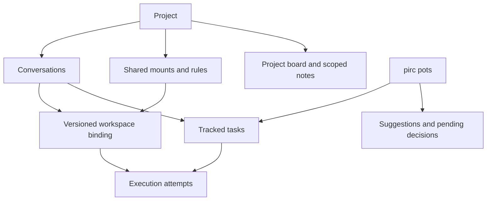

# Unified conversations, projects and an independent App

[Plans](README.md) · [Workspace modes](modes.md) · [Mobile](mobile.md) · [Assistant contracts](../docs/architecture/assistant-memory.md) · [Checkpoints](checkpoints.md) · [pots](pots/README.md) · [Rust foundations](library-extraction.md) · [Conversation execution contracts](conversation-execution-contracts.md)

Status: adopted architecture baseline with an authorized staged implementation
covering first Send, environment bindings, resource transitions, canonical tasks/
collaboration and bounded pots. The published baseline `303fa8f8` and subsequent local retry-recovery, editor-snapshot, native blob cleanup, Node connection capability fencing and live Web/native acceptance
checkpoints are summarized below (2026-10-27). UI redesign/navigation reorganization remains deferred;
Web/Android changes are limited to necessary functional integration. Use only
focused simple Flutter checks when Flutter changes.

The user authorized publication of the accumulated work and subsequent CI repairs;
remote Check and Android passed at `303fa8f8`. New architecture work retains the
local-commit default. This does not enable the new flow, deploy it, change versions
or create a Release. Undecided numerical settings still need confirmation when
their implementation stage begins; earlier library/pots work is reused.

## Current progress and next delivery (2026-10-28)

**U1 is implemented across Gateway, Node, Web and native Android, but is not
accepted for activation. `canSubmit: false` remains in production.** Current
formats: Gateway **1025**, Node **2015**, protocol **15**, client contract **2**,
Web IndexedDB **3**, Android private envelope **3**. Package/dependency versions
and Nix hashes are unchanged. Existing session, memory-deletion and checkpoint
ownership guarantees remain in effect.

**U2 has started:** [the binding migration baseline](conversation-binding-migration.md)
now persists legacy binding revisions, explicit project membership and configured
policy history, frozen global-memory origins/project cleanup receipts, and ordinary
Web/Android command admission environments with Node authority rechecks after
queue/startup waits, plus frozen saved-upload origins (updated 2026-10-28). This
preserves current associations. Live-resource provenance and authority-fenced
transitions remain pending; Node enforcement is explicitly not tracked. U2 development does not enable U1 or clear its device/rollout gates.

Latest U2 delivery: [saved attachment origins](#u2-implementation-checkpoint-saved-attachment-origins-2026-10-28)
freezes new upload identity/scope, preserves historical access rules and checks
saved bytes before Agent use. It also exposes authenticated metadata directly to
Web and paired devices without leaking private Node session IDs or storage paths.
This does not enable workspace switching or sandbox revocation. The validation
counts below this point in the U1 section describe that prior U1 slice, not all
newer U2 changes.

U4 has begun with an [internal Node admission fence](#u4-implementation-checkpoint-node-transition-admission-fence-2026-10-28)
and tracked supervisor drain, followed by [runner-scoped inference retirement](#u4-implementation-checkpoint-runner-scoped-inference-retirement-2026-10-28). Linux process scopes now have a [durable launch journal and bounded restart reconciliation](#u4-implementation-checkpoint-durable-sandbox-launch-journal-2026-10-28), followed by [guarded startup](#u4-implementation-checkpoint-guarded-native-linux-launch-2026-10-28) and [terminal effect-boundary checks](#u4-implementation-checkpoint-fenced-terminal-input-2026-10-28). [Approved host-command supervision](#u4-implementation-checkpoint-supervised-host-commands-2026-10-28) now joins Stop/drain with durable launch evidence. Its receipts explicitly deny revocation/installation
completion. No public workspace switch or new resource grant is enabled; Gateway
coordination, OS enforcement, replacement binding and Web/App controls remain.

Delivered U1 behavior:

- Persist account-scoped immutable first-message intent and original attachment
  bytes before delivery. Publish the stable conversation only after acceptance;
  query the same operation across restarts without duplicate allocation/admission.
- Keep private Web/Android drafts and unsent conflict copies, reject stale writers
  and retain accepted/uncertain originals. Seven-day expiry is limited to
  **unaccepted Gateway staging**, not accepted attachments or private drafts.
- Preserve Stop and authorized deletion before or after Node mapping, including
  offline queues and independent confirmation of Stop versus message admission.
- Retry a positively rejected first message only through explicit user action,
  current authority/control and a durable nonce/predecessor/attempt number. Keep
  the same conversation and input; ambiguous results are queried, not replayed.
- Retire an unreserved retry nonce durably at Gateway, so a delayed POST cannot
  revive it. Both clients now offer explicit recovery and persist matching proof;
  checking never sends, and sending again remains a separate user action.
- Commit uncertainty before remote effects, so losing both the successful receipt
  and the later error write cannot leave a falsely resumable local record. Web and
  native interrupted submissions query first; a further Send is a separate action.
- Wire the native Android engine and existing Web/Flutter recovery surfaces,
  including version negotiation, independent Gateway access and minimal bilingual
  status/actions. New navigation and visual redesign are deferred.

Latest U1 slice: [capabilities bound to the checked Node connection](#u1-implementation-checkpoint-node-capabilities-and-connection-fencing-2026-10-27)
fixes a compatibility gap after intent acceptance: materialization and first
admission now recheck capabilities, and allocation/uploads/admission/retry cannot
reuse that proof on a replacement Node connection. Authority and control are
revalidated after asynchronous probes. A known replacement is refused before
command reservation; already reserved uncertain outcomes remain query-only.
Original inputs/files and the explicit blank release after confirmed Stop survive.

The [previous storage-reply proof](#u1-implementation-checkpoint-node-storage-reply-loss-2026-10-27)
remains covered by the live client regression suite. Current validation adds
**336 Gateway tests**, strict all-target Gateway Clippy, three native checkpoint
process cases, the old-client contract and Node protocol tests, two Web i18n cases
and focused Dart localization analysis. Web/Android recovery prompts describe
unsupported Nodes and changed connections in English/Traditional Chinese.

All **five explicit live-client process tests** pass: the new two-case storage-reply
test, [offline Stop/deletion](#u1-implementation-checkpoint-offline-allocation-fencing-and-private-blob-cleanup-2026-10-27)
(two cases), [mapped takeover](#u1-implementation-checkpoint-delayed-web-dispatch-versus-native-takeover-2026-10-27)
(three cases), [native interruption/revocation](#u1-implementation-checkpoint-paired-native-process-recovery-and-revocation-2026-10-27)
(two fault cases) and [Web interruption](#u1-implementation-checkpoint-live-web-reconciliation-and-durable-uncertainty-2026-10-27)
(three fault cases). The native compiler treats warnings as errors; strict targeted
Clippy and formatting are checked. See [repeatable commands](../docs/development/first-send-acceptance.md).
The preceding native deletion fix retains 65 passing JVM cases; they are not
rerun for this fixture-only slice.

The earlier marker repair retains **79 Web tests**, clean Svelte checks and
**63 native JVM cases**; [editor snapshots](#u1-implementation-checkpoint-editor-attachments-survive-source-cleanup-2026-10-27)
retain 26 focused Flutter cases. That U1 slice changed Gateway compatibility checks
and recovery error translations without changing schemas, protocol or client contract.
The backend [nonce retirement](#u1-implementation-checkpoint-gateway-retirement-of-an-unreserved-retry-2026-10-27)
slice retains 329 Gateway tests and five process cases. These are bounded proofs,
not the full permission/Stop/delete matrix or Android OS/device acceptance.
Live-client tests are explicitly run and ignored by the default suite;
the last verified published green CI remains tied to `303fa8f8`.

| Stage                             | Current status                                                                                 | Next deliverable                                                                                                    |
| --------------------------------- | ---------------------------------------------------------------------------------------------- | ------------------------------------------------------------------------------------------------------------------- |
| U1 — first Send                   | Implementation present; activation blocked on remaining acceptance                             | Ambiguous journal recovery, actual client/backend failure matrix, Android process/device and rollout/rollback proof |
| U2 — bindings                     | Bindings, policy/memory/saved-upload provenance and Gateway/Node command admission implemented | Live-resource provenance and effect-boundary version fencing                                                        |
| U3 — navigation/UI                | Explicitly deferred                                                                            | Necessary functional controls only until the core model is stable                                                   |
| U4 — resource transitions         | Internal Node admission fence and tracked supervisor drain; no public switch                   | Gateway coordination, OS revocation/replacement acknowledgement and offline recovery                                |
| U5 — canonical work/collaboration | Existing primitives available; unified mapping pending                                         | Common task/attempt identities, shared notes and resource waits without overwrites                                  |
| U6 — proactive pots               | Existing progress observation/explicit dispatch; content analysis pending                      | Separate observation/execution grants, finite budgets and quiet synchronized suggestions                            |

Immediate U1 queue:

1. Finish historical-binary/rolling-upgrade and broader permission-change
   acceptance. Unit cases now cover missing/reduced Node capabilities, changed
   connections and authority/control lost during probes; this is not a full mixed
   deployment proof. Node allocation/upload reply loss after storage exists passes. Initial
   interruption/restart, device revocation,
   mapped Web-dispatch/native takeover and reverse-direction offline pre-allocation
   Stop/deletion now pass. They do not imply every mapped reverse-direction race
   or the full matrix is covered.
2. Verify actual Android process death, OS private files/Keystore, MethodChannel
   and attachment memory pressure; ask for a physical device when ready.
3. Finish activation/rollback and affected full CI/conformance checks, including
   an explicit live-client acceptance gate, before enabling the new path.
   Published `303fa8f8` passed remote Check (including Linux native checkpoints and
   Nix) and Android; this does not certify the newer local client checkpoints.
   Local Nix verification remains waived. U2 development proceeds while these U1
   activation gates stay open, followed by U4, U5 and U6.

The dated checkpoints later in this file preserve what was delivered and tested
at that time. Historical “local only”, “next slice” and incomplete-adoption notes
are superseded by this snapshot where they conflict; unchecked acceptance gates
remain open. The [work queue](README.md#current-implementation-status-2026-10-27)
provides the compact cross-plan view.

## Agreed direction and priority

- Merge the user-facing Chat and Work experience. A conversation can be ordinary
  chat, research or work without asking the user to choose a separate product area.
- Organize conversations in projects; distinguish organization from execution.
- Make the App a complete, independent client of the backend. Normal use must
  not require a desktop Web session to remain open or approve routine actions.
- Give pirc a stable assistant entry point that can discover relevant matters,
  propose work and coordinate agents within the user's granted authority.
  Proactive suggestions are wanted; frequent, repetitive interruptions are not.
- Define the domain relationships and user journeys before designing new screens
  or expanding UI parity. Web and App should implement the same behavior contract.
- Keep Flutter Web as an evaluation option. Replacing the existing Web client,
  rewriting transport and changing the native-content requirement are not decided.

Security and data-loss fixes remain important. Existing mobile compatibility and
physical-device acceptance gaps remain recorded, not silently closed by this
architecture proposal. The initial App scope remains Android; iOS transport is
outside the previously agreed scope.

## Accepted specification-review recommendations (2026-10-24)

The user accepted the recommendations in the preceding review. These are the
planning baseline; do not repeatedly ask for approval of the same choices.
Engineering detail and validation remain work to do, not evidence of implementation.

| Area                         | Adopted direction                                                                                                                                                                                  |
| ---------------------------- | -------------------------------------------------------------------------------------------------------------------------------------------------------------------------------------------------- |
| Workspace transitions        | Durable stages and clear applying/ready/blocked status; reject stale effects; preserve context and files; no automatic restoration of revoked access after a failed switch                         |
| Multiple folders             | One main working directory plus named mounts, with explicit permission/grant provenance and real enforcement; removing a UI mount is insufficient                                                  |
| Project configuration        | User-controlled rules; agents may propose changes; ordinary rule updates apply at a safe turn boundary with a recorded revision; access revocation uses the live-transition flow                   |
| Project collaboration        | Separate approved rules, versioned shared notes and attributed board messages; authorized agents may maintain notes with conflict checks; board posts never grant rights                           |
| Project resource inheritance | Project changes use inherited configuration with an affected-conversation preview and enforced revocation, rather than hidden independent copies                                                   |
| Task tracking                | One canonical task record; map goal/todo/team work into objective, milestones and child work; automatic tracking for long/background or multi-agent work, optional for brief work                  |
| Completion and progress      | Required children/background work must finish; explicit user-acceptance requests become Ready for review; use real stages/counts rather than invented percentages                                  |
| Concurrent agents            | Host-managed waits with holder/reason, release wake-ups and rereads; no model polling or forced unlock of active writers; shared non-overlapping work and an isolated-worktree option for overlaps |
| pots control                 | User stop/takeover takes precedence; pots cannot silently restart stopped work; distinguish pausing new coordination from stopping already-running tasks                                           |
| Client consistency           | Backend-authorized commands, idempotent outcome reconciliation, revisions/cursors, separate notification/read/decision states and account-isolated local drafts/cache                              |
| Migration and extraction     | Map existing identities and provenance, verify restart-safe migrations and compatibility; stage product changes and provider extraction separately; preserve loop event/error/cancel behavior      |

The user subsequently adopted the [review's defaults](unified-architecture-review.md#adopted-defaults-and-deliberately-deferred-decisions):
explicit main-folder selection/scope, read-only new additional mounts, managed
allocation at first accepted send unless Create folder was explicit, durable notes
without age-based expiry, and scoped/bounded pots with quiet nonurgent digests.
The three proposed crate names and optional default-off OAuth are also adopted.
Existing grants and source-aware deletion rules remain intact.

Still unspecified: exact pots budget/concurrency values, quiet hours/digest cadence,
board-retention/editor presets, storage/provenance details and final Rust APIs.
App authentication/topology and Flutter Web remain explicitly deferred. Decision A
and the distinction between leaving a project and blocking a folder stand.
Implementation remains a separate step from documenting/publishing this plan.

## Accepted follow-up behavior and detailed contracts (2026-10-24)

The user accepted all seven follow-up recommendations, detailed items 1–3 first,
then requested the same depth for items 4–7. [Conversation execution contracts](conversation-execution-contracts.md)
now covers all seven with flows, authority/ownership boundaries, exception handling
and future acceptance cases. These are adopted target behaviors; this planning
work does not implement code, migrations or deployed permission changes. The user
subsequently authorized review, integration and publication of the repository commits;
that does not authorize implementing this architecture or publishing a release.

| Item                                 | Accepted direction                                                                                                                                                    | Detail status                                                                                                                                                    |
| ------------------------------------ | --------------------------------------------------------------------------------------------------------------------------------------------------------------------- | ---------------------------------------------------------------------------------------------------------------------------------------------------------------- |
| 1. Chat/Work capabilities            | Compose runtime availability, conversation configuration, resource grants, approvals and readiness; no automatic global assistant/admin rights from mounting a folder | Detailed in the capability mapping and old-mode migration contract                                                                                               |
| 2. Messages during multiple tasks    | One foreground response flow; attributed parallel child/background tasks; questions, corrections, independent objectives and explicit controls have distinct routing  | Detailed in the message routing, ordering and cancellation contract                                                                                              |
| 3. Overlapping folder permissions    | Leaving removes project-derived grants and discloses retained independent grants; an explicit conversation-level folder block overrides overlapping grants            | Detailed in the effective-access rules, examples and revocation contract                                                                                         |
| 4. Switching Nodes                   | Switch execution binding without automatic migration of files, processes or browser state; no automatic offline failover                                              | [Switch flow and failure cases](conversation-execution-contracts.md#4-switch-nodes-without-implicit-migration); separate file transfer remains outside switching |
| 5. Archive/delete/leave              | Archive organizes; deletion reconciles affected running work first; leaving changes grants; original folders and memory provenance are protected                      | [Lifecycle ownership, deletion flow and cases](conversation-execution-contracts.md#5-archive-leave-and-delete-with-explicit-ownership)                           |
| 6. Historical content and file links | Preserve saved dialogue under decision A; distinguish conversation-owned attachments from live project file references                                                | [Content kinds, access flow and cases](conversation-execution-contracts.md#6-separate-saved-content-from-live-file-references)                                   |
| 7. pots entry and takeover           | An accepted suggestion links to one canonical task; subsequent discussion stays task-linked; takeover suspends coordination only for the affected task                | [pots workflow, controls and cases](pots/design.md#coordination-contract)                                                                                        |

### 4. Switching Nodes without implicit data transfer

One attempt uses one selected Node for directly mounted resources. Switching
preserves dialogue and results with their source locations; it does not move
uncommitted edits, files, shell processes, development servers, credentials or
browser profiles. Preview what remains on the old Node and what is available on
the new one. File synchronization/copying is a separate explicitly authorized
operation, not a side effect of selecting another server. An unavailable original
Node does not authorize silent failover. Apply the existing live-transition and
partial-effect rules; never replay old writes against the replacement folder.

### 5. Archive, delete and leave have different effects

Archiving changes organization, without automatically stopping work or schedules.
Leaving changes project grants under item 3. Deleting a conversation/project with
affected active work first fences new dispatch, stops affected workers and scoped
descendants, and reconciles their outcomes before reporting deletion complete.
An offline worker leaves that operation pending rather than creating an orphan
that can continue writing.
Show the affected tasks, schedules, notes, attachments and checkpoint records in
the deletion preview; distinguish related references from records actually owned
by the deleted entity. Do not silently delete unrelated work or user-owned folders.

Keep the existing memory-origin deletion/forget rules, including other authors'
contributions. Deletion cannot be bypassed by copying source-derived memory into
shared notes. The [detailed lifecycle contract](conversation-execution-contracts.md#5-archive-leave-and-delete-with-explicit-ownership)
now specifies owned/retained records, schedules, mixed-origin memory, checkpoint
dependencies and interrupted cleanup. Concrete storage/receipt mechanisms and
retention durations remain to specify; no universal erasure claim is implied.

### 6. Retained history is distinct from fresh file access

Keep already-saved dialogue and independently owned conversation attachments under
their existing authority and lifecycle. A project file reference, preview or
download must check current resource rights before fetching fresh bytes. Leaving
a project removes project-derived retrieval; retained independent grants, if any,
are disclosed under item 3. Cached text/thumbnails already obtained are not
retroactively erased by decision A, but caches must not make new fetches using old
authority. Separate stored attachment copies from live references with provenance;
Web and App must use the same checks without an open Web client acting as relay.

### 7. pots suggestions lead to the same task and bounded takeover

Accepting a suggestion creates or links the canonical task once, subject to its
actual execution grant. Further discussion and results stay linked to that task;
do not create a second mirrored work conversation just for pots. Keep the source
conversation and actor visible when the user opens the task from the pots inbox.
Taking over one task suspends conflicting pots coordination for that task and its
scoped dispatch; unrelated responsibilities continue. Provide separate explicit
controls for pausing all new coordination and stopping selected running tasks.
Resuming a taken-over task's coordination remains explicit.

## Confirmed decisions: context and live switching (2026-10-24)

The user selected **A: preserve conversation context**. Leaving a project keeps
existing dialogue/history eligible as model context. It removes project-derived
mounts and authorization for new project access, including configuration, rules,
board and notes. Independently granted folder access is separately disclosed;
it does not preserve project membership. The accepted distinction between leaving
and explicitly blocking a folder is specified in the
[overlap contract](conversation-execution-contracts.md#3-resolve-overlapping-folder-permissions-explicitly).
Do not clear or sanitize the old conversation as a side effect of departure.
Previously read material may still be known; this is accepted, not an isolation
claim about information already obtained. Stop injecting the departed project's
rules as active configuration, even if their text remains in historical messages.

The user also specified the running-workflow behavior:

1. Switching/removing a workspace or mounted folder while an agent is running
   first shows a warning explaining affected resources and in-flight work.
2. Canceling leaves the workspace and execution unchanged. If the user proceeds,
   revoke the removed access and reject subsequent stale/unauthorized operations
   through enforced execution/sandbox boundaries; do not wait for task completion
   or for the agent to approve the change.
3. Deliver a trusted runtime event to the agent explaining that the **user**
   changed/removed the workspace or mounts, what is now available and why an
   affected operation was denied/interrupted. Deliver it at a safe event boundary
   before accepting further effects; model notification alone is not enforcement.
4. Keep the same visible conversation and its context. The agent may continue
   within the remaining grants or ask the user if it needs clarification. The
   application must not force a follow-up question or automatically restore the
   removed mount, expand rights, select another directory or retry an old write
   against the replacement workspace.

### Enforcement implications to design, not existing functionality

The requirement is authoritative revocation, not merely removing a UI item or
returning an error from the next cooperative file tool. Current Linux bubblewrap
mount plans and macOS sandbox-exec profiles are constructed for process launch
(`crates/pirc-node/src/sandbox/{linux,macos}.rs`). No dynamic per-mount revocation
mechanism was established by this review. Updating a policy object cannot be
assumed to revoke a running shell's open descriptors or its background children.

Adopted design contract; implementation still requires technical validation:

- Treat the confirmed request as a versioned access transition. Immediately fence
  new work under the old binding at the controlling service and execution host;
  stale queued commands and approval results cannot recreate the removed access.
- Stop/quiesce affected tool processes and descendants, retire their old sandbox
  authority, and rebuild the execution sandbox where live enforcement is not
  available. Preserve the conversation/model context and explain interrupted
  tool outcomes. A preserved agent identity does not require the same OS process.
- Publish the replacement binding only after its permissions are installed and
  revocation has been acknowledged. Revalidate every subsequent effect against
  the current generation and target; old proposals are not retargeted implicitly.
- Switching must preserve original files and already completed effects. An
  interrupted command may have partially changed files: record that uncertainty
  and expose relevant checkpoints; do not claim rollback or replay it blindly.
- An offline execution host cannot acknowledge immediate revocation. Show the
  transition as pending/blocked, fence Gateway dispatch, and keep reconnecting
  workers from resuming their old authority before reconciliation. Do not claim
  that a remote offline process stopped at the instant the user tapped Confirm.
- Show applying/completed/failed states and retain a durable transition identity
  through retries, crashes and concurrent device changes. Completion requires
  the actual revocation boundary; an agent-facing notice is not completion proof.

The intended UX takes effect on confirmation without asking the agent's consent.
The exact OS enforcement and remote acknowledgement strategy remains engineering
work; there is no zero-latency distributed revocation guarantee in this plan.

## Current behavior: evidence and constraints

These are implementation facts to account for, not the target architecture:

- [Workspace modes](../docs/guides/modes.md) currently place `assistant: full`
  workspaces in Chat and others in Work. Modes also determine prompt, tools,
  working-directory behavior and feature access; the split is more than navigation.
- `crates/pirc-protocol/src/mode.rs` rejects full assistant capability with a
  workspace working directory, and rejects a mode that is both delegator and
  delegation target. Do not remove those checks just to merge the tabs.
- Projects, directory workspaces and their links currently have different
  lifecycle and permission rules. Project links are preferences, not permissions.
- [Assistant contracts](../docs/architecture/assistant-memory.md) separate global
  assistant memory from repository handoffs and protect provenance. Moving a
  conversation must not rewrite memory origins or widen what an agent can read.
- Android's `lib/live/gateway.dart` calls a Kotlin bridge. Native `PircApi.kt`
  directly requests Gateway session snapshots and commands; `EventStream.kt`
  opens authenticated Gateway event streams. An open Web page is not a relay.
- `core/Pairing.kt` consumes a pairing link created through Web. Gateway
  `management.rs` requires a browser identity to approve native management grants.
  These are genuine Web-dependent setup/administration steps today.
- `GatewayRuntime.kt` refreshes snapshots and checks session control leases.
  Another device holding a lease, an unreachable Gateway and an offline Node are
  different conditions; the UI must distinguish them. Reported switching/connection
  problems have not been reproduced as part of this planning pass.
- Gateway `push.rs` supports browser and phone delivery. Transport implementation
  does not establish successful real-device background delivery; existing remote
  push acceptance remains open.

## Domain model: proposed relationships

The 2026-10-24 user clarification replaces the earlier organization-only project
proposal: project membership also supplies mounted resources and configuration;
leaving removes project-derived access. Implementation details remain proposals.

| Concept             | Responsibility                                                                                    | Relationship and lifetime                                                                                                                 |
| ------------------- | ------------------------------------------------------------------------------------------------- | ----------------------------------------------------------------------------------------------------------------------------------------- |
| Project             | Folder-like organization plus shared mounts, rules/configuration and proposed collaboration board | Contains conversations and one or more resource bindings; need not equal one physical directory                                           |
| Conversation        | Stable dialogue, attributed messages/results and a configured workspace                           | Optionally belongs to one project; has its own bindings plus currently authorized project bindings                                        |
| Workspace binding   | Resolve the selected Node, primary working directory and named read/write mounts                  | Configurable when creating a conversation; can use existing folders or an explicitly created server folder; versioned at transitions      |
| Resource mount      | Describe a directory/configuration resource, its alias, host, permissions and grant source        | May derive from a project or explicit conversation configuration; not just a symlink or display label                                     |
| Task                | Track an objective, dependencies, owner, progress, blocking reason and deliverables               | One immutable request/suggestion origin; optional execution conversation until dispatch; child tasks/attempts and pots share its identity |
| Execution attempt   | Run an agent turn/work against an explicit environment and authority generation                   | One conversation, optionally one task; its resource set cannot silently mutate mid-run                                                    |
| Pending decision    | Durable proposal/confirmation with an authoritative outcome                                       | References task/attempt and revision; shared across devices                                                                               |
| pots responsibility | Track an ongoing user-authorized concern and when to observe or follow up                         | May create suggestions and authorized tasks; bounded by scopes, budget and pause controls                                                 |

Boundaries:

1. Project membership supplies defined resource grants, not all host access.
   Conversation-specific mounts and project mounts have separate provenance.
   Resolve overlapping grants using the [effective-access contract](conversation-execution-contracts.md#effective-access-rules);
   defaults and physical alias enforcement still need implementation detail.
   A mount must be enforced for shell/tools/children as well as UI.
2. Creating a new empty folder is permitted only under a configured server root
   and current user authority; validate paths, symlinks, collisions and ownership.
   Do not reuse a pre-existing nonempty path as if it were newly allocated.
3. Initial execution contract: all direct filesystem mounts of one attempt
   resolve on the selected Node. Cross-Node resources need an explicit remote
   access/copy design; a folder on server B is not magically local on server A.
4. Leaving/moving a project is an access transition. Block new affected work,
   reconcile queued actions, quiesce/stop old workers and descendants, revoke old
   project grants, rebuild the execution sandbox while preserving conversation
   context, then resume under a new binding generation. Do not report success
   while old workers retain revoked authority.
   An offline Node or interrupted transition remains pending/blocked until resolved.
5. Changing a mount list does not close existing file descriptors or withdraw
   bytes already read. Decision A preserves existing conversation context and
   history; unmounting does not erase those. Previously copied files/summaries
   remain attributable and are not evidence of successful resource revocation.
   Never copy additional project content to bypass the user's removal.
6. Authority from unrelated mounts or broad host access may overlap the removed
   project path. Leaving removes project-derived authority and discloses explicit
   independent grants; ambient host reads cannot silently restore it. A conversation
   folder block overrides overlapping grants, under the effective-access contract.
7. Keep memory authorship/deletion provenance and original filesystem data.
   Project board/notes reopen scoped collaboration design; automatic migration of
   existing global USER/MEMORY into project-only stores is not authorized.
8. Every task keeps a stable identity across attempts. Existing checkpoint recovery
   still opens an isolated workspace and blank recovery conversation; it does not
   inherit the source memory writer or overwrite later user changes.

### Drafts, tasks and execution states

- **Conversation:** configure workspace/mounts at creation → local draft → first
  accepted message → persisted conversation → archived or explicitly deleted.
  Adopted allocation policy: retain workspace choices in the draft and allocate
  managed storage at first accepted send, unless the user explicitly invokes Create
  folder. Empty drafts still do not litter the session list; never delete a
  user-created folder merely because its draft was abandoned.
- A first-send request has a stable idempotency identity. Retries, uploads and
  interrupted creation must not create duplicate conversations or orphaned
  permanent attachments. An unsent message remains visibly a draft.
- **Task:** proposed → ready → running → waiting for user / resource / dependency
  → awaiting review → completed; canceled and failed remain distinguishable.
  Recommend tracked tasks for complex work; long/background and multi-agent work
  should require them. Create tasks automatically from an authorized request;
  do not require a form or infer execution permission from a task card.
  Plain questions and brief edits can remain ordinary turns. Progress shows
  milestones and blocking reasons; percentages need an actual measurable basis.
  User acceptance, where required, is distinct from an agent saying it is done.
- A tracking-only pots task has an origin/owner but may have no execution
  conversation or attempt yet. Start reuses an explicitly selected conversation
  or creates one once at the first dispatched instruction. Opening/tracking the
  suggestion alone must not add an empty session to the conversation list.
- **Attempt:** queued → starting → running → succeeded / failed / stopped;
  disconnect can leave outcome unknown. Do not treat lost connectivity as success
  or blindly retry a possibly completed side effect.
- **Environment:** available, offline, incompatible or access denied. These do
  not erase the conversation or imply that its task was canceled.

Foreground response ownership, message targeting and overlapping task behavior
are defined in the [message routing contract](conversation-execution-contracts.md#2-route-new-messages-while-tasks-run).
Exact persisted state names and transitions require a later engineering review.

## Primary user journeys

### 1. Create a conversation and workspace

1. Open New conversation. Configure its workspace: use mounted folders, inherit
   project resources, or explicitly create an empty folder in an allowed server
   location. A managed empty default keeps ordinary chatting easy.
2. Show the selected server, primary directory and additional named mounts without
   forcing a Chat/Work choice. A plain chat uses the same workspace abstraction.
3. Keep an unsent conversation as a draft; apply the adopted allocation timing above.
4. On first send, persist idempotently, resolve current grants and launch the
   needed agent context. An unavailable environment leaves the request recoverable.
5. Organizing it into or out of a project applies the explicit resource transition
   below; it does not physically move a repository or reassign old memory origins.

### 2. Discuss, then work in the same conversation

1. Open a project conversation and discuss the change.
2. Ask the agent to implement it. Use the configured workspace and its explicit
   primary target/mount aliases. Project defaults are resolved when configuring
   the binding, not silently re-read to redirect an already-running attempt.
3. If several targets are plausible, ask once with readable device/directory
   choices. Never guess a remote target or silently widen permissions.
4. Show the selected environment and granted operation scope in the conversation.
   Use the established approval policy; no extra dialog is needed merely because
   the UI previously called this Work.
5. Start the task/attempt, keeping progress, questions and results in this dialogue.
   Detailed execution logs are accessible without forcing a navigation change.
6. Show changed files, tests, outstanding issues and any requested acceptance.

The contract guarantees one user-visible dialogue, not a single privileged agent
process. How a chat turn hands context to an execution agent remains a design
checkpoint before implementation; preserve source attribution and tool ownership.

### 3. Work directly, without going through pirc

1. Open a known environment or project and start a conversation there.
2. Send the work request directly; pirc is not a compulsory intermediary.
3. The task can appear in the shared overview without creating a second session.
4. If pirc is allowed to coordinate that task, show its role. Direct user
   instructions supersede conflicting pending assistant instructions.

### 4. Ask pirc to coordinate several tasks

1. Give pirc an objective or accept one of its suggestions.
2. Review scope/targets when existing grants do not already authorize them.
3. Create canonical tasks with dependencies and named execution environments.
4. Run independent tasks concurrently only where authority and isolation permit.
   Reuse existing delegation mechanisms rather than introducing a competing queue.
5. Collect decisions in the pirc inbox. Open any task to communicate directly
   with its agent; responses and status stay attached to that task.
6. Aggregate meaningful results without copying every tool event into pirc's chat.

### 5. Take over, switch devices, and return control

- Opening a conversation is viewing, not automatic takeover. Reading must not
  require the current controller to be online.
- Before a conflicting command, show who/what currently controls the execution
  and offer explicit takeover. Fence stale commands using a backend generation.
- User takeover suspends conflicting pirc dispatch for that task; unrelated pots
  responsibilities continue. It does not silently kill running tools; show whether
  work continues, pauses or is stopping.
- Resuming assistant coordination is explicit. Another browser tab opening must
  not silently reclaim it.
- Every decision has one backend outcome. Duplicate submissions return the
  current handled state. Web and App show where/when it was handled when known.
- Device command control, assistant coordination authority and filesystem writer
  isolation are distinct; one lease must not be assumed to solve all three.

### 6. Switch environments, leave projects or recover work

- Before starting a run, changing workspace selection changes the next run's
  binding. After completion, a new environment starts a new attributed attempt
  in the same visible conversation; old results retain their original location.
- During execution, warn before a workspace/mount removal or switch. On user
  confirmation, enforce revocation, reject stale effects and notify the agent
  under the confirmed live-switching contract above. Preserve conversation context;
  stop/rebuild affected execution where required instead of relabeling a process.
  Starting a separate task elsewhere remains a distinct operation.
- Leaving a project must revoke its mounts, rules, board access and retrieval from
  project notes. Mark the move pending until the old authority is no longer usable;
  do not silently let a detached background child keep working in the project.
- Merely navigating to another page does not change membership or stop work.
- Existing files stay where they are. Decision A retains history from the old
  project as future model context while removing project-derived mounts and new
  retrieval. Historical text does not reauthorize the departed project's resources.
- Checkpoint recovery keeps its independent workspace and blank conversation,
  linked from the source. No implicit original-directory overwrite or source
  memory-writer inheritance is allowed.

## Project collaboration: board, notes and resource waiting

The user's shared-board idea is a collaboration requirement under design.
Existing team `board_*`/`task_*` operations in `features/team/broker.rs` are a
starting point, but that parent-side broker is not automatically a durable board
shared by every independent conversation in a project.

Use three explicit kinds of information:

| Kind                           | Content                                                                     | Authority                                                                                     |
| ------------------------------ | --------------------------------------------------------------------------- | --------------------------------------------------------------------------------------------- |
| Project rules/configuration    | User-approved instructions and resource settings                            | Versioned, user-controlled; agents propose changes rather than grant themselves rights        |
| Project board and shared notes | Work claims, messages, decisions, stable project facts                      | Scoped and attributed to actor/task/source; revisions, retention and deletion policy required |
| Resource wait state            | Who actually holds a write lease, conflicting path, wait reason and release | Computed by the execution host; board text cannot acquire/release a real lock                 |

Recommended conflict flow: A holds a path → B receives structured owner/path/reason
→ B does independent work or enters a visible waiting state → release wakes B → B
rechecks authority and rereads the current file before attempting its edit.
Do not classify temporary contention as task completion or a generic fatal error.
Avoid model polling loops and unlimited retry spend; cancellation and a bounded
escalation policy remain available. Detect dependency cycles; do not solve them
by expiring a still-active writer's lease or asking an agent to bypass the broker.

The current Node write broker is per Node and holds leases until the run settles
or stops. A second lock table in Gateway would not automatically coordinate shell
processes, user editors or multiple Nodes sharing storage. Keep Node enforcement,
expose useful wait state, and prefer isolated worktrees for overlapping parallel
code changes. Checkpoints provide recovery, not universal writer isolation.

Board content is other-agent data with provenance, not a user's instruction or
approval. It must not automatically become global personal memory. Leaving a
project removes future access, but previously copied text cannot be claimed erased.
Durable project notes have no automatic age-based expiry; explicit removal and
source/project deletion follow the lifecycle contract. Operational board retention
is configured separately; storage and editor presets still require specification.
Post-departure context follows decision A: previously read notes may remain, while
retrieval through the departed project's authority is denied.

## pirc pots: proactive but bounded

Product name supplied by the user: **pirc pots** (personal assistant): one stable
assistant entry point that observes, suggests and, only within explicitly granted
authority, dispatches attributed work. The full adopted design (separate
observe/suggest/execute authorities, “From pots” attribution, notification
categories and quiet operation) has moved to [pots design](pots/design.md). The
delivered subset and remaining work are in [pots](pots/README.md).

## Independent App and shared backend contract

The App is an equal client, not a remote control for an open Web page. Web and
App both connect to Gateway; Node execution and durable coordination continue
independently of client visibility. A web login/identity-provider page opened on
the phone is compatible with this goal; requiring an already logged-in desktop
Web session is not.

### Identity and management

- Design native sign-in/bootstrap, reauthentication, credential renewal, recovery
  and revocation without requiring another device's Web UI. Keep the existing
  pairing path as an optional onboarding method during migration.
- Authorize management by verified identity, scope and required reauthentication,
  not by client platform alone. Do not simply grant all existing device tokens
  provider-credential or device-management privileges.
- The current browser-approved short-lived grant is an existing security decision
  to replace deliberately. Select the authentication mechanism and migration
  policy before implementing; do not infer approval to weaken it from this plan.

### State, commands and connection recovery

- Gateway exposes canonical task/decision state and recoverable account-level
  changes. Nodes remain authorities for execution/files; this plan does not
  require moving all transcripts or files into Gateway storage.
- Use versioned snapshots plus resumable events; detect missing history and
  resync. Session switching cannot depend on a Web client's local state.
- Cache already-read conversations locally by account. Show cached content,
  freshness and reconnect state; retain drafts and navigation during failures.
  Account changes/revocation must not expose another account's cache or drafts.
- Resolve mutations with idempotency keys, current revisions and authorization.
  Reconcile unknown outcomes instead of claiming exactly-once side effects.
- Offline viewing/drafting is allowed for cached data. First-version destructive
  or approval commands are not silently queued for later execution; revalidate
  state and authority when the user submits after reconnecting.
- Distinguish Gateway unreachable, Node offline, expired credentials, unavailable
  environment and control held elsewhere. Provide a relevant next action.

### Durable inbox and notification delivery

- Store the event/decision before notification delivery. A push is a wake-up hint
  and deep link, not the only copy of the assistant's message or an authorization.
- Web closing must not stop dispatch. App suspension must not stop backend work.
  Reopening the App reconciles unread/handled state even if push was lost.
- Retire local prompts/notifications when resolution is received. An offline
  device cannot be guaranteed immediate retraction; tapping a stale notification
  must fetch the current state and refuse duplicate execution.
- Gateway and required Nodes must still be available. A sleeping laptop hosting
  them remains a deployment limitation. Always-on coordination and phone OS push
  behavior need separate deployment/device acceptance.

## Relation to reusable crates and App connection design

See [Library extraction](library-extraction.md) for checked handoff findings and
the combined delivery sequence, and [pots design](pots/design.md) for the dots/Grok
Bot references.
The reusable loop does not own product tasks, mounts, memory or pots authority.
Provider extraction can be behavior-preserving and independent; loop integration
must respect tool-wait, cancellation, event ordering and context transitions.

The user deferred the secure server-to-App connection mechanism. Preserve the
independent-client requirements above while leaving authentication/topology for
separate review. Android already connects to Gateway directly; no new public
Node/agent port, bypass of Gateway authorization, or inbound phone listener is
implied. Model-provider subscription OAuth is separate from pirc App login.

## Flutter Web: evaluation only

A shared Flutter client could reduce duplicate UI and state logic. It is not
required to remove browser dependencies, and it cannot fix backend availability,
permissions or ordering bugs by itself. No Web replacement is approved here.

After the domain/behavior contract is agreed, evaluate a thin vertical slice:

- Login and direct Gateway transport, reconnect and two-device confirmation.
- Long conversation scrolling, selectable text, code highlighting and file views.
- Mobile CJK IME, desktop keyboard shortcuts, terminal resize/input and focus.
- Deep links, browser navigation, accessibility and phone/tablet/desktop layouts.
- Large histories, startup/download cost and sustained rendering responsiveness.
- Platform adapters for storage, notifications, files and native Kotlin services;
  existing method channels cannot simply run in a browser.

Compare keeping the existing Web client against sharing Flutter data/state/UI,
using the same workflows and fixtures. Set acceptance budgets before the spike;
do not invent a migration estimate without measuring these difficult surfaces.

Application UI reuse is separate from rendering agent-generated HTML/JavaScript.
Keep the current native-content requirement and explicit unsupported cases.
Structured result cards/forms may be evaluated later; this plan does not silently
replace arbitrary content with simplified output or authorize WebView fallback.

## Migration and compatibility constraints

- Map existing Chat projects, directory workspaces and sessions to the new
  concepts without resetting IDs, breaking deep links or moving user files.
  Define aliasing if new conversation/task IDs are needed.
- Navigation migration alone preserves old sessions and their authority. An
  explicit project departure or mount revocation is a separate transition that
  may require stopping/rebuilding the old execution; do not confuse the two.
- Preserve memory provenance, deletion/forget semantics, uploads and project
  ownership. Moving a conversation must not reinterpret which prior project or
  conversation created a memory. Define cross-project move/deletion behavior
  before enabling that operation. Project-scoped collaboration is accepted; its
  lifecycle details remain to specify. Existing global memory is not silently
  re-scoped or migrated.
- Preserve pending approvals, schedule/calendar targets, delegation references
  and checkpoint recovery provenance. Migration must not duplicate scheduled
  runs, replay a command or resume a stopped task.
- Plan version negotiation and supported Gateway/Node/client combinations for
  the transition. App updates and browser cached versions will not be simultaneous.
- Define restart-safe migration and a tested compatible fallback before changing
  storage; UI rollback is not permission to downgrade a migrated database.
- Present existing work in unified navigation first; migrate execution semantics
  incrementally. Avoid a simultaneous renderer rewrite, authentication cutover
  and task-storage migration.

## Next implementation sequence (2026-10-26)

Baseline: fetched `origin/main` at `6d87f97f`, product version 0.10.0, including
unreleased changes after that tag. This sequence was initially prepared as planning
only; the later active implementation goal is recorded above. It refines stages
A–C without superseding accepted behavior or treating old acceptance cases as passed.
U3's navigation redesign is now explicitly deferred.

### What the updated code already provides

| Area                      | Evidence in the fetched tree                                                                                                                                                                                             | Consequence for the next slice                                                                                                                    |
| ------------------------- | ------------------------------------------------------------------------------------------------------------------------------------------------------------------------------------------------------------------------ | ------------------------------------------------------------------------------------------------------------------------------------------------- |
| Reusable foundations      | Types, transport/OAuth, loop and tool-schema crates exist; production `run_loop.rs` drives the core                                                                                                                      | Extend the existing adapters; do not repeat the extraction or require a second loop rewrite before product work                                   |
| pots                      | Tracking, explicit dispatch, ownership-based Stop, archive and revocation-fence paging exist at `6d87f97f`                                                                                                               | Those are delivered subsets; content observation, autonomous suggestions and full acceptance remain open                                          |
| Draft conversations       | Web `app.svelte.ts` and Android `gateway.dart` create a local draft and persist it during first Send                                                                                                                     | Preserve this UX; harden the split between creation and first-message admission rather than build drafts again                                    |
| Creation versus commands  | Gateway `routes.rs::create_session` accepts only `workspaceId`; Node `app.rs::create_session` allocates a fresh session. Existing session commands already have command IDs, payload hashes and unknown-outcome handling | First creation needs a durable operation identity across both hosts; reuse the command contracts instead of claiming all sends lack deduplication |
| Conversation identity     | Gateway `db.rs::Session` already has a public stable ID, with private Node-session mapping                                                                                                                               | Keep public IDs/deep links; separate future environment binding from identity without renumbering conversations                                   |
| Current workspace removal | `workspace_removal.rs` fences mutations and requires an online, idle Work workspace; Node registration/files are retained                                                                                                | This is not live per-conversation mount revocation or project departure; do not enable switching by reusing its UI alone                          |
| Task identity             | `pots/schema.sql` requires a unique suggestion origin for each pots task                                                                                                                                                 | This cannot represent every direct user task unchanged; map existing tasks before adding a competing universal task table                         |

The creation gap is a code-path finding, not a reproduced device failure in this
review. Both clients currently create the server session, obtain control and then
send. A lost create response or a later admission failure can leave creation and
the first message with different outcomes. Existing command deduplication starts
after there is a session and does not cover that entire sequence.

### Recommended order and bounded deliveries

| Order                                                      | Deliverable                                                                                                                                                      | Visible result and exit gate                                                                                                                                                      |
| ---------------------------------------------------------- | ---------------------------------------------------------------------------------------------------------------------------------------------------------------- | --------------------------------------------------------------------------------------------------------------------------------------------------------------------------------- |
| G0. Relevant reliability baseline                          | Reproduce/classify the recorded storage-refusal admission issue and the relevant failed tests; inventory current identities, versions and control boundaries     | Failure stays visible and user text is retained; focused gates establish the actual starting point without relabelling historical failures as passed                              |
| U1. Reliable first Send — recommended first implementation | A durable creation/admission operation spanning Gateway, Node, Web and Android, with queryable outcome and stable retry identity                                 | Open/abandon drafts stays local; one accepted Send creates one conversation and one admitted first message despite lost responses/restarts                                        |
| U2. Environment-binding foundation                         | Map existing workspaces, project membership, mode/capabilities, public session IDs and private Node sessions; define separate binding and membership revisions   | Existing sessions retain their permissions, links and content; clients can show one authoritative current environment without silently moving files or granting rights            |
| U3. Unified navigation and creation                        | One conversation entry point, projects and environment selection using the U1/U2 contracts; retain current styling and renderer                                  | Web and App offer the same create/open/send behavior. Unsupported environment combinations remain explicitly unavailable rather than appearing enabled                            |
| U4. Real resource transitions                              | Stage single-Node idle transitions first, then live revocation/rebuild and interrupted/offline reconciliation; add project mounts/rules with explicit provenance | Context is retained, removed authority is actually withdrawn, and new-generation work starts only after host acknowledgement; cross-Node handoff is a separately tested extension |
| U5. Canonical work and collaboration                       | Map pots tasks, goal/todo/team work, attempts and decisions to one identity; then add shared notes/board and structured resource waits                           | The same task appears from a project, conversation or pots; parallel agents see blockers and cannot overwrite each other's notes or bypass a write lease                          |
| U6. Bounded proactive pots                                 | Add explicit content-read scopes, finite observer budgets, event-driven analysis and then quiet digest/push delivery                                             | Useful sourced suggestions with no automatic execution grant; stale suggestions/notifications reconcile to the same task or handled decision                                      |

G0 is scoped preparation for each affected slice, not an instruction to repeatedly
run every expensive test before any progress. The existing library/workspace and
conformance failures remain release/acceptance debt until reproduced and fixed or
explicitly classified. Do not weaken tests, change golden files merely to pass,
or call sandbox-looking failures pre-existing without evidence.

U2's identity/contract inventory can be done while specifying U1. Its binding
changes must not be smuggled into the first-send patch. U3 is a navigation delivery,
not completion of same-conversation environment switching: the latter depends on
U4. Do not remove the current mode checks for full-assistant/workspace-directory
combinations just to combine the tabs. Users keep the existing execution behavior
until an explicitly supported capability/resource combination is delivered.

### U1: the first implementation proposal

**Scope:** existing workspaces and an explicit first user message, including the
current model/thinking choices and supported attachments. No new mount rights,
project moves, managed-folder allocator, automatic task creation or pots standing
grants. Managed folder allocation later attaches to this operation identity;
creating an empty folder explicitly remains an independent user action.

Before code, name the API and persisted states in a short contract review. The
behavior is constrained as follows:

1. Generate a stable, account-scoped creation-operation key for one draft submission.
   Persist it through reconnects and bind it to the selected workspace and immutable
   submission payload. The same key with a different target/payload conflicts;
   distinct drafts with identical text remain distinct conversations.
2. Validate current workspace/mode/owner access, payload and attachment preparation
   before accepting the submission. Define **accepted** as durable storage of the
   validated first-message intent and its target, not a successful model answer or
   merely an HTTP connection. A failure before that boundary leaves a local draft.
3. Reserve the Gateway operation and stable public conversation ID before requesting
   Node creation. Node records a corresponding durable mapping so a retry cannot allocate another session.
   Publish one conversation when its first-message intent is durably accepted;
   internal preparation rows without an accepted message are not ordinary sessions.
   An accepted message awaiting delivery has a visible pending/failed status.
4. Correlate the initial command and Node admission with that operation. Reuse
   existing command deduplication and control-lease checks; do not bypass ownership
   to make first Send more convenient. Durable acceptance, Node message admission
   and model execution are different acknowledgements. Do not promise a distributed
   SQLite transaction or exactly-once arbitrary tool effects.
5. A lost response becomes a queryable pending/unknown result. Reconcile using the
   same key and recorded Node/message receipt; never allocate a fresh session or
   rerun an ambiguous send automatically. Stop/revocation/deletion fences still
   apply during reconciliation. A duplicate lookup cannot revive deleted work.
6. Keep unsent/rejected content and attachment bytes until their authoritative
   outcome is known. After acceptance, retain a recoverable pending-message record
   rather than presenting the same text as a new unsent message. Navigating away
   or changing accounts cannot append the result to another conversation/account.
7. Stage attachments under their owner/submission identity and promote/reconcile
   them once. Cleanup only positively owned, unaccepted staging data, with an
   explicit retention policy; never delete user folders or accepted attachments.
8. Preserve old-session commands and caller-specific creation flows used by pots,
   schedules, delegation and checkpoint continuation. Inventory them before API
   changes. Negotiate support for the new workflow: an old Node must yield a clear
   unsupported state, not silently fall back to the unsafe split flow. Existing
   clients keep their documented behavior; do not claim the new guarantee for them.

Suggested patch boundaries: U1a contracts plus failure fixtures; U1b Gateway/Node
operation persistence and reconciliation; U1c Web/native Android integration and
cross-client verification. Keep intermediate code gated until the complete flow
has the required backend/client support. The initial proof uses local fake
inference and temporary state, not provider credentials or a user's live database.

| Case                                                                                | Required outcome                                                                                                        |
| ----------------------------------------------------------------------------------- | ----------------------------------------------------------------------------------------------------------------------- |
| Abandon a draft or open another                                                     | No remote session or managed-folder allocation; explicit user-created folders remain                                    |
| Submit the same operation concurrently                                              | One public conversation, one Node session and one initial admission; same result returned to authorized callers         |
| Lose the response after either host commits                                         | Same operation can be queried after restart; no second session/message, and no blind replay of an unknown effect        |
| Reuse a key with different text, workspace or attachment manifest                   | Conflict; do not mutate the accepted original request or retarget it                                                    |
| Node offline, mode unavailable, revoked grant or malformed upload before acceptance | Draft remains usable; no visible empty conversation or implicit fallback to another Node                                |
| Session storage refuses an append after acceptance                                  | Show a recoverable failure/pending outcome with retained input; do not claim the message ran or automatically resend it |
| Navigate away, switch account or delete during creation                             | No cross-account result/cache leak, selection jump or resurrection; authorized outcome remains discoverable             |
| Upload fails, reconnects or completes twice                                         | No duplicate attachments; accepted references survive cleanup; abandoned staging stays owner-scoped                     |
| Receive events before the HTTP response or reconnect with an old cursor             | Reconcile to one authoritative conversation and message; no duplicate list row                                          |
| Web is closed while native Android creates and sends                                | The paired App completes the flow directly with Gateway/Node; browser setup/management limitations remain separate      |
| Existing schedules, pots dispatch or checkpoint continuation                        | Their targeting, attribution, at-most-once fences and isolated recovery behavior are unchanged                          |

A storage-failure reopening path needs its own correctness proof. Do not blindly
reopen an uncertain journal or repeat tools as part of retrying message admission.

### U2–U6: decisions to make at their entry, not new blanket approvals

- **U2:** produce a concrete old-to-new identity/migration table. Keep the public
  session ID; distinguish project membership revision, execution-binding generation,
  Node runner epoch and device-control generation. Record write-time membership for
  new memory versions before enabling cross-project moves. Missing historical
  provenance is not inferred from today's project. Old clients cannot bypass a
  new authority fence.
- **U4:** prove removal of access through live processes, open descriptors,
  descendants and overlapping paths on each supported sandbox. Ambient read access
  cannot defeat removal. Offline stays pending; a failed transition never silently
  restores revoked grants. Preserve context decision A and report partial effects.
- **U5:** keep existing immutable pots suggestion origins and task links when mapping
  direct user origins/attempts. Ordinary questions need no task form. Board messages
  are coordination evidence, never grants; note revisions and blocked-writer wakeups
  must be enforced independently of model instructions.
- **U6:** choose finite budget/concurrency values and notification settings before
  enabling observation. Progress-read does not authorize transcript/file reads.
  Start with scoped manual opt-in and sourced suggestions; standing dispatch is
  still a separate later grant. Archive/pagination improvements can ship separately
  without waiting for proactivity or expanding read authority.

Each slice has Gateway/Node, Web and Android acceptance appropriate to its scope,
including restart/concurrency and memory/checkpoint regressions where touched.
Record synthetic, real-process, browser and device evidence separately. No current
P7/N4/L5/C6 acceptance case closes because this sequence was documented. Use
disposable test state, preserve user APKs and delete only run-created build/test
outputs. Nix verification remains waived; physical-device and real-push gaps stay
open until actually exercised.

App authentication/bootstrap/renewal and server-exposure design remain a separate
user discussion, not a prerequisite for fixing ordinary paired-App workflows.
Flutter Web, iOS transport, external crate publication and a new release are not
part of these deliveries. The active goal starts with **U1 and its G0 checks**,
then proceeds through the authorized core stages while deferring U3's navigation
redesign. Keep commits local until publication is requested.

### U1 implementation checkpoint: Node allocation (2026-10-26)

Implemented locally; U1 remains **in progress**. `session_creation.rs` adds the
Node's durable allocation and read-only lookup primitive. Gateway first-message
acceptance, attachments and Web/Android adoption are not connected yet, so the
existing first-send UX has not changed and the end-to-end guarantee is not complete.

- `POST /api/session-creations` accepts `operationId` (1–100 URL-safe ASCII
  characters), `workspaceId` and a lowercase SHA-256 `submissionHash`. Owner comes
  from the authenticated Node request. The hash binds the future immutable
  submission; the allocation primitive does not validate or store message content.
- `GET /api/session-creations/:id` looks up only that owner's operation without
  allocating anything. Both endpoints return `creation` with `operationId`,
  `workspaceId`, `sessionId` and `state`; the hash/owner are not returned.
- States: `reserved` has a durable identity but no published Node session;
  `ready` has an allocated Node session, not an admitted message or running agent;
  `deleting` and `deleted` reflect the existing fences without recreating anything.
- Same owner/key with different workspace/hash conflicts. Independent drafts or
  different owners get independent identities. Independent SQLite connections are
  serialized when reserving and finalizing, and retries survive reopening the DB.
- Filesystem preparation can fail after reservation. Retry uses the same identity;
  a pre-commit crash's empty directory may be reused, but unexpected content and
  symlinks are refused without deletion. Missing storage for an already-ready
  session is never silently recreated.
- Node schema **2004** adds a content-free operation ledger; identity survives
  session/project deletion to fence delayed requests. Existing sessions, memory,
  uploads, checkpoints and pots records are preserved. See [upgrade notes](../docs/deploy/upgrades.md#unreleased-node-session-creation-ledger).
- New routes are additive to protocol 15; legacy creation/command routes are
  unchanged. Future Gateway integration must require this route and fail closed
  on an old Node, never fall back to a non-idempotent creation request.

Verification for this local allocation checkpoint (2026-10-26):
`cargo test --offline --locked -p pirc-node --lib` with filters `session_creation`,
`store::tests`, `checkpoints::` and `pots::tests` passed **44 tests** (14 + 12 + 7 + 11).
The checkpoint subprocess-helper test is ignored by the normal harness; its parent
hard-kill acceptance test passed. This is synthetic/local-process coverage, not a
full Gateway/client/device journey. Strict `cargo clippy --offline --locked -p
pirc-node --lib --tests -- -D warnings` passed. No Flutter files changed, so no
Flutter suite, emulator or browser was run. Full U1 and historical workspace/
conformance gates remain open. Builds use a disposable target removed after checks.

Remaining U1 work: Gateway durable intent and public-ID reservation; initial
command/admission and storage-refusal outcome reconciliation; attachment staging;
account-scoped client submission recovery; mixed-version failure handling; and the
full U1 acceptance table. The Node allocation proof alone closes none of those.

### G0 implementation checkpoint: message admission (2026-10-26)

Implemented locally as a prerequisite for U1. The existing persistence-order
fixture recorded a successful prompt response after a refused journal append.
This checkpoint changes that failure response intentionally; it does not mark
U1's creation/admission/attachment transaction complete.

- For ordinary idle `prompt` input (also idle `steer` / `follow_up`), the Agent RPC
  waits for initial message admission, including feature and `beforePrompt` hook
  work. Synchronous successful admission retains its prior event order. This is
  not an acknowledgement that inference or tools completed.
- A failed start ends before inference, even when an early stale-writer refusal
  has not set the store's write-failed flag. It cannot answer using old history
  after failing to admit the new user message.
- A failed, cancelled or lost admission receipt reports
  `errorCode: admission_outcome_unknown`. Some initial entries may already be on
  disk; Node stores `outcome_unknown`, not a safely retryable rejection. The same
  command ID keeps its existing receipt. No journal reopening, new operation ID
  or automatic replay is added. Proven reconciliation after restart remains U1
  work, not something this in-process receipt alone guarantees.
- Ordinary commands and deliveries remain serialized while admission waits.
  Stop/deletion may overtake only after the input RPC is queued, including a Stop
  already waiting during preparation. This avoids blocking Stop behind hooks
  without letting model/settings changes retarget the pending message.
- Startup cancellation drops hook work. Hook shells now use their own process
  groups and the existing group cleanup guard, so cancellation/timeout cannot
  leave those hook children running. This covers owned hook processes, not
  revocation of all sandbox capabilities or external effects already performed.
- Slash-command acknowledgement and input queued during an active run retain
  their existing semantics; a queued response is not proof of journal admission.
  Public session IDs, database schemas, memory provenance and checkpoint
  ownership are unchanged by this checkpoint.

Validation (2026-10-26), using one disposable target with debug info/incremental
compilation disabled:

- `cargo test --offline --locked -p pirc-agent --lib`: **420 passed**, including
  seven new admission cases. They cover delayed acknowledgement, stale storage,
  failed feature startup, Stop, concurrent prompts, a partially committed first
  message and cleanup of a real hook child process.
- Node library filters `runner::`, `checkpoints::`, `pots::tests`: **28 + 7 + 11
  passed**. The two subprocess helper entries remain ignored by their normal
  harness; their parent tests passed. New Node cases exercise the actual command
  manager, SQLite receipts and RPC channels with a fake agent process, including
  Stop overtaking, settings staying serialized, duplicate requests, and a lost
  answer while the runner is still alive.
- Built the current `pirc-node` binary and ran all **7** `agent_loop_order`
  conformance cases with `PIRC_CONFORMANCE_REQUIRED=1`. These use real local
  Agent processes and fake inference. The persistence fixture changes only the
  refused prompt response to `false (admission_outcome_unknown)`; ordinary
  successful ordering and the other snapshots passed unchanged.
- Strict `cargo clippy --offline --locked -p pirc-agent -p pirc-node --lib --tests
-- -D warnings`, formatting and diff checks passed.

No Web/Flutter source changed and no browser, emulator or device test ran. Code
inspection confirms both clients keep input after HTTP failure; Android also has
an explicit unknown-send guard. Web receipt checking and stable retry identity
still need the U1 client work. This is not new end-to-end App acceptance. Full
workspace/conformance debt,
Gateway creation reconciliation, attachment staging and client recovery remain
open. The run-created build target is removed after validation; existing APKs
and other worktrees' outputs are preserved.

### Remote integration: repository license (2026-10-26)

Rebased the completed local planning, Node allocation and admission checkpoints
onto `origin/main` at `e34586b2`. That remote change adopts AGPL-3.0-only for all
13 Rust workspace crates; it changes no API, protocol or database schema. Native
and standalone Web release staging now copy the project `LICENSE` separately
from dependency notices. Nix source allowlists, installed licenses and package
metadata follow the same license; extraction/publication documents no longer
report the root license as undecided.

After rebase: 420 Agent library tests, 14 Node creation/route tests, 28 runner
checks and 6 release-notice/CI tests passed. One runner test is an intentionally
ignored subprocess helper exercised by its passing parent test. Strict Agent/Node
Clippy, Rust/changed-file formatting and workspace Cargo metadata checks passed.
Nix build/evaluation remains waived, and no APK, device test or Release was run.
The unfinished Gateway preparation remains local and is excluded from this
integration push. Full U1 acceptance and later architecture stages stay open.

The earlier remote Check diagnosis at `e34586b2` identified a `node_link`
conformance snapshot mismatch: the two protocol-refusal reasons still named daemon 14
although the production protocol is 15. The snapshot now records 15, with
independent assertions for the mismatch close code and current protocol number.
A real-process `node_link` run and all seven `agent_loop_order` cases passed
locally after the integration; strict conformance Clippy passed too. This changes
only tests and their expected transcript, not the App/Gateway/Node wire behavior.

### U1 implementation checkpoint: Gateway preparation (2026-10-26)

Local only, following the one-off integration push through `a926ea38`. Gateway
schema **1012** adds owner-scoped preparation records. This is an intermediate
U1 stage; **`canSubmit: false`** remains the explicit capability response, and
neither client uses this path yet.

- `POST /api/conversation-submissions/prepare` binds an operation ID to the
  workspace, first-message text, optional model/thinking and attachment manifest.
  Gateway reserves stable public session, Node creation and command identities
  before any Node request. It creates no ordinary session, command or file.
- `GET /api/conversation-submissions/{id}` recovers the same preparation after
  restart or a lost response. The same owner/key with changed content, workspace,
  settings or attachment manifest conflicts; separate drafts and accounts remain
  independent even with identical text. Private Node/command identities and the
  fingerprint are not returned to clients.
- `DELETE /api/conversation-submissions/{id}` cancels and removes the payload while
  keeping the operation fence. Replaying that identity cannot revive it. Workspace
  deletion/removal and session deletion clear corresponding pending payloads in
  the same SQLite transaction as their fence. This is logical database removal;
  existing WAL/backup limitations remain as documented in backup/recovery.
- New preparations respect current mode/model availability and private checkpoint
  workspace ownership. Outcome lookup/cancellation remains available to its owner
  after configuration changes. Work removal and project deletion cannot silently
  discard another user's pending input. Content access never grants execution.
- Browser authentication and paired-device bearer tokens reach the same
  owner-scoped operation. A local HTTP test prepares/queries using only the paired
  token, without a browser Origin or management grant; revoking it blocks access.
  This is route-level proof, not an end-to-end Android first-send/device pass.

Validation: all **227** Gateway binary unit/HTTP tests passed, including 17 new
preparation cases plus a Work-removal ownership case. Cases use independent SQLite
connections, concurrent reserve/retry/cancel/delete, restart, immutable payloads,
strict upload/text limits, private recovery ownership and 1011→1012 migration.
Historical 1000/1006/1007/1008/1009 fixtures continue testing real old schemas,
without accidentally including the newly added table/triggers. Strict Gateway
Clippy, Rust/changed-doc formatting and diff checks passed.

Remaining U1: validated attachment bytes and idempotent promotion; acceptance with
fresh authority/online checks; Node allocation/admission reconciliation and stable
lease/command authority; Web/Android persistence/recovery; the complete first-send
acceptance table. An attachment manifest is not a verified upload, and a stored
preparation is not an accepted message. No model or tool runs from these routes.
The later attachment checkpoint below records the selected staging retention policy; full client activation remains gated.
No Web/Flutter source, device or emulator work was included. Run-owned outputs are
removed after verification; existing APKs, other worktrees and their artifacts stay.

### U1 implementation checkpoint: durable attachment staging (2026-10-27)

Local only. The user chose **seven days** for unaccepted attachment staging.
Gateway schema **1013** adds file receipts, expiry metadata and durable cleanup
jobs; Node schema 2004 / protocol 15 stay unchanged. The backend capability now
includes `canStageAttachments: true` and `attachmentRetentionDays: 7`, while
**`canSubmit: false` remains in force**. Web/Android still use the old flow.

- `PUT /api/conversation-submissions/{id}/attachments/{attachment}` receives raw
  `application/octet-stream` bytes, even for JSON/HTML content. The immutable
  manifest owns the original name/MIME. Size, SHA-256, ownership, private recovery
  workspace access and current cancellation/removal fences are checked. A wrong
  body never substitutes new contents under an existing operation/attachment ID.
- Files use 0700 directories and 0600 files under the Gateway's private
  `submission-staging/<reserved-public-session-id>/`, using only manifest IDs as
  storage names. Uploaded user filenames never become storage paths. File bytes
  are kept outside the metadata SQLite file so expiry can release their space.
- A partial file is created exclusively, synced and published by an atomic
  no-clobber link; the directory is synced before committing its receipt. After
  a lost response/restart, the same complete file can be revalidated and adopted.
  Existing unexpected content or links are refused and preserved. A discovered
  bad file invalidates its old ready receipt; the local original remains needed.
- The seven-day deadline is committed before filesystem work, covering crash
  orphans without a receipt. It is refreshed by a manifest-valid upload attempt;
  GET/status and prepare retries do not refresh it. Expiry only removes staging:
  the pending text, immutable manifest and operation identity remain available,
  and the owner may restage under the same identity. This introduces no expiry
  rule for accepted conversation attachments or shared project notes.
- Status includes `stagedAttachmentIds`, `attachmentsExpiresAt`,
  `attachmentsExpiredAt` and `cleanupPending`. Cancel/project/session removal
  queues cleanup in the same transaction that removes payload/receipts. The
  Gateway retries jobs at startup and every minute in bounded pages. It removes
  only manifest-owned final/partial files, refuses unknown files/directories or
  symlinks, and persists directory deletion before retiring a job. Failed jobs
  rotate so a blocked first page cannot starve later work.
- A cross-connection cancellation test exposed a real WAL snapshot-upgrade race
  in the shared mutation helper. Outermost `atomic` now reserves the writer with
  `BEGIN IMMEDIATE` before reading, retaining nested savepoints and rollback.
  This changes lock acquisition, not memory provenance or deletion ownership.

Validation: **243 Gateway unit/HTTP tests passed**, including 14 new attachment
cases and two explicit transaction regressions. Evidence covers duplicate uploads
through independent SQLite connections, cancel versus upload, response/receipt
loss, 1012→1013 migration, database reopening/startup cleanup, seven-day boundaries,
orphans, workspace deletion isolation, bad files/links, cleanup pagination and
native-device HTTP transfer of a JSON file without a browser Origin. Strict
Gateway Clippy, Rust/changed-document formatting and diff checks passed. These
are local HTTP/storage tests, not an Android device or complete first-send pass.

Remaining U1: idempotent Node upload promotion, durable acceptance and public
publication with fresh authority checks, Node allocation/admission outcome
reconciliation, stable lease/command authority and Web/Android draft persistence
and recovery. No model/tool executes from preparation/staging, and the complete
U1 acceptance table remains open. Source, tests and plan stay local; run-owned
build artifacts are removed after verification, preserving APKs and other work.

### U1 implementation checkpoint: Node attachment transfer (2026-10-27)

Local only. Node schema **2005** adds durable creation-scoped upload identities;
Gateway stays at schema 1013 and the link stays protocol 15. Gateway still reports
**`canSubmit: false`** and clients keep the existing flow. This checkpoint stores
files; it neither accepts the first message nor grants execution.

- Node-only `GET /api/session-creations/capabilities` advertises allocation and
  attachment transfer support. `PUT /api/session-creations/{operation}/attachments/{attachment}`
  binds owner, creation, immutable submission hash, filename, MIME, byte size and
  SHA-256 to one durable upload ID. `GET` on the same path reconciles it. Future
  Gateway integration must refuse unsupported Nodes rather than fall back to
  non-idempotent allocation or uploads.
- A reserved upload ID and random storage name are committed before filesystem
  work. Private files are synced and published without clobbering. A crash after
  file publication or before receipt commit adopts the same complete file on
  retry. A partial file resumes only when its existing bytes match the expected
  prefix. Wrong content, metadata, symlinks, special files and unexpected partial
  bytes fail closed; missing/corrupt ready files return a storage error rather
  than silently recreating an already acknowledged upload.
- Image/file classification matches the legacy upload route. Transfers allow at
  most 16 attachments and honor configured byte limits. Newly created uploads
  are bound to their source session, preventing another conversation from
  retaining a cache ID whose source deletion would invalidate it. Legacy uploads
  retain their existing workspace scope and response shape.
- Session deletion removes both ready files and reserved crash partials after
  checkpoint retention checks and the committed deletion fence. Payload metadata
  is scrubbed; the minimal upload ID/hash tombstone prevents delayed retries from
  reviving files or the session. Existing user workspace files remain intact.
  Project deletion also checks other owners' reserved creations before a session
  row exists. An already completed transfer can still be queried/reconciled after
  mode removal, without granting a new mutation.
- These Node copies are intended for transfer **after durable Gateway acceptance**
  in the next integration slice, not as an additional draft staging location.
  The user's seven-day expiry applies to unaccepted Gateway staging; no new
  accepted-attachment expiry is introduced here.

Validation: **31 creation/transfer tests** passed, plus focused upload/router,
store, runner, checkpoint and pots regressions. Cases include independent SQLite
connections, concurrent delete/transfer, reserved orphans, injected receipt-write
failure, GIF metadata parity, changed bytes/owner, missing storage, symlink/FIFO
refusal, 2004→2005 preservation and deletion of ready/reserved files. Strict
Node/conformance Clippy and Rust formatting passed. A real Node process was killed
and restarted across the WebSocket link: lookup/retry retained the upload and
conversation IDs, and deletion rejected revival. The legacy `node_panels_uploads`
real-process transcript also passed unchanged. No Web/Flutter source, emulator,
Android device, provider or user browser was exercised.

Remaining U1: Gateway durable acceptance/public publication, immutable transfer
integration, fresh execution authority and lease/command admission reconciliation,
then Web/Android draft persistence/recovery and the full acceptance table. The
transfer API alone does not resolve an uncertain command or guarantee execution.
Run-owned artifacts are removed after verification; this checkpoint stays local.

### G0 verification checkpoint: admission-aware conformance (2026-10-27)

A cache-bypassing GitHub API read corrected an earlier stale status: the remote
[Check run at `a926ea38`](https://github.com/mozufu/pirc/actions/runs/40350193507)
finished **failed**, not still running. Its failures included initial-context
measurement, feature transcripts and Node/browser relay timeouts. These repairs
remain **local**; the remote run has not been rerun or made green by this work.

- A real Node reproduced the relay timeout. The fake Gateway waited only for a
  command response while the Agent awaited its `history.authority` or
  `workspace.mirrorState` pre-admission read. Relay now services those existing
  fixture reads while awaiting the matching response, preserving unrelated
  buffered events, strict frame round trips and the finite timeout. The real
  Node's five `node_link_side` cases pass. Production permission/admission behavior
  is unchanged; no early success is restored to break the wait.
- The context-timeout test previously started its clock after `call` returned,
  which is now after the context hook finishes. It now observes the request
  before awaiting acknowledgement, retaining the 2.5–10 second timeout assertion,
  successful admission check and unavailable/stale-memory assertions.
- **42 feature/order transcripts** now place a successful prompt response after
  deferred initial admission. Structured comparison of old/new JSON confirmed
  that all non-response events, tool results, model requests and response values
  stayed identical; only those successful response positions changed. Hook-order
  assertions independently require the user message end and turn start before
  the ACK, and the ACK before the assistant message. Existing synchronous prompt,
  slash command and delivery behavior remains covered.

Validation: **50 Agent real-process tests** across the 13 affected test targets
passed with snapshot updates disabled, plus the five real Node link cases. Strict
conformance Clippy, Rust formatting and diff checks passed. Browser-feature tests
here use fake browser replies; real Chromium Node/browser scenarios and a fresh
Linux CI run are **not** verified. One unrelated `agent_background_tty` transcript
was excluded from the final macOS pass because BSD `od -c` formats spaces
differently from the Linux baseline (that case passed in the recorded Linux CI).
Its original expected transcript is unchanged. No user Chrome was started or
closed, and no Flutter/device, Nix build, remote push or Release was performed.

The complete U1 flow remains gated; these fixture repairs are not a substitute
for Gateway acceptance and Web/Android recovery integration. Run-owned binaries,
logs and snapshot-comparison backups are removed after the local commit.

### U1 implementation checkpoint: accepted intent and Node materialization (2026-10-27)

Local only. Gateway schema **1014** records durable acceptance separately from
unaccepted preparation. Node schema 2005 and protocol 15 stay unchanged. This
joins the existing Gateway/Node identities and file-transfer paths; **`canSubmit:
false` remains the client activation gate** until command admission/recovery and
Web/Android persistence are connected. The internal capabilities additionally
advertise `canAcceptIntent` and `canMaterialize`.

| State                          | Meaning                                                            | Public conversation / execution                                                                                            |
| ------------------------------ | ------------------------------------------------------------------ | -------------------------------------------------------------------------------------------------------------------------- |
| `preparing`, `accepted: false` | Unaccepted immutable draft/manifest                                | No ordinary session; no Node mutation                                                                                      |
| `accepted`, `accepted: true`   | Validated intent and one public pending session committed together | Node allocation/delivery may still be pending; no message admission claim                                                  |
| `ready`, `accepted: true`      | The same Node creation and attachment receipts are durably mapped  | Files are ready; the first message has **not** been sent to the Agent                                                      |
| `cancelled`                    | A durable non-reusable cancellation/deletion identity              | `accepted` and `acceptedAt` preserve whether acceptance previously happened; content is scrubbed; retries do not revive it |

- `POST /api/conversation-submissions/{id}/accept` accepts only the prepared,
  immutable payload. It makes a read-only Node capability request first, checks
  current workspace/mode/private recovery ownership, available model and upload
  limits, and revalidates file receipts, bytes, SHA-256 and image MIME before the
  commit. A missing upload, expired staging, unsupported/offline Node or removed
  access leaves the draft unaccepted, with no ordinary session or Node mutation.
- One SQLite write transaction publishes the reserved public session ID and
  acceptance together, retaining the original text/manifest, resolved model and
  thinking choice. Rollback cannot leave an empty published conversation. A
  duplicate acceptance returns its durable outcome without another capability
  call or changing settings, even if later configuration becomes unavailable.
  Native-device revocation/expiry is rechecked after the asynchronous preflight.
- `POST /api/conversation-submissions/{id}/materialize` uses the reserved Node
  creation identity and each immutable attachment ID to allocate/map the same
  Node session and transfer raw bytes through the existing authenticated link.
  Files travel in `bodyBase64` with transport `application/octet-stream`;
  their immutable `mimeType` travels in the URL-encoded query alongside filenames.
  Gateway requires Node's `attachmentMimeInQuery: true` capability, refusing older
  Nodes before acceptance. A real-process test caught the earlier assumption
  that `bodyBase64` bypassed JSON parsing: Node's legacy router still parses an
  `application/json` body. The new raw transport preserves JSON file bytes/MIME
  without changing that legacy parser. Remote receipt identities, workspace,
  state, hash and byte size are checked before committing readiness. Lost responses retain acceptance and
  can reconcile with the same allocation/transfer keys; no new public session is
  created. An invalid or deletion-fenced receipt cannot bind another conversation.
- `GET /api/conversation-submissions/{id}` is still a local outcome read. It does
  not allocate, upload, renew control or run anything. Materialization failures
  return the retained accepted intent with a machine-readable `deliveryError`;
  they do not relabel the text as a new unsent message. Neither new POST route
  acquires a lease, sends an Agent command or calls inference.
- A first-message fence prevents ordinary commands from overtaking an accepted
  pending submission; Stop keeps its existing path. The command-admission slice
  must release that fence only after reconciling its original first-message
  receipt. Legacy sessions and specialized creation flows have no such acceptance
  record and retain their current behavior.
- Acceptance removes the seven-day unaccepted deadline. Accepted source files
  remain until the next admission/cleanup stage or authorized conversation/project
  deletion; they are not silently expired. Private file reads now use existing
  Rustix support through `pirc-config`, with `NOFOLLOW`, `NONBLOCK` and descriptor
  ownership/type/mode checks. No dependency/lockfile/Nix cargo hash changed.
- Cancel-versus-accept is fenced in SQLite across independent connections.
  Session/project deletion clears the accepted payload/settings and queues file
  cleanup with the existing memory/deletion ownership rules. **Removing Work is
  different:** accepted pending history is retained behind the removal fence and
  resumes under the same identity only after explicit restore; unaccepted drafts
  keep their existing cancellation behavior.

Validation: **262 Gateway unit/HTTP tests** passed, including 19 new
acceptance/materialization cases; **32 Node creation/transfer tests** and the
private-file descriptor test passed too. Coverage includes independent-connection
publication/cancellation/expiry races, injected receipt commit failure, malformed
receipts, lost transfer responses, staging expiry/MIME, preflight/allocation-time
device revocation, private recovery ownership, Work remove/restore, 1013→1014
migration, missing raw-MIME capability and bearer acceptance without an Origin.
Strict all-target Clippy passed for Gateway, Node, config and conformance.

The real Gateway/Node process proof passed using only a paired token after setup:
prepare/upload/accept, a Gateway crash/restart, Node materialization, independent
Node and Gateway crashes/restarts, same-operation recovery, a competing ordinary
prompt refused, Chat deletion on both hosts, delayed retries refused revival and
startup staging cleanup. The fake inference server saw **zero requests**. The
previous Node-only crash proof and legacy `node_panels_uploads` process transcript
also passed with the latest binaries; the legacy transcript stayed unchanged.
Rust/changed-document formatting and diff checks passed. These are local HTTP,
storage and process checks, not Flutter UI, Android-device, Chromium, Nix build or
remote-CI verification. Run-owned build/log artifacts are removed after the local
commit; APKs, other agents' work and user data are preserved.

Remaining U1: original command/lease admission and read-only receipt reconciliation;
first-send cancellation/deletion before a Node mapping is known (including cleanup
of an uncertain allocation); Web/Android durable drafts, accepted pending display
and reconnect recovery; the complete multi-client failure table. Do not enable
`canSubmit` or claim the first message executed from an acceptance/ready receipt.
No frontend redesign, remote push, deployment or Release is included.

## U1 implementation checkpoint: first-message dispatch and Stop fence (2026-10-27)

Local only. Gateway schema **1015** and Node schema **2006** add the first-message
command ledger and durable Stop fence; protocol 15 is unchanged. This connects
accepted intent/materialized attachments to Agent admission. **`canSubmit: false`
remains in place** until uncertain-allocation cancellation and client recovery
are complete. Existing Web/Android creation is not switched by these capabilities.

- `POST /api/conversation-submissions/{id}/dispatch` takes a held
  `{clientId, generation}`. Before the first attempt, a SQLite write transaction
  checks current owner/device/workspace/mode/model availability, the original Node
  mapping and control lease, then records the single reserved command ID. The
  Node receives the frozen model/thinking/text/upload IDs together. Duplicates
  reconcile receipts; they neither obtain control nor blindly resend a prompt.
- The Node's `POST /api/session-creations/{id}/admission` commits an immutable
  command/input-hash binding before runner work. Under the existing session
  command gate, it sets model and thinking, then enqueues the first prompt. The
  full hash covers settings and submission identity as well as the prompt. A
  conflicting retry cannot substitute content/model/files or another command.
- `GET /api/conversation-submissions/{id}/receipt` may reconcile Node's
  `GET /api/session-creations/{id}/admission`. Ordinary commands also gain
  `GET /api/sessions/{id}/commands/{commandId}` on both hosts. These paths do not
  claim unowned legacy sessions, start a runner, replay commands, renew a lease
  or need a management grant/browser connection. They verify owner, session,
  command and hashes before recording evidence. Deletion hides command contents;
  deletion tombstones cannot prove a previously hidden command was never admitted.
- `sending`, `admitted`, `admission_failed`, `outcome_unknown`, `stopping` and
  `stopped` extend the earlier preparation states. `messageAdmission` separately
  reports `outcome`, `stopRequested` and `stopConfirmed`. Known admission and its
  complete result survive stale pending/error responses. A lost acknowledgement
  or restart before receipt commit stays uncertain rather than becoming success
  or a retryable failure. `admitted` proves Agent acceptance, not task completion.
- For a materialized conversation, Stop records a persistent fence in the same
  transaction as its command receipt.
  Node enqueue shares the DB lock with that fence: Stop either prevents the
  original prompt enqueue or aborts behind the already-enqueued prompt. It cannot
  miss a delayed original send. With no live runner, the fence itself can confirm
  Stop without starting one. Known admission or confirmed Stop releases the
  ordinary-input gate; an explicitly new user message may proceed, while the
  original first-message identity remains permanently fenced. Stop does not undo
  effects that completed earlier, and confirmed Stop can coexist with an unknown
  original admission outcome.
- After confirmed admission, Gateway queues staging-source cleanup and removes
  its transfer receipts; session-bound Node attachments remain available. The
  user-selected **seven-day expiry applies only to unaccepted staging**. Accepted
  pending input/files have no silent age expiry. Session/project deletion retains
  existing source-aware memory deletion and isolated checkpoint recovery rules.
- New initial commands left `received`/`dispatched` at Node restart become
  `outcome_unknown`; legacy `received` commands retain their existing behavior.
  Migrations preserve old sessions, creation/acceptance IDs, command receipts,
  control, memory and checkpoint data. Older binaries refuse the newer schemas.
  No dependency, Cargo lockfile or Nix cargo hash changes are required.

Validation: **275 Gateway unit/HTTP tests** and **416 Node library tests** passed
(three existing Node tests remain ignored). This includes independent-connection
first-dispatch races, foreign/stale leases, response loss, read-only reconciliation,
wrong settings/command/session evidence, Stop-before-send, Stop during initial
configuration, monotonic accepted results/Stop, deletion fences and migrations
1014→1015 / 2005→2006. Existing memory concurrency/large-history, checkpoint and
pots cases remain passing. Strict all-target Clippy passed for Gateway, Node,
config and conformance.

Real Gateway/Node/Agent checks use a paired token after setup, with no browser
connection or management grant: an attachment and exact first message are admitted
once, then both hosts crash/restart and repeated dispatch/receipt queries leave
exactly one user message and one model request. Gateway staging cleans while the
Node file remains intact. A second process case confirms Stop before dispatch,
restarts, refusal of a delayed original send, and successful explicit new input.
The earlier accepted/materialized attachment restart/deletion process proof also
passes. Legacy `node_session_commands` and `node_panels_uploads` process transcripts
pass unchanged with the updated binaries. These are local storage/HTTP/process checks, not Android-device, Flutter
UI, Chromium, Linux sandbox, Nix build or remote-CI verification. Run-owned
build/log artifacts are removed after this checkpoint's local commit; APKs,
other agents' work and user data are preserved.

Remaining U1: cancellation/deletion before a Node allocation mapping is known,
including cleanup of an uncertain allocation; Web/Android durable draft and
accepted-pending presentation/reconnect recovery; the complete multi-client
failure table. Dispatch is deliberately attempted once: even Node
`not_submitted` after a lost request stays uncertain, since another request may
still be in flight. It needs an explicit proven-safe recovery policy or Stop,
not an automatic replay. Keep the client activation gate closed until these
remaining pieces are implemented and verified. Later environment bindings,
mount revocation, canonical collaboration and bounded pots stages remain open.
No frontend redesign, push, deployment or Release is included.

## U1 implementation checkpoint: uncertain allocation deletion (2026-10-27)

Local only. Gateway schema **1016** queues remote cleanup by immutable creation
identity; Node schema **2007** records cancellation even before allocation exists.
Protocol 15 is unchanged. Gateway requires `canCancelCreation: true` before new
acceptance. **`canSubmit: false` remains** until durable Web/Android adoption and
complete multi-client failure/recovery handling are verified.

- Accepted-first-send conversations now use the ordinary
  `DELETE /api/sessions/{id}` entry point even when the Node session ID was never
  received, or the Node is offline. A fresh Delete still checks the existing
  owner and mode's `delete_sessions` permission. It commits the deletion fence,
  payload/settings scrubbing and an identity-only remote cleanup job together.
  Stop is distinct: this route is an explicit conversation deletion, not a
  replacement for stopping a run while retaining its conversation/history.
- The response is **202** with `deletion.state: deleting` and `cleanupPending:
true` while remote cleanup remains unconfirmed; **204** follows confirmation.
  Owner-scoped preparation reads report `cleanupPending` for local and remote
  cleanup and an optional `cleanupError`. Read queries do not initiate cleanup,
  create a conversation, take a lease or replay a message. Discarding an
  unaccepted draft still has no Node side effect and keeps the seven-day policy.
- Gateway's startup/periodic worker retries up to 32 queued jobs per page with
  four in flight, ordering by last attempt so failed jobs do not hold a fixed
  first page forever. The original owner-authorized deletion survives its device
  token/browser disappearing and is scoped to that one recorded creation.
  Reconnection after Gateway or Node restart does not require a browser login,
  management grant or Web page. No arbitrary Node action is authorized by the job.
- Node `POST /api/session-creations/{id}/cancel` takes the immutable workspace ID
  and submission hash; `GET` at the same path reads its outcome. A cancellation
  that beats allocation commits a permanent owner/operation tombstone without
  creating a session or files. If allocation already exists, it fences its
  session in that same SQLite write transaction. Late allocation, attachment and
  first-admission requests cannot revive it. A changed hash/workspace conflicts;
  another owner's operation and private recovery workspace remain protected.
- Ready sessions use the existing runner/terminal/browser shutdown, checkpoint
  retention check, upload/session cleanup and shared in-flight deletion task.
  The new internal path is restricted to creation-owned data; the legacy public
  delete route keeps its existing mode permission check. Workspace roots and
  user files there are retained. An interrupted reservation can remove only an
  empty allocated directory; unexpected contents/symlinks remain untouched with
  cleanup pending. Unavailable mode/storage/checkpoint cleanup also stays pending;
  the deletion fence persists and cleanup retries without claiming success.
- Gateway validates the cancellation's operation/workspace/hash and, if already
  known, exact Node session ID. It retires the remote job and completes local
  session deletion/source-aware memory forgetting together only after matching
  `complete: true` evidence. A missing mapping never causes a fresh allocation
  merely to discover what to delete. A late allocation response cannot publish
  its mapping after the local deletion fence. Project/session deletion triggers
  also enqueue accepted first-send cleanups, including previously cancelled rows
  migrated from schema 1015. No prompt/file contents are copied to the job table.

Validation: **282 Gateway unit/HTTP tests**, **422 Node library tests** (three
existing ignores) and strict all-target Clippy for Gateway/Node/config/conformance
passed. New cases cover independent-connection allocation/cancel races,
pre-allocation tombstones, crash/reopen recovery, malformed completion evidence,
mode permissions/removal, owner isolation, unexpected reserved contents, late
mapping publication and 1015→1016 / 2006→2007 migrations. Existing memory
concurrency/large-history, checkpoints, pots and legacy Node library cases pass.

Five real Gateway/Node/Agent process cases pass with the new binaries: the two
new cancellation cases accept through a paired token, stop only the fixture
Node, request deletion while it is offline, crash/restart Gateway, observe
honest pending cleanup, then resume the same Node and verify eventual cleanup.
Both a missing Node mapping and already-materialized attachment are covered;
late accept/materialize/dispatch/prepare requests do not revive work, workspace
sentinel data survives and no model request occurs. Earlier first-admission/Stop
and accepted-attachment restart/deletion cases remain passing. Legacy
`node_session_commands` and `node_panels_uploads` process transcripts also pass
unchanged. These are local
HTTP/storage/process results, not Flutter UI, Android-device, Chromium, Linux
sandbox, Nix build or remote-CI verification. Only this run's build/log artifacts
are removed after the local commit; user APKs, other agents' work and data remain.

Remaining U1: persist/account-scope Web and Android drafts/files and operation
identities; wire accepted-pending display, initial control/admission, receipt and
deleting-state recovery; complete the multi-client failure table (including
controls while an accepted conversation still lacks a Node mapping). Keep fresh
mode/owner permissions and the distinction between Stop, draft discard and
conversation deletion when adding those client controls. Later binding/resource
transition/collaboration/pots stages and frontend redesign deferrals are unchanged.
No remote push, deployment or Release is included.

## U1 implementation checkpoint: Web durable drafts and recovery (2026-10-27)

Local only. Web now has the durable client path behind negotiated capabilities;
**Gateway still advertises `canSubmit: false`**. This checkpoint does not activate
it for ordinary users or complete U1. Gateway 1016, Node 2007 and protocol 15 are
unchanged; there are no dependency, lockfile or Nix cargo-hash changes.

- The IndexedDB adapter scopes each draft by Gateway origin and authenticated
  owner, stores original text/model/thinking and Blob bytes, and resolves writes
  only after a strict-durability transaction completes. Revision checks serialize
  competing tabs. Quota/storage refusal prevents network submission; it never
  silently falls back to the legacy create-and-send route. The client reserves
  its local draft identity before the initial storage await. Delayed commits,
  navigation, queued edits and account switches cannot replace a newer selection
  or resurrect a discarded draft. Empty abandoned drafts are removed only if
  still empty and mutable when the transaction runs.
- Explicit Send freezes and persists the operation and attachment hashes before
  any preparation request, then uses the existing prepare/upload/accept/
  materialize/dispatch APIs. All retries keep the original operation, workspace,
  manifest and public session identity. Only durable acceptance publishes a
  session. The composer clears after known admission and opens the actual server
  snapshot; it does not fabricate an accepted transcript locally.
- Necessary recovery controls use existing styles: saved drafts/pending sends,
  collapsed original input, Check result, explicit Continue, Take control, Stop
  and the existing conversation/memory deletion confirmation. Check result and
  reconnect reconciliation only query outcomes; they do not open the normal
  controlled session, acquire/renew a lease, allocate or replay a prompt.
  Admitted results offer explicit Open conversation. Unknown dispatch stays
  query-only. A missing preparation after a lost prepare response permits an
  explicit continuation with that same idempotency key. Known Stop releases the
  pending gate explicitly while retaining the original input for inspection.
- Capabilities now return `ownerUser`, `canFenceAccount` and
  `canFindPendingSession`. Durable requests pin the expected account using
  `x-pirc-account` (encodeURIComponent of the authenticated owner); a changed
  account receives `409 account_changed` before mutation. Preparation also pins
  `expectedOwner` in its body so an older strict backend rejects the new request
  rather than accepting it under changed browser cookies. The optional header
  does not change legacy clients. Cold recovery first requires authenticated
  capabilities; transient offline checks retain already-open local content.
- `GET /api/conversation-submissions/session/{publicSessionId}` finds only the
  authenticated owner's accepted, non-deleted first intent without known
  admission. Another device can inspect/adopt that pending input without local
  attachment bytes or automatically dispatching it. Stop, draft discard and
  accepted conversation deletion retain their separate permission/lifetime rules;
  confirmed deletion scrubs the local text/bytes and retains cleanup status until
  completion. The seven-day deadline still covers only unaccepted Gateway file
  staging, not accepted attachments or private local drafts.

Validation: **478 Web tests across 64 files** (including **25 focused first-send
tests**), typecheck (zero errors/warnings) and production build pass. Gateway
**284 unit/HTTP tests** and strict all-target Clippy pass, including
account-change refusal and owner-scoped pending discovery
without a Node request/lease. Focused client tests cover real App-state send,
storage refusal, competing revisions, delayed writes/navigation, lost replies,
read-only checking, remote pending adoption and account isolation. The dedicated
Headless Shell proof (`node apps/web/tool/check-first-send-storage.mjs`) exercises
the production IndexedDB adapter across page reload and browser close/relaunch,
Blob restoration, aborted-write rollback and two-tab contention. It uses only a
run-owned profile and the repository's isolated test browser, never user Chrome.
This is a real storage-browser proof, not a full browser-to-Gateway/Node/Agent or
Android-device acceptance. The production build reports a non-fatal large-chunk
warning; UI redesign/performance work remains outside this slice.

Remaining U1: native Android private durable storage and controller/recovery
adoption; the full multi-device/restart/permission matrix and a real integrated
client-to-Gateway/Node/Agent proof. Stop before a Node mapping is known is still
unimplemented in the client (Delete is not its substitute). Removed-workspace/
model and cancellation-before-preparation recovery also need full matrix proof;
input stays retained rather than claiming completion. Keep `canSubmit` closed
until those gates pass. Later binding/revocation/tasks/pots stages remain open.
No Flutter code changed or device/emulator/Nix/remote-CI verification ran in this
slice. Source and commit stay local; only run-owned build/log/scratch artifacts
are removed, preserving APKs, test-browser cache and others' work.

## U1 implementation checkpoint: native durable submission engine (2026-10-27)

Local only. Android now has a native storage/transport/submission engine exposed
through the existing Gateway MethodChannel. **The Flutter LiveController and
recovery UI have not adopted it yet**; existing App behavior is unchanged and
Gateway still advertises **`canSubmit: false`**. This is a U1 client foundation,
not completed Android or end-to-end first-send acceptance. Gateway 1016, Node
2007, protocol 15 and all dependency/lockfile/Nix hashes are unchanged.

- `FirstSendDraftStore` uses the App's private `noBackupFilesDir`, scoped by
  Gateway origin and authenticated owner. Original text/model/thinking and file
  metadata commit only after referenced attachment bytes have been synced. SHA-256
  filenames, atomic metadata replacement and directory sync avoid a partially
  published manifest. Thread/process locks and compare-and-swap revisions protect
  concurrent windows; a transform runs under the same file lock. Discard leaves
  an identifier-only tombstone before removing owned blobs, so delayed writes
  cannot recreate it. Unexpected symlinks, corrupt metadata/bytes and storage
  errors fail visibly instead of deleting content or falling back to sending.
- Attachments remain private native files, not a Base64 copy of all draft bytes
  on every keyboard edit. Upload rereads and verifies the stored bytes against
  their size/hash. Existing Android selection limits remain 8 MiB per attachment,
  with at most 16 manifest entries. Orphan bytes without a committed record do
  not appear as conversations. Only positively owned files are removed; there
  is no recursive cleanup of user directories or another account's drafts.
- `NativeFirstSend` binds an authenticated capability response to the current
  pairing stamp/owner and captures the original API connection. Local edits do
  not need network calls or decrypt credentials per keystroke. Pair/unpair and
  late old-account replies invalidate access; same-origin/owner reauthentication
  can recover its original files. The native APIs expose controlled submission
  actions rather than letting Flutter manufacture admission/stop states or
  forget an uncertain send through a generic draft edit.
- Explicit Submit commits frozen input and the prepare-attempt marker before
  HTTP, then uses existing preparation, staged upload, acceptance,
  materialization, control and dispatch identities. The native install's client
  ID is used for the lease. Check is outcome-only: it never creates, takes
  control or sends. A lost prepare response can continue under its original key
  after lookup; unknown dispatch is never replayed. Pending discovery/adoption
  supports another device's accepted intent without requiring its local bytes.
- Stop persists one command ID before requesting control and checks that receipt
  before any retry. Take control is an explicit separate action. Confirmed Stop
  can release the input gate while retaining the original input. Cancellation
  uses local discard before preparation and the existing owner/mode-authorized
  Gateway deletion after acceptance; pending cleanup remains visible. Stop before
  a Node mapping is known is still unavailable and is not replaced by Delete.
- `FirstSendApi` pins `x-pirc-account`, uses the paired authenticated Gateway
  directly, restricts routes and rejects normalized traversal. It sends raw
  attachment octets, disables redirects/connection retries and marks mutation
  bodies one-shot, including against automatic `503 Retry-After: 0` replay.
  Neither a live Web page nor a management grant is required.
- Native recovery checks exposed two Web receipt-merge defects. Same-phase
  admitted receipts now update Stop confirmation, and cancelled receipts can
  advance from cleanup pending to complete. Both clients preserve confirmed Stop
  and completed deletion against late older evidence without reviving input.

Validation: **25 focused native JVM tests** pass (**22 new first-send cases**
and three existing ReadRecovery cases), with no skips. The Android main Kotlin
code and targeted unit classes compile against the actual app configuration.
**27 focused Web first-send tests** and Svelte typecheck (zero errors/warnings)
pass for the receipt corrections. Native cases cover disk reopen/Blob verification, two independent storage connections,
failed metadata validation, orphan files, corrupt/symlink paths, frozen input,
account switching, lost dispatch replies, query-only unknowns, fixed Stop IDs,
delete completion, activation gating and rejection of forged admission/unsafe
forgetting. Transport tests use only a local MockWebServer and synthetic tokens;
no provider or third party receives data. Web first-send regression tests and
Svelte typecheck cover the shared receipt corrections. This is **not** a Flutter
widget, APK/device, process-death, Linux sandbox, Nix or remote-CI pass. A reopened
store/JVM fixture is not proof of an Android process being killed/restarted.

Remaining U1: wire Flutter LiveController draft/file persistence, creation/send,
pending recovery controls and cross-account/navigation/lifecycle guards to this
engine, then run focused Flutter checks and the real client/Gateway/Node/Agent
failure matrix. Keep client activation closed until that work and the unknown
mapping/permission-removal cases pass. Later binding/revocation/tasks/pots work
and UI redesign deferrals are unchanged. Only this run's temporary build/log
artifacts are removed; APKs, SDKs, existing build output and other agents' work
are preserved. No push, deployment or Release is included.

## U1 implementation checkpoint: Flutter controller and recovery wiring (2026-10-27)

Implemented locally. Flutter now adopts the native durable engine for negotiated
first Send; **Gateway still advertises `canSubmit: false`** pending the remaining
failure/integration gates. This supersedes the earlier native checkpoint's
controller/UI adoption limitation, but does not complete U1. Gateway 1016, Node
2007, protocol 15, package versions and dependency/Nix hashes are unchanged.

- `FirstSendState` owns the client wiring within the existing LiveController.
  Create reserves its local operation before awaiting storage; edits, selected
  model/thinking and attachment removal are persisted through native revisions.
  Files are stored locally before submission, with only new bytes crossing the
  channel; subsequent edits carry metadata. Cold-restored accepted intents can
  continue from Gateway-owned files without pretending to have local copies.
  Attachment-only first Send works through the normal button/desktop Enter.
- Actual Send uses native submit rather than legacy session creation, settings
  commands, upload and prompt calls. A storage failure retains the current text
  and cannot expose that old path. The composer clears only after known admission
  and opening the real session; there is no invented local transcript. Frozen or
  in-flight input cannot be edited or retargeted. Before admission, approval-mode
  overrides remain unavailable: this U1 slice uses the workspace's existing
  default rather than implying an unsupported per-message permission change.
- Navigation, account changes and late replies are fenced by owner/pairing,
  selection and operation identity. Local revision watermarks reject stale
  callbacks, including after a dismissal. Page/project/back navigation drains
  writes before leaving; storage failure keeps the newest visible input. Leaving
  during a send does not jump back on admission. Empty mutable drafts are pruned
  only after their queued writes; nonempty input remains recoverable. Explicit
  pair/unpair drains local writes before retiring the binding.
- Existing sidebar styling now contains a collapsed saved-draft/pending-send
  entry. A pending first message replaces the composer with a compact recovery
  card: original text is collapsed and previews are bounded before layout. Check
  is query-only, Open conversation is explicit after a checked outcome, and
  Take control/Stop use their separate native actions. Resume/background handling
  does not watch local draft IDs or send them automatically. Deletion events
  reconcile the original private record without reviving the view.
- Discarding an apparently unaccepted draft cannot silently become accepted
  conversation/memory deletion. The UI refreshes local state before confirmation;
  native cancel additionally requires explicit `deleteAccepted` consent before
  using the accepted-session Delete route. It persists that consent separately
  from `cancelRequested` for a retry, and returns `confirmation_required` if
  acceptance won a race. Declining retains the input; ordinary owner/mode
  permission checks and source-aware memory deletion still happen at Gateway.
- A failed cold capability negotiation blocks new creation instead of guessing
  that the old split flow is safe. Older unsupported bridges and an explicit
  `canSubmit: false` retain their documented legacy behavior. Previously reserved
  operations never fall back. Authenticated native recovery/discovery remains
  available with the new-send gate disabled; new execution remains disabled.
  Already-bound drafts stay editable through a transient network failure. Cold
  restoration still needs authenticated capabilities before exposing private
  data; private bytes remain on disk while offline.
- Refreshing identical native capabilities now reuses the same bound connection,
  so a foreground refresh cannot interrupt an in-flight Send. Changed identity
  or activation still retires that binding. New functional labels and deletion
  warnings are present in English/Traditional Chinese; existing renderer,
  navigation structure and visual design are retained.

Validation: **20 focused Flutter tests** pass (13 controller/boundary cases,
three widget cases including the actual App shell, and four legacy first-send
regressions). Targeted Dart analysis reports **no issues**. **28 native JVM
cases** pass without skips, including concurrent capability refresh during a
held HTTP acceptance, another device adopting staged files without local blobs,
explicit accepted-delete confirmation and the earlier storage/transport cases.
Flutter boundary tests use a fake native port; native filesystem/HTTP tests use
synthetic loopback fixtures. They are separate proofs, not an actual Android
MethodChannel-to-Gateway/Node/Agent process or device pass. No full Flutter suite,
emulator, APK build, Nix or remote CI was run. Only run-created test caches,
isolated native output and logs are removed; APKs/SDKs/preexisting output stay.

Remaining U1: the real client/Gateway/Node/Agent multi-device, restart and
permission failure matrix; actual Android process-death/filesystem validation;
Stop before a Node mapping is known; removed workspace/model cancellation and
usable known-admission-failure recovery. Include preservation of unsaved edits
when another window freezes/accepts the same operation, older-client command
fencing through accepted/materializing states, and Web's cold-negotiation and
rollback recovery alongside Android. Keep activation closed until those gates
pass. Later bindings, mount revocation, canonical collaboration and bounded pots
stages remain open. This checkpoint stays local with no push/deployment/Release.

## U1 implementation checkpoint: Node pre-allocation Stop foundation (2026-10-27)

Implemented locally as the Node half of pending-creation Stop; **U1 and the
public Stop integration remain incomplete**. Node schema **2008** adds an
owner/operation/workspace/manifest-bound execution fence without reserving a
session, creating files, publishing a conversation, starting an Agent or deleting
history. Gateway schema 1016, protocol 15, dependency locks and package versions
are unchanged. Gateway still advertises **`canSubmit: false`**.

- Node-only `POST /api/session-creations/{operation}/stop` records a pre-admission
  Stop from the immutable `workspaceId` and `submissionHash`. GET on the same
  path reads its confirmation, with a nullable Node session ID. Node capabilities
  advertise `canStopBeforeAllocation: true`; this is not a client-facing control
  lease or permission to bypass Gateway authorization.
- Allocation/initialization and initial command intake use the same SQLite write
  transaction boundary as this fence. A delayed or explicitly requested blank
  allocation can still initialize storage, but its original first message remains
  permanently stopped. Stop by itself does not allocate that storage. Explicit
  new commands still require the normal fresh lease and mode authorization.
- If initial command intake already started without a confirmed ordinary Stop,
  this endpoint returns `409 initial_admission_exists`: the caller must use the
  established leased session Stop. It never claims to abort a command that may
  be executing, and neither duplicate requests nor delayed retries abort later
  work. A previously confirmed ordinary Stop can be adopted without re-aborting.
- Owner, recovery-workspace privacy and immutable manifest binding apply. Stop
  works even after the workspace mode is removed, because it grants no new
  execution authority. Stop/Delete retain the same identity in either order;
  cancellation remains the stronger fence and cannot be reversed into creation.
  History, uploads, user files and memory sources are not erased by this API.
- Schema 2007 upgrades to 2008 without changing existing sessions, commands or
  admission records. Old Node binaries refuse schema 2008; back up Node state
  before any future upgrade, and restore the complete matching backup on rollback.

Validation: **440 Node library tests pass**, including **18 new pre-admission
Stop cases**; three existing subprocess-only helpers remain ignored in the
ordinary library invocation. Coverage includes independent SQLite-connection
allocation/intake races, durable reopen, owner/private-checkpoint guards,
Stop/Delete ordering, removed mode, immutable identity and 2007-to-2008 plus
historical schema migrations. **Two required real Node process tests pass**
with a synthetic loopback Gateway: the new case hard-kills/restarts the Node,
reads the original pre-allocation Stop, permits blank allocation, rejects late
initial execution and preserves the allocation/fence after another restart.
The existing durable attachment/crash/delete process regression also passes.
These are Node/link proofs, not a real Gateway/client or Android device pass.
Strict Node/conformance Clippy (`--all-targets -- -D warnings`), targeted Rust
format checks and `git diff --check` pass. Only this run's isolated Rust target
and logs are cleaned; APKs/SDKs, browser caches, user data and other work stay.

Remaining integration: Gateway must durably authorize/queue/reconcile this Stop
before a Node mapping exists, serialize it against dispatch, preserve uncertain
receipts and expose accurate mapping readiness. Web/Android then need explicit
control/Stop and safe blank-conversation continuation without replaying original
input. A real client-to-Gateway-to-Node failure matrix remains required. No
frontend change, Flutter test, APK build, emulator, device, Nix validation,
push, deployment or Release is part of this Node foundation. All later goal
stages and the other U1 gates listed above remain open.

## U1 implementation checkpoint: Gateway queued pre-allocation Stop (2026-10-27)

Implemented locally on top of the Node 2008 fence. Gateway schema **1017** adds
an operation-scoped Stop-control lease and durable Stop jobs; Node schema 2008,
protocol 15, versions/dependency locks and Nix hashes are unchanged. **U1 stays
in progress and `canSubmit: false` remains in effect.** Web/Android have not yet
adopted these new Stop endpoints.

- `POST /api/conversation-submissions/{operation}/stop-control/acquire` grants a
  **30-second `pending_first_send_stop` scope**, with explicit force takeover and
  monotonic generations. GET `.../stop-control` only reads it, and POST
  `.../stop-control/release` expires it. It is owner/account-scoped, requires a
  live initiating identity and never acquires, renews or impersonates Node
  command control. Another active client requires explicit takeover.
- POST `.../stop` consumes that current lease and persists the Stop/job together
  with the original dispatch fence, before any Node request. It is available
  only for an accepted intent with no Node mapping or first-command intake.
  If mapping wins first, `session_control_required` directs the caller to the
  existing fresh Node lease/Stop flow. No authority silently changes scope.
- The worker negotiates Node support and retries only the immutable creation
  Stop; it cannot send a prompt or abort later work. The accepted job survives
  Gateway restart and initiating-device revocation. GET `.../receipt` reconciles
  via Node GET only, with no hidden lease acquisition or Stop POST. Offline,
  unsupported or invalid receipts remain visibly unconfirmed; no replay occurs.
  New acceptance now requires Node `canStopBeforeAllocation: true`, failing
  before publication if the selected Node cannot honor this workflow.
- Operation/workspace/manifest/known mapping must match before confirmation.
  Stop completion releases only the pending-input gate. Node command leases,
  current mode/owner checks and memory/checkpoint rules still apply. Delete
  supersedes the queued Stop and a late Stop receipt cannot revive its source.
- Responses include `nodeMapped`, independent of the admission/Stop phase.
  Confirmed Stop need not imply a Node session exists. Explicit POST
  `.../materialize` after confirmation prepares the same blank conversation
  under freshly checked grants, without sending the original message or
  promoting its original attachments. The frozen input and Gateway file bytes
  remain retained; the seven-day unaccepted-staging deadline does not apply.

Validation: **303 Gateway tests pass** (19 added cases: 16 pending Stop/control
cases, one capability-negotiation refusal and two ordinary Stop/admission receipt
regressions). Coverage includes independent SQLite connections, takeover/stale
leases, device revocation, restart/reopen, deletion races, removed mode, mapping
races, identity proofs and 1016-to-1017 plus historical schema migrations.
Confirmed Stop and message-admission knowledge remain separate: unknown original
admission still reconciles after Stop, and a pending later Stop still reconciles
after known admission. A weaker late empty receipt cannot turn an unknown
admission into a fabricated non-admission by reusing an older Stop flag.

**Seven required real-process tests pass** across creation, admission,
cancellation and Stop. The new paired-client Gateway/Node/Agent proof uses two
devices, explicit takeover while Node is offline, Gateway hard restart, revocation
of the initiating device, Node reconnect and durable Stop confirmation. Explicit
blank continuation retains exact original file bytes, creates no old attachment
upload and runs only a deliberate new message under a fresh Node lease. Node and
Gateway are restarted again; history contains the new input and no old
input, and no duplicate provider request occurs. A synthetic local provider and
HTTP fixtures supply all input; there is no live Web page/event connection, real
provider traffic or Android device in this proof. Existing first-admission and
attachment/deletion process regressions also pass. Strict Gateway/conformance
Clippy (`--all-targets -- -D warnings`), targeted Rust formatting and diff checks
pass. Only this run's isolated Rust target/logs are removed; existing APKs,
SDKs, browser caches, user data and other agents' artifacts are retained.

Remaining U1: Web/native Android/Flutter must adopt scoped pending Stop and
`nodeMapped`, handle a mapping race by asking for the proper Node control, and
explicitly continue into the stopped blank conversation. Complete the remaining
client/process/account/permission failure matrix, usable known-admission-failure
recovery with files and unsaved-edit preservation when another window accepts
an operation. Actual Android process-death/filesystem acceptance is still open.
Later binding, revocation, canonical collaboration and bounded pots stages stay
open. This checkpoint stays local; no frontend redesign, Flutter test, APK build,
emulator/device, Nix check, push, deployment or Release is included.

## U1 implementation checkpoint: Web and Android pending Stop adoption (2026-10-27)

Implemented locally over Gateway 1017 / Node 2008, with protocol 15 and dependency
versions unchanged. **`canSubmit: false` remains in effect; U1 is not complete.**
Both clients now use `nodeMapped` independently of the Stop phase, with the
existing mapped-session path retained for older compatible responses.

- Web and native Android acquire the separate `pending_first_send_stop` lease
  before unmapped Stop, validate its scope/client/generation and persist that
  exact control identity before POST. An explicit retry can reuse the saved
  identity; Check/reconnect only reads receipts. Expiry/takeover requires the
  corresponding explicit control action. Mapping races refresh state and use
  fresh Node control rather than treating a pending lease as a Node lease.
- A local durable Stop command identity fences any still-running original send
  before later prepare/materialize/dispatch steps. It survives a lost Stop
  response or restart. Already-requested Stop reconciles without another Stop
  POST or lease acquisition. Account/pairing guards and fixed API paths apply
  to the added native endpoints; no browser page or management grant is needed.
- Acceptance, known admission, requested/confirmed Stop and positive Node mapping
  are merged independently. A late older response cannot erase Stop or mapping,
  and stronger later admission evidence is still accepted. Stop confirmation is
  not a claim that earlier work was undone; uncertain admission has a visible
  explanation. Delete remains dominant and never offers a stale Open action.
- Explicit Open after confirmed unmapped Stop first materializes the same blank
  conversation and verifies mapping. It retains frozen original text/files and
  never dispatches that old input. Selection/account guards prevent late Open
  replies from navigating over a newer user choice. Failure retains recovery
  input instead of releasing it. New functional labels are in English/Traditional
  Chinese; existing collapsed details, renderer and styling remain in place.
- Authenticated Web startup also restores saved drafts/pending operations when
  new sends are disabled, preserving cold recovery without activating sends.

Validation: **491 Web tests across 64 files pass**, Svelte typecheck has zero
errors/warnings, and the production Web build passes into an isolated output
folder (the existing bundle-size advisory remains). **33 focused native JVM tests
pass without skips** across the HTTP API, durable store, account binding and
submission/recovery engine. The actual App Kotlin/MethodChannel callers compile
against the Android SDK; Flutter build/copy-asset tasks are excluded, and only
those four JVM classes execute. **17 focused Flutter tests pass** from the
controller/boundary and recovery-widget files, including the actual App shell;
targeted analysis reports no issues. No full Flutter suite is run.

New coverage includes pending-scope validation, fixed-owner/no-replay HTTP,
lost/unreceived Stop restoration with the same saved control identity, mapping
races, explicit blank continuation without uploads/dispatch, late receipt merges,
retained Blob/private files and cold Web recovery with activation disabled.
Flutter uses a fake native port; native filesystem/HTTP tests use temporary
host files and a synthetic loopback server. These are separate proofs, not an
Android process-death/device or real UI-to-Gateway/Node/Agent acceptance pass.
All 2,543 Flutter entries per locale match their JSON sources; the six new labels
also match Web/native asset dictionaries, whose existing platform-specific
contents are retained. No browser, emulator, device, Nix or APK build is used.
Run-owned isolated native/Web output and logs are removed; pre-existing APKs,
SDKs, shared build output and other agents' artifacts stay intact.

Remaining U1: real Web/native-client-to-Gateway/Node/Agent failure acceptance,
Android process-death/private-filesystem/device proof, remaining multi-device and
permission cases, useful known-admission-failure retry with files and preservation
of unsaved edits when another window freezes/accepts the operation. Before
activation, explicitly fence mixed/older client and rollback behavior: a globally
true version-1 `canSubmit` must not enable clients that lack the required recovery
contract, or let a downgrade ignore a locally saved Stop intent. Backend command
fences and the currently false activation flag do not close that client-version
gate. Later architecture stages stay open. No UI redesign, Flutter Web/iOS work,
push, deployment, release or APK build is included in this checkpoint.

## U1 implementation checkpoint: mixed-client and rollback fences (2026-10-27)

Implemented locally over Node 2008 / protocol 15. Gateway advances to **1018**
with a semantic version fence, without changing table shapes, dependency locks,
Nix hashes or package versions. **Production `canSubmit: false` remains unchanged;
U1 and the later architecture stages are still open.**

- First-send wire version 1 is separate from the new client recovery contract.
  Modern Web/native clients send exactly one `x-pirc-first-send-contract: 2`;
  capabilities report `clientContract` and `requiredClientContract: 2`. A future
  rollout flag can enable only the matching contract. Missing, old, unknown or
  duplicate versions cannot enable it. This is compatibility negotiation, not
  authentication or a new grant.
- Prepare, Accept, Materialize and Dispatch refuse incompatible clients before
  mutation, including clients holding an old cached `canSubmit: true`. Result
  lookup, Stop and deletion retain their existing account/control/confirmation
  checks. Ordinary legacy session APIs retain their existing behavior; no global
  ban on old clients is introduced.
- Clients refresh capabilities before executable Send work. Incompatible support
  cannot freeze a new draft or switch an already-bound modern operation to legacy
  creation. Both successful old gated replies and missing endpoints preserve the
  recovery fence; repeated checks cannot remove it. A genuinely cold, explicitly
  unsupported legacy connection keeps its previous flow without restoring private
  recovery. Unknown outcomes and saved Stop intent remain query-only. Late Web
  capability failures cannot clear a newer account binding or selection.
- Web upgrades the same `pirc-first-send-v1` IndexedDB to version **2** without
  recreating its store or rewriting rows/Blobs. Older version-1 connections must
  close before upgrade; later old-code opens fail rather than writing over Stop
  metadata. Android writes private metadata envelope **2**; authenticated bound
  reads import envelope 1 atomically under its account/file lock after validating
  scope and operation path. Logical revision, original text, attachment bytes and
  Stop identity remain intact. Unknown future formats are refused unchanged.
- Gateway 1018 makes older Gateways refuse the live database, preventing a binary
  downgrade from bypassing this contract. Rollback needs the entire matching
  state backup and binaries; editing `user_version`, clearing private client data
  or deleting uncertain drafts is not a recovery procedure. Upgrade back to a
  compatible client to inspect its retained private records. Unaccepted Gateway
  staging alone retains the user-selected seven-day expiry; accepted files and
  private drafts do not gain an age limit.

Validation: 307 Gateway tests and nine real Gateway/Node process cases pass,
including an old browser/paired-client refusal and unchanged ordinary session
creation. Strict Gateway/conformance Clippy passes. A guarded dedicated Headless
Shell/profile verifies the production IndexedDB adapter against an actual v1
connection, blocked upgrade, lossless Blob/Stop import, old-writer refusal,
transaction aborts, competing tabs and browser restart. This is a separate storage
proof, not complete UI-to-Agent acceptance. **498 Web tests across 64 files pass**;
Svelte typecheck has zero errors/warnings, and an isolated production build passes
with the existing chunk-size advisory. **36 focused native JVM tests pass without
skips** across the HTTP API, store, account binding and flow engine; actual App
Kotlin/MethodChannel callers compile against the SDK with Flutter build/assets
excluded. **19 focused Flutter tests pass** in the controller/boundary and recovery
widget files; targeted Dart analysis is clean. Native tests use temporary host
files and synthetic HTTP; Flutter uses a fake native port. English/Traditional
Chinese Web labels cover unknown support and blocked old tabs.

Remaining U1: real Web/native-client-to-Gateway/Node/Agent failure acceptance;
Android process-death/private-filesystem/device proof; remaining multi-device and
permission cases; useful known-admission-failure retry with files; preservation
of unsaved edits when another window freezes/accepts the operation; and final
activation/rollback acceptance across these pieces. No emulator, device, full
Flutter suite, Nix check, APK, deployment, push or release is included. Run-owned
isolated test output is removed after verification; APKs, SDKs, shared output and
other agents' files are preserved.

## U1 implementation checkpoint: preserving conflicted editor input (2026-10-27)

Implemented locally on top of the recovery-contract checkpoint. Gateway 1018,
Node 2008, protocol 15, client contract 2, private storage versions, dependency
locks and package versions stay unchanged. **`canSubmit: false` and the remaining
U1 acceptance gates stay in effect.**

- A stale Web/Android editor never overwrites a peer's changed/frozen operation.
  Typed local revision conflicts preserve the current text, settings and selected
  attachment bytes as a separate private, unfrozen draft. `recoveredFrom` records
  only the original local operation ID; it is excluded from model/Node submission.
  No source command, receipt, acceptance, Stop identity or control grant is copied.
  The source remains available for its normal query/Stop/deletion flow.
- The functional notice and **Unsent edits** entry make the separate local copy
  explicit. Opening it restores an editable draft; only a subsequent explicit Send
  may prepare a new operation. Recovery, navigation and reopening never send it.
  Repeated edits use the same editor-owned recovery revision. If another editor
  changes or freezes that copy, a new copy preserves later edits instead of
  overwriting the peer. Identical input simply adopts the peer's newer facts,
  without manufacturing an unnecessary duplicate draft. Attachment selection IDs
  identify immutable bytes; later hashing does not count as an input edit.
- Web waits for draft persistence before New conversation, opening a conversation,
  Workspace, Calendar, Schedules, pots and recovery navigation. Persistence refusal
  retains the current input/selection. Delayed older New conversation completions
  cannot replace the latest intent. Admission/confirmed-Stop opening also drains
  queued writes before clearing the editor. Explicit discard and account isolation
  retain their separate semantics.
- Android performs local `recover` through the existing authenticated native draft
  bridge. Under its account/file lock it copies size/digest-verified existing bytes
  or the editor's newly selected bytes, and atomically commits independent metadata.
  A recovery remains usable after source-local cleanup once its own bytes committed.
  Missing/corrupt originals are refused without publishing a partial draft; the
  controller keeps the editor rather than claiming the files were saved. No Web
  page, Gateway mutation, new permission or new login scheme is involved.
- Private recovery copies have the existing local-draft lifetime, not the seven-day
  unaccepted Gateway-staging deadline. Discarding a copy does not delete the source
  conversation, its memories or another editor's copy. Original accepted deletion
  keeps its separate confirmation/memory cleanup. This slice does not change
  checkpoint ownership or restore behavior.

Validation: **508 Web tests across 64 files pass**; Svelte typecheck has no errors
or warnings and an isolated production build passes with its existing size advisory.
The production IndexedDB adapter and FirstSend recovery run in two real isolated
Headless Shell pages: a peer freeze preserves the original, the unsent text and
both old/new Blob bytes survive browser restart, and no transport is available to
send the recovery. Earlier migration, abort, account and competing-tab checks
remain included. **40 focused native JVM tests pass without skips**, including
actual file-lock contention, independent byte copies, source cleanup, stale-copy
refusal, corruption/missing bytes, account isolation and no-HTTP native recovery.
Actual App Kotlin callers compile against the SDK; Flutter build/asset tasks are
excluded. **21 focused Flutter tests pass** in the same two controller/recovery
files; targeted analysis is clean. Fake-port Flutter proofs and synthetic native
HTTP/filesystem proofs remain distinct from real device acceptance. All **2,545**
generated Flutter entries per locale match their JSON sources; the two new labels
also match Web/native English and Traditional Chinese catalogs.

Remaining U1: the real Web/native-client-to-Gateway/Node/Agent failure matrix;
Android process-death/private-filesystem/device proof, including cleanup racing an
editor before any independent recovery copy commits; permission and multi-device
cases; useful known-admission-failure retry with files; and the final activation
and rollback gate. Abrupt termination before a local transaction acknowledges is
not proven by these tests. Forced account/workspace removal and explicit deletion
still need their complete end-to-end acceptance. Later stable bindings, mount
revocation, canonical tasks/collaboration and bounded pots stages stay open. No
full Flutter suite, emulator, device, Nix, APK, push, deployment or Release is used.
Only this run's isolated output, temporary profiles and logs are removed afterward.

## U1 implementation checkpoint: Node rejected-admission retry foundation (2026-10-27)

Implemented locally as the Node foundation for useful known-failure recovery.
Node schema advances to **2009**; Gateway remains **1018**, protocol 15, package
versions, dependency locks and Nix hashes are unchanged. **`canSubmit: false`
remains in effect. Gateway/Web/Android retry integration and U1 are not complete.**

- Node advertises `canRetryInitialAdmission: true`. The new trusted-link endpoint
  `POST /api/session-creations/{id}/admission/retry` takes
  `{previousCommandId, admission}`; `admission` is the full original immutable
  input plus a new `commandId` and current `{clientId, generation}`. It does not
  allocate a conversation, move its binding, re-upload files or replace the input.
- One immediate SQLite transaction validates ownership, ready storage, unchanged
  submission/model/thinking/text/upload IDs, the exact current predecessor, its
  durable **rejected** command status, current mode and the held control lease.
  Only then does it reserve a new command and advance the current attempt pointer.
  Pending, accepted, outcome-unknown, deleted or stopped work cannot become a new
  attempt. Competing new IDs for the same predecessor have one winner.
- `creation_admission_attempts` stores immutable owner/creation/command/input-hash,
  predecessor and time only. It backfills existing nonempty initial command
  identities during migration; prompt/files stay in their existing stores.
  Reusing an attempt identity returns its own read-only receipt without invoking
  the runner or renewing control. Changed content/predecessor conflicts. A late
  original POST is also only its old-attempt receipt, not an alias for execution.
- `GET /api/session-creations/{id}/admission` keeps reporting the current attempt;
  `GET /api/session-creations/{id}/admission/attempts/{commandId}` reads an owned
  historical attempt. Results retain the creation's global Stop/deletion facts.
  The existing command/Stop enqueue lock checks the current attempt ID, so old
  enqueues cannot run after replacement and Stop cannot miss a late retry.
  Startup marks an unacknowledged current retry unknown; it never replays it.
- Older Node binaries refuse schema 2009. Rollback needs the full matching state
  backup and binary, including session/file state, not an edited `user_version`.
  Existing initial-request and ordinary command APIs retain their behavior.
  This Node-only endpoint adds no client permission or automatic retry loop.

Validation: **447 Node library tests pass**, with the same three existing ignored
subprocess/PTY helpers; no new ignore or real-host test is enabled. Coverage
includes all historical migrations, predecessor/owner/input checks, competing
attempt IDs, Stop/control refusal, per-attempt receipts and startup uncertainty.
Strict Node/conformance Clippy passes with `--all-targets -- -D warnings`.
**Three real Node-process cases pass**: existing transfer/crash/deletion and
pre-allocation Stop cases, plus the new Node/Agent retry proof. The new case
provokes a known pre-message rejection with an unavailable synthetic model
catalog, repairs it, explicitly restarts the fixture and retries with a fresh
lease. Creation/session and upload IDs stay identical; the actual Agent JSONL
contains exactly one user message, a duplicate adds none, and the original
rejected receipt remains queryable. This is not a simulated accepted response.
The trusted Gateway is a local fake link; no provider/browser is contacted.

Required next delivery:

1. Add Gateway durable retry identity/predecessor/command history and atomic
   eligibility/current-grant/lease checks; require the Node retry capability.
   Keep the accepted input and public/Node conversation identities unchanged.
2. Reconcile each attempt without replay. Late replies for an older attempt must
   not overwrite the current receipt or turn an unknown new attempt into a known
   rejection. Record reservation before relay; a crash/lost response remains an
   explicit read/Stop recovery case, not permission for an automatic new attempt.
3. Web/native Android must persist the exact retry identity and predecessor before
   an explicit Retry action, retain original files, and query unknown results.
   Retry must use the same conversation; a private new-draft copy is not a
   replacement for this first-message recovery operation.
4. Verify real Gateway/Node/Agent and both clients, competing devices, lost replies,
   restart, grant/control revocation, Stop/deletion and retained attachments.
   Generic storage/journal reopening still needs its own proof; this known
   pre-message-failure case does not authorize reopening an uncertain append.

The broader client/device/failure and activation gates from preceding checkpoints
remain open, as do later bindings, mounts, canonical collaboration and proactive
pots. No Flutter change or test, device, Nix check, APK, push, deployment or Release
is included. Only this run's isolated build/logs are removed after verification;
SDKs, existing APKs, shared output and other agents' files stay intact.

## U1 implementation checkpoint: Gateway durable rejected-admission retries (2026-10-27)

Implemented locally over the Node retry foundation. Gateway advances to **1019**;
Node stays **2009**, protocol 15, client contract 2, package/dependency versions
and Nix hashes are unchanged. **`canSubmit: false` remains in effect. Web/native
Android retry adoption and complete U1 acceptance remain open.**

- Gateway advertises `canRetryFirstMessage`. An explicit
  `POST /api/conversation-submissions/{id}/retry` supplies
  `{retryId, previousCommandId, clientId, generation}`. It accepts no replacement
  text/model/files. The immutable accepted intent, public and Node session IDs,
  original command identity and promoted uploads remain unchanged.
- An immediate transaction requires the exact current, positively rejected
  predecessor, unchanged input hash, current device/mode/workspace/model/mapping
  and the user's held lease. Before relay it persists a new command, nonce,
  predecessor and strictly increasing `attemptNumber`; initial admission is 0.
  A rejected successor can be followed by another explicit successor, while a
  pending/unknown/accepted/stopped one cannot. Competing nonces have one winner.
  Node capability `canRetryInitialAdmission` is required before a new reservation;
  an older/offline Node does not create an attempted retry or lose the original.
- `messageAdmission` includes `commandId`, `retryId`, `attemptNumber` and
  `retryEligible` alongside its existing outcome/Stop facts. The number is tied
  to the immutable retry row, not timestamps or a guessed ordering of UUIDs.
  Every asynchronous response/failure carries its originating command identity;
  a late answer for an older attempt cannot downgrade or overwrite the current one.
- Duplicate Retry requests only reconcile the current operation; they neither
  acquire control nor relay another POST. The owner-scoped
  `GET /api/conversation-submissions/{id}/retries/{retryId}` gives that nonce's
  command/predecessor/number, last known status and `isCurrent`, together with the
  current preparation. It contains no copied prompt/file contents. Querying never
  executes or takes control. A 404 means the nonce is not recorded at that instant,
  not permission to invent another attempt or replay a possibly pending request.
- Current retries query the Node's exact per-attempt receipt. A missing receipt
  stays unknown; the predecessor's rejection cannot prove a successor failed.
  Reservation survives Gateway restart before relay, with the same nonce/command
  and unknown outcome. No background retry job or blind retransmission is added.
- The original operation's global Stop is independent of an attempt receipt.
  If a retry never reached Node, read-only reconciliation can validate the
  creation-wide Stop against the same owner/session/input and known predecessor.
  An ordinary Stop acknowledgement can use the same evidence. This confirms the
  execution fence and permits explicit blank continuation while keeping earlier
  admission unknown; it never substitutes the predecessor's receipt for the new
  command. Later valid acceptance evidence still advances that command without
  clearing Stop. Unrelated IDs/hashes cannot confirm it. Repeated reads send no Stop.
- Admission success alone schedules the existing staging cleanup once. Failed or
  unknown retries retain accepted source files; seven-day expiry remains limited
  to unaccepted staging. Existing conversation/memory deletion and checkpoint
  ownership are unchanged. Historical commands retain their own receipts.

Validation: **320 Gateway tests pass** with no skips, including owned nonce GET,
concurrent reservation, lost/unreceived replies, late results/failures, versioned
attempt order, mode/model/lease/device refusal, missing-attempt Stop, restart and
all historical migrations. Strict Gateway/conformance Clippy passes with
`--all-targets -- -D warnings`. **Five Gateway/Node process cases pass** across
initial admission, queued Stop, old-client compatibility and the new paired retry.
The new case uses real Gateway/Node/Agent processes and two paired HTTP clients,
with a deliberately missing fixture Agent executable producing a confirmed
pre-message rejection. After repair and both hosts restarting, retry retains
one public conversation and the original on-disk upload bytes; the actual history
has one user message and the local fake provider receives one model call. Both
hosts restart again; another paired device queries the same nonce/ordinal/result
without a control lease, and a duplicate POST does not infer again. Unit proofs
for the unreceived-retry Stop case are separate from that process acceptance.
These are synthetic local inputs, not user data or a real Android client/device.

Required next delivery: Web/native Android persist retry nonce and predecessor
before an explicit action; adopt attempt ordering without dropping metadata or
accepting stale callbacks; reconcile via read-only GET; retain frozen original
files and existing Stop/delete consent; and expose only the necessary Retry/status
controls. Retry uses the same conversation, not a new-draft workaround. Then
complete the real client-to-Gateway/Node/Agent failure/permission matrix and Android
process-death/private-filesystem/device checks. Generic journal reopening and final
activation/rollback acceptance remain open. Later binding, mount, collaboration
and bounded-pots stages stay open. No UI/Flutter change or test, browser, device,
Nix, APK, push, deployment or Release is included in this checkpoint. Run-owned
isolated output/logs are removed afterward; existing APKs, SDKs, caches and other
agents' files remain.

## U1 implementation checkpoint: Web and native Android rejected-admission retries (2026-10-27)

Implemented locally on Gateway **1019** / Node **2009**, wire 1 / protocol 15 /
client contract 2. Production **`canSubmit: false` remains unchanged**; this is
client adoption, not activation or completion of U1. Package/dependency versions,
Nix hashes, normal session/memory/checkpoint ownership and APIs are unchanged.

- Both existing recovery surfaces offer **Retry original message** only for a
  positively rejected current command and advertised support. A new Retry first
  reconciles, refreshes account/activation/capability and obtains the user's
  ordinary held control; it never forces a takeover. The private journal then
  atomically reserves one nonce with the exact rejected command and attempt
  number before POST. No editable payload, new conversation, copied draft,
  re-upload or replacement first message is used. The same accepted original
  text, settings and attachment identities remain frozen.
- A pending nonce changes repeated Retry/Check into read-only nonce/result GETs.
  A missing nonce is not permission to POST again or generate another attempt.
  If the current operation has advanced, the newer command/ordinal resolves the
  local pending record, including a competing device's winner. Deletion still
  wins. A lost reply, local restart or concurrent window cannot silently replay.
- The explicit Gateway `409 initial_retry_unsupported` is known to occur before
  reservation/relay. It records a resolved **not-reserved** refusal, retains the
  original and allows a later user Retry after upgrading Node. Generic 4xx/5xx,
  transport errors and 404 queries have no such meaning and remain query-only.
- Receipt merging retains command/nonce/attempt metadata and orders per-command
  outcomes by their persisted number. An older rejection cannot replace a newer
  unknown outcome; a late unknown cannot undo a positive rejection of the same
  attempt. Stop is merged independently across the whole operation, without
  borrowing an older command's rejection to resolve a newer one. Valid admission
  can still advance after Stop; cancellation/finished cleanup cannot be undone.
  Late error callbacks cannot mark an already-resolved newer attempt uncertain.
- Web keeps the same IndexedDB name and upgrades to **version 3**, preserving
  existing rows/revisions/Blobs while fencing version-1/2 writers. Android private
  envelope **3** imports validated version-1/2 records under the existing account/
  file lock without changing their logical revision or bytes. Older native
  binaries refuse envelope 3; future formats are refused without mutation.
- Android uses a narrow authenticated native `/retry` / `/retries/{nonce}` route
  and `firstSendRetry` bridge directly to Gateway. Flutter restores the native
  journal even after a failed response, so pending status and disabled Retry are
  truthful. English and Traditional Chinese labels use existing catalogs. Both
  surfaces keep original details folded, existing Stop/control and memory-aware
  deletion consent. UI redesign remains deferred.

Validation: **68 focused Web tests**, zero Svelte errors/warnings, **50 native JVM
cases** and **22 focused Flutter tests** pass. Targeted Flutter analysis has no
issues. Native proofs compile actual core/submission sources and exercise private
filesystem/MockWebServer HTTP, migration, persisted-before-POST nonce, lost reply,
reopen, unsupported capability/Node and read-only uncertain recovery. They do not
exercise Android OS, Keystore or the live MethodChannel. Production IndexedDB and
FirstSend are also exercised by two real dedicated Headless Shell pages: one
competing retry POST, exact saved nonce/original Blob across browser restart,
no second POST on Check/Retry, old-writer refusal and previous conflict-copy cases.
That browser transport is synthetic, separate from the prior five real backend
process proofs. No everyday Chrome/profile, emulator or user data is touched.

Remaining gates: real Web UI and real native client connected to Gateway/Node/
Agent through the full interruption/permission matrix; Android process death and
physical-device checks; generic durable-journal reopening/repair and activation/
rollback acceptance. A client crash after committing its nonce but before POST
may leave that nonce absent remotely: preserve it as unknown and offer existing
Stop/blank-continuation or authorized deletion, never silently reconstruct or
replay it. Full recovery UX for this case remains an activation gate. The accepted
files stay retained until admission or deletion; **seven-day expiry still applies
only to unaccepted Gateway staging**, not private drafts or accepted attachments.
Later environment binding, actual mount revocation, collaboration and bounded pots
remain open. Run-owned isolated output/logs are cleaned; shared caches, SDKs,
existing APKs and other agents' work remain. Local commit only, no APK, push,
deployment, Nix validation or Release.

## U1 implementation checkpoint: Gateway retirement of an unreserved retry (2026-10-27)

Local backend foundation over published **`303fa8f8`**, whose remote Check and
Android workflows passed. Gateway schema advances to **1020**; Node **2009**,
protocol **15**, client contract **2**, Web IndexedDB/private Android envelope
**3**, package/dependency versions and Nix hashes are unchanged. Production
**`canSubmit: false` remains unchanged**. This is not completion or activation of
U1, and the new client recovery action is not yet wired.

- Close the server side of a client crash after saving its retry nonce but before
  POST. Owner-scoped `POST /api/conversation-submissions/{operationId}/retries/{retryId}/retire`
  accepts only `previousCommandId`, `clientId` and `generation`, under recovery
  contract 2. Capability `canRetireFirstMessageRetry` advertises this addition.
  A missing GET receipt alone remains inconclusive; no automatic replay is added.
- If unreserved, retire the nonce only when the original operation's current
  command is positively rejected, no Stop/deletion intervened, and its owner has
  current ordinary control. Revalidate paired-device authority inside the write
  transaction. A retirement needs neither a usable model nor a Node RPC because
  it only removes the ability to execute that nonce; it never acquires control.
- Reservation and retirement share an immediate SQLite transaction boundary,
  including across independent connections. If reservation won, return/reconcile
  the existing command without undoing, re-sending or retiring it. If retirement
  won, every delayed `/retry` request with that nonce is refused as `retry_retired`.
  Reuse with another predecessor is `retry_identity_conflict` in both cases.
- GET returns a durable owner-scoped `retry` proof with exact nonce/predecessor,
  `status: not_reserved` and `retired: true`, plus the current preparation. No
  command, admission attempt number, conversation, message or file is allocated.
  Repeated retirement is read-only without reacquiring an expired lease. The
  identity-only tombstone survives restart, Stop and authorized content deletion.
  A later user-requested new nonce still requires normal retry checks and retains
  the same frozen conversation/input/files; unknown commands remain query-only.
- Schema 1019 migration preserves current preparations, original commands and
  historical retry receipts. Schema 1020 fences older Gateway writers. Future
  rollback requires matching complete state/binaries; editing schema versions or
  dropping tombstones would remove the delayed-request protection. Existing
  seven-day unaccepted staging cleanup, memory provenance/deletion and checkpoint
  ownership are unchanged.

Validation: **329 Gateway tests pass**, including retirement/reservation races
across independent connections, request identity, owner/device/lease/Stop/unknown
refusals, old client contracts, durable replay prevention, content deletion and
historical migrations. **Five real Gateway/Node/Agent process cases pass** for
initial admission, Stop, compatibility and retry. The retry case now retires an
unreceived nonce, restarts both hosts, queries it from another paired HTTP client,
refuses a delayed POST, then performs one explicit fresh attempt. It verifies one
public conversation, one user message/model call and unchanged original upload
bytes; a reserved command is never undone by the retirement endpoint.
Strict Gateway/conformance Clippy (`--all-targets -- -D warnings`), Rust formatting
and documentation formatting checks also pass.

Remaining delivery: Web/native recovery must inspect the matching durable proof,
commit resolution to the private journal without stale-callback overwrites, and
offer an explicit recovery action separately from user Retry. Do not resolve a
nonce on GET 404, a generic failure or a mismatched receipt. Older clients remain
query-only; no private format migration is required by this backend checkpoint.
Then finish conflict-copy/source-file cleanup races, actual client/backend failure
acceptance, Android process-death/device checks and activation/rollback gates.
U2 bindings, U4 resource transitions, U5 collaboration and U6 proactive pots remain
open. UI redesign and Flutter Web are deferred. Local commit only: no push, APK,
deployment, Nix validation, browser/emulator or Release. Only this run's isolated
build/test output is removed; user state, shared caches/SDKs and existing APKs stay.

## U1 implementation checkpoint: Web and native interrupted retry recovery (2026-10-27)

Client adoption of local Gateway retirement (`9b5c776b`), on Gateway **1020** /
Node **2009**, protocol **15**, client contract **2** and existing Web/native
private format **3**. No format/version/dependency/Nix changes and no activation:
production **`canSubmit: false` remains unchanged**. UI redesign is still deferred.

- Existing Web and Flutter recovery panels add **Recover interrupted retry** for
  a pending local nonce with the same positively rejected predecessor. Explain
  that recovery does not resend. Check still performs GETs only; Retry remains a
  separate explicit action after durable resolution. Details remain folded and
  labels/errors use the English/Traditional Chinese catalogs.
- Recovery first checks the saved outcome, refreshes owner/contract and
  `canRetireFirstMessageRetry`, then requests ordinary control without force or
  takeover. Re-read the journal after control acquisition; changed nonce,
  predecessor, Stop or deletion prevents the retirement POST. Recovery is allowed
  while Send rollout is disabled because it only removes a pending nonce's ability
  to execute; a later Retry still needs its separate rollout/capability checks.
- Preserve the complete retry receipt on GET/retirement, rather than discarding
  its identity envelope. Require matching nonce/predecessor plus explicit
  `status: not_reserved, retired: true`, without a contradictory command/ordinal
  or the retired nonce appearing as a current admission. Validate operation,
  session and workspace before merging. Reserved receipts require an ordered
  successor command; missing, malformed or mismatched proofs cannot resolve an
  uncertain nonce. Unknown reservations remain unknown and cannot resend.
- Atomically merge the proof into the existing private journal as resolved and
  not-reserved only if that exact local attempt is still current. Retain original
  text/attachment bytes; never create a replacement conversation or file. Late
  results cannot resolve a newer nonce, clear Stop or restore deleted content.
  Losing the HTTP reply or the subsequent local write is recoverable by a later
  owned GET; no additional operation identity or new schema is needed.
- Android uses its paired native HTTP client directly, a narrowly allowed retire
  endpoint and `firstSendRecoverRetry` bridge action. Requests pin the account,
  carry contract 2 and are one-shot without redirect/retry-after replay. Flutter
  restores the native journal after failures; recovery never invokes submit.
  No Web login, management grant or open Web connection is needed.

Validation: **76 focused Web tests**, zero Svelte errors/warnings, **57 native JVM
cases** and **23 focused Flutter tests** pass; targeted Dart analysis is clean.
The Kotlin 2.3.20 compile uses warnings-as-errors. Native tests compile the actual
core/submission/receipt sources against cached dependencies and exercise private
files with MockWebServer. Pure bridge conversion/pairing helpers are extracted
unchanged for this isolated JVM harness; Android OS/Keystore and a live Flutter
MethodChannel are not exercised by it. Flutter tests use the existing fake port.

A dedicated Headless Shell with a new run-owned profile runs production
`FirstSend`, HTTP transport and IndexedDB in two competing pages. A simulated
unreceived retry and lost retirement response retain the same nonce; both pages
can retire that nonce idempotently without another Retry POST. Closing/reopening
that browser keeps the exact original Blob bytes, one draft and resolved proof;
post-restart traffic is GET-only. Its HTTP server is synthetic, distinct from
`9b5c776b`'s real Gateway/Node/Agent process proof. It never launches or closes the
user's everyday Chrome/profile.

Remaining: conflict-copy/source-file cleanup races and remaining journal repair;
actual Web/native clients connected to Gateway/Node/Agent through the full
interruption/permission matrix; Android process death/private-storage/device and
activation/rollback acceptance. U1 is not yet cleared for activation. U2 bindings,
U4 mount revocation, U5 tasks/collaboration and U6 bounded proactive pots remain
open. Existing memory and checkpoint contracts are untouched. No APK, push,
deployment, Release or local Nix validation. Clean only this run's isolated
Flutter/JVM/browser artifacts; preserve SDKs, shared caches, existing APKs and data.

## U1 implementation checkpoint: editor attachments survive source cleanup (2026-10-27)

Fixed locally on top of `c41e4e8a`. Gateway 1020, Node 2009, protocol 15,
client contract 2, Web IndexedDB 3 and Android private envelope 3 are unchanged.
**`canSubmit: false` remains; this does not clear live-client/device acceptance.**

The reproduced failure was an Android draft reopened from native storage: its
editor held only attachment metadata. If another window completed/discarded the
source and removed its bytes before conflict recovery, the unsent editor could
not save an independent copy. The new regression fails on the old implementation
with `missing original bytes`.

- Native `firstSendDrafts/open` captures the record and every editable attachment
  under the existing account/file lock, verifying each size/digest. Cleanup either
  precedes the read (no snapshot) or follows a complete read. Missing/corrupt bytes
  refuse opening, before the current editor/navigation is cleared. No partial
  draft is published, source revision changed, HTTP request made, grant acquired
  or message sent. Pairing/account checks surround the operation as before.
- Flutter keeps the snapshot's bytes with the selected editor, like newly picked
  files; list/get/pending frozen records stay metadata-only. The snapshot does not
  create a persistent duplicate or new retention policy. Existing 16-file/8 MiB
  per-file limits remain; selected-editor memory use includes these bytes. Saving
  normally avoids resupplying stored bytes; conflict recovery can supply them even
  after the source's metadata and files are deleted. The independent private copy
  must be reviewed and explicitly sent. Its bytes survive later reopening.
- Native writes reject bytes that disagree with an already supplied digest. The
  stale original operation cannot be resurrected, and peer edits to an existing
  recovery copy still cause a separate copy rather than overwrite. Delayed opening
  cannot replace a newer navigation/account selection or its input.
- Web already holds Blob references independently of the source record. Added a
  production-controller regression; no Web runtime behavior was changed. Source
  deletion cannot invalidate that editor's unsent attachment reference.

Validation: **51 Web cases** in `first-send.test.ts` and
`first-send-app.svelte.test.ts`; **62 native JVM cases** in the five FirstSend
store/API/receipt/native-flow test classes (Kotlin compile with `-Werror`);
**26 focused Flutter cases** in `first_send_test.dart` and
`first_send_recovery_test.dart`, plus clean targeted Dart analysis. Native proofs
include actual competing file locks, cleanup before any copy, reopening the saved
copy, corrupt/missing files, mismatched bytes, owner/pairing isolation, frozen
metadata-only reads and no HTTP beyond initial capability authentication. The
Flutter test port now actually removes local bytes on source deletion; submitted
bytes are checked separately. It also covers failed-open input preservation and
late-open/new-navigation competition.

A separate dedicated Headless Shell runs production `FirstSend` and IndexedDB in
two pages with no transport available. Peer source cleanup and peer editing of the
first copy preserve both independent drafts and exact Blob content after browser
restart. Its fresh run-owned profile never uses or closes everyday Chrome.
Native JVM proofs use actual core/submission sources and unchanged extracted pure
bridge helpers, not Android OS/Keystore or a live MethodChannel. Flutter uses a fake
port; the browser proof does not connect to actual Gateway/Node/Agent.

Remaining: actual clients against Gateway/Node/Agent for the interruption,
post-response local-write/reopening, permission, Stop/delete and mixed-version
matrix; Android process death/private-files/device (including large attachment
memory pressure) and rollout/rollback gates. A killed editor before its local
write commits is not claimed durable by an in-memory snapshot. U2/U4/U5/U6 remain
open. Memory provenance and checkpoint restore guarantees are unchanged. No APK,
emulator, deployment, Release, push or local Nix check. Remove only this run's
isolated Flutter/JVM/browser output; preserve shared caches, SDKs, APKs and data.

## U1 implementation checkpoint: live Web reconciliation and durable uncertainty (2026-10-27)

Implemented locally after `9ca70448`. All storage/protocol/package versions and
Nix hashes stay unchanged. Production **`canSubmit: false`** stays in effect.

The real-client acceptance test exposed a journal gap: after a successful remote
dispatch, if both receipt and catch-handler writes fail, the older local record
could still say ready/known. Its original input survived, but the UI could offer
Continue without acknowledging uncertainty. Web and native Android now commit an
uncertain marker before preparation/upload/action/control effects; storage refusal
before that commit prevents the effect. Known admission/cancellation is not
silently downgraded. Web Continue on an already uncertain frozen record returns
only its lookup, matching the native behavior; even a ready lookup requires a
separate later user action to continue. The same stable operation/input is kept.

Added the explicit `conversation_web_client` conformance test and
`scripts/first-send-browser.mjs`; [execution instructions](../docs/development/first-send-acceptance.md)
are indexed in the documentation. The production Web `FirstSend`, HTTP transport
and IndexedDB run in a dedicated Headless Shell. A fixture-only loopback proxy
supplies synthetic forward authentication and enables the returned capability,
while asserting the real Gateway still advertises disabled rollout. Mutations and
lookups reach the actual built Gateway, Node and Agent. The existing conformance
model provider and sandbox launcher are synthetic, not real inference or sandbox
isolation proof.

Three operations are verified:

1. Disconnect before dispatch response headers. Observed Chromium transparently
   repeats the POST; the Gateway resolves it to the same command, not another run.
2. Truncate a successful dispatch body. The browser retains frozen uncertain
   original input and receives no successful local receipt.
3. Abort the actual IndexedDB transaction attempting to store an admitted receipt,
   then reject subsequent writes (including the error handler). Its prior durable
   uncertainty marker and original attachment survive.

The helper closes its browser, the fixture crashes/restarts both real hosts, and
two new pages open the same private journal. Parallel Check and a subsequent
Continue of the known admitted operation generate GETs only. Both pages retain
original Blob content. Server-side assertions before/after restart check one
conversation, one original user entry and one model request **per operation**,
unchanged session/command IDs and exact native upload bytes. Local copies and
server receipts cannot manufacture a second operation.

Validation: the explicit integration test **passes with all three cases** after
the marker repair; **79 tests in four Web first-send/recovery files**, Svelte
zero errors/warnings, **63 native JVM cases** and strict targeted Clippy pass.
Native tests verify that each request sees an already committed marker and
reopen the exact pre-receipt journal for GET-only recovery. They still use
MockWebServer/private JVM files and unchanged extracted bridge helpers, not
Android OS, live MethodChannel or actual native-to-Gateway process integration.
No Flutter changes/full Flutter suite, emulator, device, APK or local Nix test.
The browser test is opt-in/ignored by the normal suite; normal green CI alone
cannot be cited for it. The original implementation failed the new real-client
local-write case; its earlier no-reply case also revealed browser POST replay,
which is now an explicit duplicate-effect check.

Remaining: actual paired native client/backend fault matrix; Web/native permission
revocation, competing devices, Stop/delete, interrupted allocation and old-client
cases; Android process/device/large-attachment pressure; migration/rollback and
activation including an explicit CI gate for this browser acceptance. U2/U4/U5/U6
remain open. Memory provenance and checkpoint isolation are unchanged. Commit
locally only; clean this run's isolated build/JVM/browser outputs after their
processes exit, preserving SDKs/caches/APKs/user state. No push, deployment or Release.

## U1 implementation checkpoint: paired native process recovery and revocation (2026-10-27)

Implemented locally after `923b9ef6`. This slice adds test infrastructure and
acceptance documentation only; production code, package/storage/protocol versions,
Nix hashes, memory provenance and checkpoint isolation remain unchanged.
Production **`canSubmit: false`** remains in effect. Published `303fa8f8` Check and
Android were rechecked green, so no additional CI repair or push was needed.

Added the opt-in `conversation_native_client` test, `NativeFirstSendLive` JVM
entrypoint and a pinned-cache compiler helper. It uses the actual Kotlin
first-send engine, native atomic file journal, HTTP transport and unchanged bridge
conversion helpers. The actual Gateway creates two device tokens; both clients
use bearer authorization with no browser identity/Origin. The fixture interceptor
only adapts Host routing and the returned capability and injects the specified
faults; real Gateway authorization/Node admission remain in use. The existing model
provider and sandbox launcher are fakes, not provider or sandbox-isolation proof.

For each operation the second client adopts the pending conversation before
admission, using a separate private journal without copying the first client's
attachment bytes. After real dispatch, one case discards the successful reply;
the other makes the actual operation directory read-only, refusing both receipt
and catch-handler writes. Original frozen/uncertain journals and files survive.
The first JVM terminates, Gateway/Node are crashed/restarted, and a fresh JVM
reopens both clients. Continue/Check perform only GETs and recover the original
admitted session/command. Before and after restart the backend verifies exactly
one user history entry/model request per operation and exact native upload bytes;
the original client verifies its unchanged private attachment bytes as well.

The harness then revokes only the first token through the real device API. Its
receipt lookup and new submission receive 401; its new local draft is unchanged
and no remote preparation was created. The second device still checks both
admitted results successfully. Every native request after reopening is GET-only.
No live Web session or management grant is used by either native client.

Validation: the explicit native integration test passes both fault scenarios plus
restart/two-device reconciliation/revocation. The existing live Web test passes
all three cases after extracting shared process/receipt/history/file assertions.
Strict Clippy for both test targets, Kotlin compilation with warnings as errors,
Rust formatting and documentation formatting pass. Initial harness failures were
corrected to match existing contracts: exact Host routing, adoption only while a
first message is pending, and a 204 device-deletion response. They did not require
production changes. The [acceptance guide](../docs/development/first-send-acceptance.md)
records commands, prerequisites and the bounded evidence.

Remaining: simultaneous device mutations, broader permission changes, Stop/delete,
interrupted allocation and old clients; actual Android OS/Keystore/private-file,
MethodChannel/process-death/device and attachment-pressure evidence; explicit
live-client CI activation plus migration/rollback. These tests are ignored by
default and JVM execution is not an Android device pass. No Flutter/full Flutter
suite, emulator, device, APK or local Nix verification. U2/U4/U5/U6 remain open.
Keep this slice local and remove its isolated target/JVM/log outputs after the
owned processes exit; preserve SDKs, caches, APKs and user state.

## U1 implementation checkpoint: delayed Web dispatch versus native takeover (2026-10-27)

Implemented locally after `df7b76c8`. Test/documentation changes only: production
behavior, storage/protocol/package versions, Nix hashes, memory provenance and
checkpoint isolation stay unchanged. **`canSubmit: false`** remains in production.

Extended the real-client harness with Web/native control races. Production Web
`FirstSend`/IndexedDB reaches a mapped conversation and acquires its control lease;
the loopback fixture holds that actual dispatch request before it reaches Gateway.
A separate JVM running the actual native engine discovers/adopts the pending
conversation using a real paired device token and independent local journal.
Native Send without Take control must receive 409 and emit no dispatch. Explicit
Take control obtains a newer generation. Three original operations then diverge:

1. Native Stop is confirmed and a duplicate Stop emits GETs only. Releasing the
   stale Web dispatch still leaves the same original input stopped, with no user
   entry or model request. Original Web files and Node uploads remain intact.
2. Native Cancel first requires accepted-message deletion confirmation; only the
   confirmed action deletes. Releasing the stale Web dispatch cannot admit input.
   Reconciliation clears the deleted content/files on both clients, the session
   becomes unavailable, and its Node uploads are removed.
3. Native Send after explicit takeover admits the same immutable input. The
   delayed Web dispatch resolves to that existing command, with exactly one user
   history entry and one model request, not another execution or upload.

The browser profile closes and the JVM terminates, both backend hosts crash and
restart, then fresh clients reopen their journals. Both use only GETs and keep
identical session/state/command IDs. Retained Web Blob and Node upload bytes are
verified. Native adoption retains metadata without inventing copies of the other
client's private attachments. The deleted Gateway staging directory is absent
once cleanup is confirmed.

The initial harness asserted full cleanup within 15 seconds, which was incorrect:
Gateway staging is swept every 60 seconds and immediately at startup, independently
of Node cleanup. The test now permits that honest pending state before restart,
then waits for and verifies actual completion after startup. No production repair
was necessary; tombstones fence execution throughout cleanup.

Validation: **three explicit process tests pass**, comprising this three-case
mixed-client test, the previous two-case native interruption/revocation test and
the three-case Web interruption test. Strict Clippy for both Rust test targets,
Kotlin compilation with warnings as errors and Rust/JavaScript/docs formatting
checks pass. Both live-client test targets remain opt-in/ignored by default; a
normal CI pass does not imply they ran. The [acceptance guide](../docs/development/first-send-acceptance.md)
now separates native-only and mixed browser/native commands.

Remaining: unallocated/offline Node and interrupted mapping with actual clients,
reverse-direction races, broader permission changes and mixed versions; Android
OS/Keystore/MethodChannel/process-death, real device and attachment pressure;
activation/rollback plus explicit live-client CI. The harness's fake provider and
sandbox launcher are not provider/sandbox-isolation proof. No Flutter/full Flutter
suite, emulator, device, APK or local Nix validation. U2/U4/U5/U6 remain open.
Commit locally only and remove this run's owned target/JVM/browser/log files;
preserve SDKs, caches, APKs, user data and other agents' work.

## U1 implementation checkpoint: offline allocation fencing and private blob cleanup (2026-10-27)

Implemented locally after `e8a55cec`. Production **`canSubmit: false`** remains;
package/storage/protocol versions and Nix hashes are unchanged. No backend/API,
Flutter UI, memory provenance or checkpoint isolation changes.

The new real-client test reverses the previous race: native saves original input
and bytes, accepts the immutable intent and holds its materialize request before
Gateway receives it. The fixture kills Node and awaits its actual disconnection.
Web discovers/adopts the unmapped accepted conversation, then explicitly stops or
confirms deletion. Stop reports `stopping` without false confirmation; deletion
reports cancelled with pending remote cleanup. Releasing native's old request
cannot allocate, upload or dispatch. Native exits and the browser closes;
Gateway crashes/restarts while Node remains offline and retains the same decision.

After Node resumes, the fixture waits for confirmed Stop/deletion cleanup. Fresh
JVM/browser clients reconcile with GETs only; repeated original Send cannot run
work. For Stop, a separate explicit Web release prepares only the same blank
conversation, without promoting the original files. Native private bytes and
Gateway staging remain exact. For deletion, the session stays unavailable,
staging and original native files are removed, and both clients clear the payload.
Both cases require zero user entries/model calls and zero Node uploads throughout.

This exposed a native storage defect: cancellation receipts cleared message/file
metadata but left the original private blob files until a later manual draft
removal. `FirstSendDraftStore` now clears only recognized blob files in that
operation's directory after a frozen, cancelled, empty-input receipt is durable.
Reading such a committed record also repairs interrupted cleanup (including older
cancelled records) under the account lock. Stop/unknown results and separate saved
copies are untouched. Symlinks/unexpected non-files are refused, and a cleanup
failure retains its committed cancellation for a later retry. No retention expiry
or storage-envelope change was introduced.

Validation: the new offline integration test failed on the physical native blob
assertion before the fix and passes both cases afterward. All **four live-client
process tests pass** after rebuilding the actual Kotlin engine. **65 JVM tests**
cover the native engine, receipt merge, HTTP and private store; new regressions
verify durable-before-cleanup ordering, stopped input/copy preservation, stale
writer rejection and interrupted/symlink cleanup recovery without touching an
outside sentinel. Strict Clippy for both Rust test targets, Kotlin compilation
with warnings as errors, and Rust/JavaScript/docs checks pass.

Remaining: Node allocation reply loss after storage creation, mixed versions,
broader access revocation and remaining mapped reverse-direction races; Android
OS/Keystore/MethodChannel/process-death, physical-device and attachment-pressure
acceptance; activation/rollback and explicit live-client CI. These are opt-in
engine/process proofs with fake provider/sandbox launcher, not full UI/device or
production sandbox tests. No full Flutter suite, emulator, APK or local Nix run.
U2/U4/U5/U6 remain open. Commit locally only and remove this run's isolated
compiler/JVM/browser/log outputs; preserve SDKs, caches, APKs and user data.

## U1 implementation checkpoint: Node storage reply loss (2026-10-27)

Delivered a two-case opt-in live-client test using a transparent Node WebSocket
relay. Actual allocation or attachment upload succeeds and is checked on disk;
only that successful reply is discarded before Gateway is crashed. Node then
restarts from the same state. No production fault hook, capability activation,
wire/schema change or synthetic Node receipt is introduced.

Fresh native/Web clients query the same accepted first input without mutating the
Node or starting inference. The unmapped/mapped state remains honest at the
respective interruption boundary. Only a further explicit native Send retries
materialization under the same creation ID, reuses the existing session/upload,
and dispatches once. A second backend restart, new JVM and reopened IndexedDB
retain the same command/session and exact original bytes. This closes the storage
reply-loss gap left by the earlier pre-allocation offline test.

Validation: the new two-case process test and all four previous explicit
native/Web tests pass; Kotlin warnings-as-errors, targeted strict Clippy and
formatting checks pass. Existing old-client contract rejection is separately
checked, not treated as full old-Node/version negotiation acceptance. JVM process
recovery remains distinct from Android OS/Keystore/MethodChannel/device proof.
This is local-only work; `canSubmit: false` and the remaining U1 acceptance gates
stay in place. The rollout/rollback gate and U2/U4/U5/U6 remain pending.

## U1 implementation checkpoint: Node capabilities and connection fencing (2026-10-27)

Fixed a real gap: acceptance probed Node capabilities, but later materialization
and initial dispatch relied on that earlier proof. A Node replacement sharing the
same Node ID/protocol could lack the required first-send semantics. Gateway now
probes before each effectful stage and binds the proof to an in-process connection
identity. The registry checks that identity under the same lock used to select
and enqueue the request; changed connections cannot receive old allocation,
attachment, initial admission or retry requests. Ordinary relay behavior remains
unchanged. No wire/schema or Nix/dependency changes are needed.

After a capability probe, materialization rechecks Stop/deletion, paired-device
validity and workspace permission. Admission revalidates the session/control
lease before reservation; retry requires the full first-send capability set as
well as retry support. A replacement already visible after the probe is rejected
before creating a command/retry record. Failures after an attempt was reserved
retain its conservative unknown result; queries never resend. Existing receipts
remain readable without a new capability probe. Explicit blank release after
Stop checks the Node connection but does not transfer or apply upload limits to
the retained original attachments. Both clients gain readable recovery errors.

Validation: 336 Gateway tests (seven new regression tests, including multiple
capability/authority fault cases); all five explicit live Web/native process tests;
three native checkpoint process cases, old-client compatibility and Node protocol
conformance; strict Gateway Clippy, Rust formatting, two Web i18n tests and focused
Dart analysis. Unit fault responders simulate older capabilities and connection
replacement; the live tests use the current real executables. These are not
historical-binary rolling-upgrade or Android OS/device acceptance.

Production `canSubmit: false` remains. The remaining compatibility/permission
matrix, device/process/Keystore/MethodChannel, rollout/rollback and full CI gates
are still open. U2/U4/U5/U6 remain the subsequent authorized stages; UI redesign is
deferred. This checkpoint is local-only and preserves memory/checkpoint ownership.

## U2 implementation checkpoint: durable legacy binding versions (2026-10-27)

Gateway schema **1021** now stores identity-only `conversation_bindings` for every
existing and newly created session. Membership revision and execution generation
are separate from runner epoch and device control. First-send acceptance, initial
Node mapping, ordinary creation and checkpoint continuation use the same atomic
adapter; no additional conversation is created. Session lists and snapshots expose
one consistent binding while private Node IDs/paths and ownership stay private.

Web retains/validates the binding in its ordinary API model. Native Android now
retains it in its Session model and serializes it to the existing Flutter bridge;
it previously discarded unknown session fields. Missing bindings remain compatible
with older Gateways. Unknown binding versions or conflicting scopes do not silently
become legacy data. This adds no new folder grants or switch operation.

See the [migration/field inventory](conversation-binding-migration.md) for the
explicit old-to-new mapping and remaining U2 work. In particular, legacy workspace
membership is not yet a normalized project relationship; mutable same-ID mode
policy is not covered by these identity revisions. New memory write-time project
provenance and old-client effect fences remain prerequisites for project moves.

Validation: **343 Gateway tests**, **29 Web API/binding cases**, **4 Kotlin core
binding cases**, clean Svelte checks and strict Gateway Clippy. All **five explicit
Web/native live-client tests**, **three native checkpoint cases** and the old-client
contract pass. The live-client verifier checks that lists/snapshots agree and the
binding stays at its original generation after interrupted allocation and host
restart. Kotlin compilation treats warnings as errors; no Flutter UI was changed.

Broader affected session/device/memory/schedule conformance has **19 passing cases**
and **one existing macOS snapshot mismatch** in `node_panels_state`: three memory
threshold counts are 53/153/153 versus the Linux golden's 42/142/142. An isolated
Gateway built from the preceding commit `cc04774c`, with the unchanged Node,
produces an identical complete response after removing the new binding object.
Only the intentional binding additions were recorded in 13 API snapshots; the
three unrelated counter expectations were not changed. This does not clear a full
Linux/deployment acceptance gate. The original snapshot mismatch remains recorded.

U1's activation and Android OS/device gates remain open; no APK, release, push or
local Nix validation is part of this slice. Run-owned build/test outputs are removed
after checks; shared SDK/caches, existing APKs and other work remain untouched.

## U2 implementation checkpoint: project membership and configured policy (2026-10-27)

Gateway schema **1022** separates canonical project membership from the existing
workspace association and records append-only configured mode/capability policy
versions. Missing modes preserve a last known project only while the source
association still matches, with `mode_unavailable` status. Mode reload, membership
resolution and affected binding generations commit together; failed persistence
keeps the previous in-memory catalog. Concurrent capability patches preserve both
edits instead of overwriting a field changed by another connection.

The owner-scoped, non-cached environment endpoint works for Web and paired Android
without a browser session, live Node or private Node allocation. Client API adapters
validate the requested conversation, scope, revisions and `enforcement: not_tracked`.
This is configuration provenance, not proof of active sandbox revocation. No UI
redesign, switch/mount API, memory rewrite, or U1 activation is included.

Validation: 354 Gateway tests, including 2048-history migration with four concurrent
catalog adopters, independent capability writers, rollback/overflow, missing-mode
restart, deletion/checkpoint privacy and Web/device authorization. 44 focused Web
cases and 7 Kotlin binding/environment cases pass, with clean Svelte diagnostics
and warning-as-error Kotlin compilation. Five explicit live Web/native tests pass
against new Gateway/Node binaries, verifying environment versions after interrupted
first Send and host restarts. Three native checkpoint cases, the old-client contract
and Node-link contract pass, plus eleven session/memory/device/schedule/event route
regressions. Strict Gateway and affected-conformance Clippy, Rustfmt, Prettier and
diff checks pass. The memory golden changes only two execution generations from 1
to 3, matching the fixture's two capability patches; every other JSON value is
unchanged. The previously reproduced `node_panels_state` macOS counter mismatch
was not rebaselined or claimed fixed.

Remaining: immutable resource and memory write-time provenance, expected-version
commands/effect fences, actual Node transitions, canonical collaboration and scoped
proactive pots. Android OS/process/Keystore and deployment/rollback acceptance remain
open. No APK, local Nix run, remote push, deployment or Release in this slice.
This run's isolated compiler/JVM/browser-test outputs were removed after all owned
processes exited; shared caches, APKs and other agents' work were preserved.

## U2 implementation checkpoint: memory write-time provenance (2026-10-28)

Gateway schema **1023** records immutable origin snapshots beside each new global
memory text version and USER proposal. A snapshot records server-verified session,
canonical project membership and configured execution/policy versions in the same
transaction. Proposal approval retains the original proposal origin across moves
and restarts; restore/project rollback retains the restored version's origin. No-op
writes keep existing versions. Legacy records stay unknown, never backfilled using
today's membership. Current memory text/source wire shapes and creator rules remain.

Origin-sidecar deletion follows history/proposal deletion and partial redaction.
Single-conversation cleanup keeps entries created elsewhere, including retained
editor origins; global Forget removes all relevant snapshots. Direct user edits
in mixed-history project cleanup have user origins. Memory write/proposal operations
recheck the Gateway's captured binding atomically and refuse `stale_environment` if
it changed while waiting. This is not yet the Node-supplied expected-generation fence.

Validation: 363 Gateway tests pass, including concurrent editors at one revision,
source rollback on persistence failure, cross-owner source refusal, duplicate
proposal/move/restart/approval, legacy proposal/restore, creator/editor deletion,
mixed-history Edit and 2048 historical versions migrated by four concurrent opens.
Seven process regressions pass: the memory API golden remains unchanged, three
native checkpoint cases preserve isolation, and old-client/Node-link/session
contracts pass. All five explicit Web/native live-client failure/restart cases
also pass against the new binaries. Kotlin core/helper compilation uses warnings
as errors; no Flutter or UI changes and no APK/device test were needed. Strict
Gateway Clippy, Rustfmt, Prettier and diff checks pass.

Remaining: source-aware project deletion with explicit legacy-unknown review,
immutable resource provenance, full command/approval/effect fences, actual Node
mount transitions, canonical collaboration and scoped proactive pots. No cross-project
switch or new grant is enabled. U1 stays gated; Android OS/device and deployment/
rollback acceptance remain open. No Flutter UI change, release, deployment or push.
Run-owned compiler, native helper and browser-test outputs were removed after all
owned processes exited; existing APKs, shared caches and other work were preserved.

## U2 implementation checkpoint: project-origin deletion and cleanup receipts (2026-10-28)

Gateway schema **1024** applies project memory cleanup using recorded write-time
origins rather than each author's current workspace. Moved and deleted authors
retain the old project's versions; later versions/proposals in a new project stay
outside the old project's automatic cleanup. Only present member conversations are
destroyed. Known all-project/suffix/mixed histories retain Forget/Rollback/Review
semantics. Legacy/missing/unresolved sources are never assigned a guessed project:
they require explicit review, even if no present member can be identified.

Web and Android reuse the existing confirmation. Unknown memory history offers
Keep/Edit/Forget with its scope explained. Edit records user provenance even for
identical replacement text, scrubs project/unknown versions, and preserves known
outside versions. Proposal origins use the same classification: known project
proposals are removed; unknown proposals need Keep/Forget at their displayed status.
Keep does not approve a proposal. Both clients send `memoryReviewVersion: 1`; older
clients cannot approve unknown-origin cleanup. Revision/status conflicts and duplicate
choices are refused. A stale review cannot silently become an automatic deletion.

The project fence, global-memory effects, completion receipt and member cleanup
scope are atomic. Node removal follows. On failure/restart, retry resumes removal
without running the memory plan again or sweeping later writes. An overlapping
standalone deletion of a recorded member uses this project scope and cannot undo
Keep/Edit with the standalone original-creator purge. Receipts contain only IDs,
owner, version and completion time, no copied text or decision payload. A pre-1024
partial deletion has no invented receipt and requires a fresh review. Original
single-conversation semantics remain for unrelated deletions; project tombstones
remain separate from global Forget.

Validation: 373 Gateway unit tests pass, including two independent database
connections deleting different projects with competing edits, 2,000 memory versions,
moved/deleted authors, proposal status conflicts, identical-text Edit, schema 1023
migration, receipt restart, stale retries, transaction rollback, current-member-only
removal and overlapping standalone cleanup. Five Web dialog tests, two localization tests and Svelte
checks (zero diagnostics) pass. Fourteen focused Flutter widget/controller tests
pass in an isolated temporary copy; analysis of the three affected Dart files is
clean. These are mocked platform/UI tests, not Android OS or physical-device tests.
Eight actual Gateway/Node process cases pass: project deletion, memory (unchanged
golden), three native checkpoints, old-client contract, Node link and session
lifecycle. Strict Gateway Clippy passes. No broad Flutter suite or APK was built.

Remaining U2 work: immutable resource provenance beyond global memory, expected
binding versions at client/Node command and approval boundaries, and actual
pending/acknowledged environment transitions. U4 mount revocation, U5 collaboration
and U6 bounded proactive pots remain open. No supported workspace switch or new
grant is enabled. `canSubmit: false`, Node schema 2009, protocol 15, first-send
contract 2 and private envelope 3 are unchanged. Android OS/device and eventual
deployment/rollback acceptance remain open; local Nix was waived. No push,
deployment or Release is part of this checkpoint.

After all owned test processes exited, **2.06 GiB** of run-owned compiler, isolated
Flutter and process-test outputs were removed. Shared caches, existing APKs and
other agents' work were preserved.

## U2 implementation checkpoint: captured command admission (2026-10-28)

Gateway schema **1025** stores a frozen admission binding with each newly received
ordinary command. Web captures the user's visible environment before uploads and
settings; Android carries it through Flutter, the native command queue and direct
Gateway API. Changed environments reject stale actions without reserving a command
or discarding the draft. Legacy clients can act in unchanged generation-1 bindings;
after a change, they must refresh/update instead of implicitly accepting new scope.

Duplicate requests return the original receipt, never repeat the effect. Conflicting
new intent under the same ID is refused. Stop still accepts a stale/absent expected
binding under current ownership/control. Historical command origins are not
backfilled. Command/environment persistence and lease validation share a transaction.

See [admission details, limits and evidence](conversation-binding-migration.md#command-admission-checkpoint-2026-10-28).
Validation: **382 Gateway tests**, **9 process cases**, **64 Web tests**, **25 Android
JVM tests**, **6 focused Flutter tests**, Svelte/Flutter analysis and strict targeted
Clippy. The actual Android native bridge compiles via Gradle; a prior local test's
JDK-only HTTP server was replaced with the existing Android-compatible mock server.

The process checks cover Web versus paired-device policy changes, duplicate and
stale commands, Stop, memory/project deletion, checkpoints, legacy first-send
contracts and Node link/session regression. They do not prove generation enforcement
after Gateway admission, active-process revocation, Android OS/Keystore or live
MethodChannel behavior. No full Flutter/workspace suite, emulator, APK, local Nix,
deployment or Release. Production still advertises `canSubmit: false`.

Next: extend the binding to Node dispatch, pending approvals/background work and
actual effects; persist installed-policy acknowledgement and transition recovery.
Do not expose workspace/project moves until the U4 revocation guarantees hold.
U1 acceptance, resource provenance, U4–U6 and deferred settings remain open.

## Design stages and later implementation gates

All unchecked work is future work; no stage grants implementation authority.
The [integrated architecture review](unified-architecture-review.md) separates
corrected contradictions, pending product settings and engineering proof gates;
its review scope is this architecture family, not every historical repository plan.

### A. Relationship and workflow review — baseline and remaining proof

- [x] Record the user's direction and separate present behavior from proposals.
- [x] Draft concept relationships, lifecycle boundaries and primary journeys.
- [x] Define independent-App criteria and keep Flutter Web optional.
- [x] Record the 2026-10-24 user requirements: configured workspaces, project
      mounts/unmounting, shared collaboration, task emphasis and attributed pots.
- [x] Record decision A and warning/confirmed-revocation/agent-notification behavior
      for running workspace changes, 2026-10-24.
- [x] Record the user's acceptance of the specification-review recommendations,
      2026-10-24, as the design baseline rather than unresolved alternatives.
- [x] Record acceptance of the seven follow-up behavior recommendations and detail
      capability composition, message/task routing and overlapping grants in
      [Conversation execution contracts](conversation-execution-contracts.md).
- [x] Extend the detailed contracts to items 4–7: Node switching, lifecycle/deletion,
      historical/live content and pots coordination, including 32 future acceptance
      cases. This records specifications, not passed runtime tests.
- [ ] Validate enforcement for active workers/descriptors and offline hosts;
      specify remaining permission defaults and project-note lifecycle details.
- [ ] Inventory existing API/storage identities against each proposed concept and
      resolve incompatible lifecycle/permission rules before a schema proposal.

### B. Shared contracts and transition design

- [ ] Specify task/attempt/decision transitions, command fencing and event recovery.
- [ ] Specify native identity/bootstrap, renewal and scoped management transitions.
- [ ] Specify safe mount/context handoffs, memory provenance and deletion/move
      behavior, including descendants, offline hosts and interrupted transitions.
- [ ] Specify project board/notes and structured resource waiting, reusing existing
      team/task and Node write-broker behavior without adding competing authority.
- [ ] Define migration/version compatibility, staged rollout and fallback criteria.
- [ ] Sketch Web and App journeys in the existing design language; do not copy
      current Chat/Work navigation simply to preserve screenshot parity.

### C. Accepted implementation sequence and deferred work

- [x] Propose a bounded delivery sequence: reliable first Send, environment-binding
      foundations, unified navigation, real resource transitions and canonical tasks
      (2026-10-26, above). This completes planning of the sequence, not implementation.
- [ ] Propose App setup/synchronization independence as a parallel contract concern,
      with mobile-only acceptance for every delivered flow.
- [ ] Add pots overview, authenticated dispatch attribution and durable decisions
      before expanding proactive discovery. Partly delivered: the overview, durable
      suggestions/tasks and explicit attributed dispatch exist
      ([pots](pots/README.md#delivered)); durable decisions remain.
- [ ] Add scoped observation, quiet suggestions and authorized coordination. Only
      progress-event observation exists; see the [pots queue](pots/README.md#remaining-work-queue).
- [ ] Evaluate Flutter Web separately; retain the current Web until acceptance
      supports an explicit migration decision.

## Acceptance scenarios to design and later verify

No scenario below has been executed by this documentation task.

| Scenario                                       | Required outcome                                                                                                                  |
| ---------------------------------------------- | --------------------------------------------------------------------------------------------------------------------------------- |
| Open/abandon several empty drafts              | No phantom sessions; workspace choices retained; explicit user-created folders are not deleted; first-send retries are idempotent |
| Discuss, then implement                        | Same visible conversation; explicit environment and authority; no blanket assistant-memory transfer                               |
| Plain project without a repository             | Managed empty workspace supports ordinary chat; selected folder/config mounts work without requiring a Git repository             |
| Move conversation / change default environment | Display/default changes do not redirect active work; membership change revokes project-derived access through a fenced transition |
| Multiple agents and an external editor         | No hidden overwrite; isolated attempts or explicit conflicts; checkpoints preserve later user changes                             |
| User takes over a pirc-managed task            | Stale assistant commands fenced; running work status shown; no silent reclaim                                                     |
| All desktop Web pages closed                   | Phone can sign in, create/continue work, answer decisions and perform authorized management                                       |
| App suspended / notification missed            | Backend tasks persist; phone reconciles inbox/status when opened; real push tested separately                                     |
| Same confirmation on two devices               | One recorded outcome; duplicate is shown as handled; stale notifications cannot execute it again                                  |
| Network fails during send or approval          | Draft/outcome preserved; reconnect reconciles status without blind replay                                                         |
| Gateway works but Node is offline              | Overview/cached state remains useful; affected execution clearly unavailable                                                      |
| Credential revoked / account switched          | Authority ends and account data is isolated; no stale credential retry loop                                                       |
| Suggestion ignored or snoozed                  | No execution, repeated nagging or automatic widening of observation scope                                                         |
| Upgrade existing data                          | Links, memories, schedules, approvals and recoveries remain attributable; no duplicate work                                       |

Additional acceptance: leaving while a shell/child is active cannot report
unmounted prematurely; an unavailable Node leaves the transition pending; old
project board retrieval is refused after departure; retained dialogue still works
as model context. Canceling the warning changes nothing; confirming rejects old
queued/approved tools, reports interrupted effects and delivers the user-change
event without a mandatory follow-up question. A running child with an open file
must not retain removed authority after transition completion. Duplicate or
concurrent switches are reconciled by revision; reconnection cannot revive the
old binding. Temporary file contention is
visible and release wakes a waiter without replaying a stale edit. A forged
"pots" text label never obtains dispatch authority.

## Specification review: what is not detailed enough (2026-10-24)

The user accepted this review's recommendations on 2026-10-24. The resulting
baseline is recorded above; this is still not a complete implementation
specification. The gaps below now distinguish remaining engineering detail from
specific defaults not previously proposed. Do not reopen accepted choices or ask
the user to design locks or Rust traits. App topology and Flutter Web stay deferred.

### 1. Live transition failure and recovery — foundational

**Missing:** a durable state machine, commit boundary, acknowledgement ownership,
partial effects, offline behavior and the exact process boundary. The agent itself
currently runs inside the sandbox: preserving a conversation does not establish
that the same agent process can survive a mount change. Specify what the Node
supervisor persists before stopping/restarting an agent and its descendants.

Adopted transition model (internal labels, not finalized API enum values):

| State            | Required fact                                                             | Permitted next behavior                                                                     |
| ---------------- | ------------------------------------------------------------------------- | ------------------------------------------------------------------------------------------- |
| Preview          | Current binding/revision and affected tools/resources shown               | Cancel without mutation; confirm against that revision                                      |
| Accepted         | Transition intent durable; old-generation dispatch fenced                 | Notify execution host; duplicate request returns this transition                            |
| Revoking         | Host stops affected effects/children and retires old authority            | Keep UI applying; never claim the old mount is already inaccessible without acknowledgement |
| Preparing        | Revocation acknowledged; replacement policy/environment being prepared    | New workspace effects remain blocked                                                        |
| Ready            | Host acknowledges installed binding; canonical revision committed         | Deliver trusted environment-change event and accept new-generation effects                  |
| Blocked / failed | Last completed stage, affected resources and outcome uncertainty recorded | Retry/reconcile; no silent regrant of the removed resources                                 |

If the new workspace fails after old access was revoked, remain blocked or use
an explicitly selected safe environment. Do not restore old project access as
an automatic rollback. A transition to server B must not expose new execution
as ready while server A's removed authority remains unaccounted for. Unrelated
user programs are not killed to enforce an agent's transition.

**Engineering deliverable:** state diagram and a failure matrix for every stage,
including Gateway/Node restart, two devices switching simultaneously, an in-flight
model reply proposing an old tool call, old terminals, open descriptors and
orphaned background children. Define notice ordering and restart reconstruction.

**Gate:** one command ID yields one transition; each crash point resumes safely;
old approvals/tool calls cannot act after revocation; original changes survive.
Reconfirming context retention or the warning is unnecessary: both are decided.

### 2. Resource identity, mount precedence and default cwd — adopted model, remaining defaults

**Remaining:** physical alias enforcement, resource lifetime and the project-wide
transition implementation. The initial permission policy is now adopted. Overlap behavior
is now adopted in the [effective-access contract](conversation-execution-contracts.md#effective-access-rules),
alongside the overall shape and inherited project configuration.

Adopted shape: one chosen main working directory plus named mounts.
Each mount has a stable resource ID, Node ID, resolved source identity, alias,
read/write mode, grant source (project or explicit conversation grant), revision
and ownership (user folder or pirc-managed allocation). The same underlying
folder must not gain separate write-lock identities merely through two aliases.
Do not claim Node-local path identity solves cross-Node shared filesystems.

The current [sandbox policy](../docs/deploy/sandbox-and-browser.md#what-the-policy-is)
allows broad reads outside private paths. Removing a mount alone cannot meet the
new requirement if the old path remains readable through that policy or a parent
mount. Enforce the adopted deny/grant precedence and validate symlink/parent
aliases. An independent grant must be visible; it must not be invented to defeat
removal. Current policy behavior is not proof of the new contract.

**Adopted defaults:** explicitly select/show the main folder and access scope;
new additional folders default to read-only unless granted writes. Existing grants
survive migration. A separately granted path is retained and disclosed on leaving;
an explicit folder block overrides it. Project changes inherit with an affected-
conversation preview and enforced revocation. Per-host acknowledgement and partial
failure handling across affected conversations remain engineering work.

**Gate:** overlapping read-only/read-write roots, duplicate aliases, removed cwd,
missing paths and unauthorized creation targets have deterministic outcomes.
Empty-draft abandonment never deletes a user-created folder. Managed allocation
occurs at first accepted send unless the user explicitly invokes Create folder;
retries must not duplicate the folder or conversation.

### 3. Project rules, shared notes and retained context — adopted structure, remaining lifecycle

**Remaining detail:** authoritative storage, precise editor scopes, the
revision/conflict protocol, retention/search and delivery of rule revisions at
the adopted safe turn boundary.

Adopt three separate records: approved project rules, revisioned project notes,
and an append-only attributed board (subject to explicit retention/deletion).
Keep Node file enforcement independent from all three. Agents can propose rule
changes; ordinary board posts cannot overwrite rules or grant permissions.
Concurrent note edits require expected revisions and conflict review.

Decision A remains in force: old dialogue stays model context. After departure,
the active prompt states the new environment and effective rules; old quoted
rules are historical material, not current policy. No fresh retrieval may use the
departed project's authority. Independently granted folder reads keep their own
scope; they do not preserve membership or active rule injection. A departure does
not change memory authorship or delete other agents' notes. Global USER/MEMORY and repository handoffs retain their existing provenance.

**Adopted:** authorized project agents may maintain notes directly with provenance
and revision conflicts; project rules remain user-controlled. Ordinary rule edits
apply at the next safe turn boundary with the revision recorded; access
revocations use the confirmed live-transition flow.
**Remaining:** detailed editor scope, retention/search settings, storage/migration
mapping and implementation of the adopted lifecycle/deletion contract. Existing
global memory is not automatically re-scoped.

**Gate:** two agents cannot silently overwrite each other's note; project leave
removes fresh retrieval but retains conversation history; old rules cannot restore
an old grant; deletion previews enumerate the relevant records and exclusions.

### 4. Tasks and existing goal/todo/team tools — engineering mapping plus UX choices

**Missing:** one authoritative task identity, mapping to existing `goal`, `todo`
and team `task_*` tools, automatic-creation criteria, completion and retry semantics.
Without this mapping the redesign would add another task list to an already
redundant experience.

Adopt one durable product task per meaningful objective. A goal describes its
objective; todos/milestones are progress within it; a delegated team task maps to
a child task or an internal step. Choose that mapping explicitly before changing
storage or showing totals. The same job seen in a conversation, project or pots
must keep one identity and one authoritative status.

Define owner, origin request, parent/dependencies, target binding, attempts,
blocking reason, artifacts, acceptance criteria and cancellation intent. An agent
ending a turn is not proof that its background jobs finished. Retry adds an
attempt, preserving the old outcome; it does not manufacture a second objective.
Do not infer execution permission from creating or accepting a task record.

**Adopted:** automatic tracking for background and multi-agent work, optional
tracking for brief edits, and Ready for review when the request explicitly needs
user acceptance. Show stages/known counts instead of invented percentages.
**Remaining:** examples defining the complex-work threshold, the mapping of team
tasks to children versus internal steps, and validated completion conditions for
work that does not require human acceptance.

**Gate:** a parent cannot finish while required child work remains running or
blocked; cancellation does not silently restart it; Web and App show the same
milestones without duplicate goal/todo/task counts.

### 5. Collaboration waits and isolation — engineering detail, limited UX choices

**Missing:** queue/wait identity, release events, fairness, deadlock handling,
crash cleanup and a deliberate same-folder versus isolated-worktree policy.

Specify a host-reported wait with task/attempt, resource, holder, reason and
cancellation token. Release invalidates the wait and prompts rechecking grants
and current file contents; it does not directly execute a previously computed
edit. Scheduling wake-ups should not consume repeated model calls. Avoid lost
wake-ups if release happens while the waiter subscribes.

Detect A-waits-for-B/B-waits-for-A cycles. Stop/escalate or reschedule work safely;
do not unlock an active writer after an arbitrary timer. A crashed holder and
its children must be reconciled before another writer is granted access.
External editors and arbitrary shell writes remain outside complete attribution.

**Adopted:** shared reads and non-overlapping edits, with isolated worktrees
available for overlapping parallel writes. Their results require explicit
integration/review. Define the placement suggestion and conflict presentation;
detailed queue algorithms and lock bookkeeping are engineering decisions.

**Gate:** release races, stopped holders, cycles, external edits and a late waiter
cannot cause silent overwrite, false completion, infinite polling or bypass.

### 6. pots authority, instruction conflicts and attention budget — user policy

**Missing:** a grant matrix, instruction precedence, budget accounting and the
lifetime of recurring responsibilities. The verbs "observe" and "coordinate"
are not sufficient to determine who may start/stop/change a particular task.

Specify per-scope read-progress/read-content, suggest, create-task, dispatch,
follow-up, stop/reprioritize and notify grants. Separate issuing an instruction
from authorizing the target's tool effect. Each dispatch records pots identity,
originating user request or standing grant, target, current grant revision and
idempotency identity. Verify the same grant at delivery and effect boundaries.

Explicit user stop/takeover supersedes queued pots dispatch; pots may
report a resulting conflict but cannot relaunch the task automatically. A comment
from another agent or an external source is not the user's new instruction.
Direct user takeover suspends coordination only for the affected task and its
scoped dispatch. Unrelated responsibilities continue; broader pausing has its own
explicit control. See the accepted follow-up and message routing contract.

**Adopted:** pausing new coordination and stopping running tasks are separate
controls with visible scope. No implicit restart after user stop/takeover.
**Adopted activation policy:** user-selected observation scopes, distinct progress/
content rights, no autonomous dispatch without an explicit request or standing
grant, and finite configured budgets/bounded concurrency. Nonurgent suggestions
use quiet digests/inbox. Actual scope selections, grants, numeric limits, quiet hours
and cadence are configuration work; no specific amounts or times were approved.

**Gate:** repeated events produce one actionable suggestion; dismissed suggestions
stay quiet until materially changed; denied/revoked grants survive retries;
budget exhaustion is reported; agents cannot create a mutual-dispatch loop.

### 7. Shared client commands and synchronization — specify now, topology later

**Missing:** request/result envelopes, cursor scope, revisions, reconnect fallback,
local drafts and canonical versus local UI state. Independent App acceptance
cannot be reduced to having an HTTP connection.

Adopted contract requirements (logical fields, not finalized routes/schema):

| Contract             | Minimum identity/state                                                                                                    |
| -------------------- | ------------------------------------------------------------------------------------------------------------------------- |
| Command              | Owner from authentication; actor; target IDs; idempotency key; expected revision; binding/grant generation where relevant |
| Command outcome      | Accepted/applied/rejected/unknown; operation/transition ID; current revision; structured reason and permitted next action |
| Workspace transition | Previous/desired binding; affected attempts; current stage; host acknowledgement; interrupted effects and error           |
| Event                | Stable event identity; defined stream cursor; aggregate revision; actor/origin; target; occurrence time                   |
| Snapshot             | Canonical revision and resume cursor; capabilities; connection/execution status; outstanding decisions                    |
| Decision             | Question/action identity; source task; revision; pending/resolved/expired; resolver and outcome                           |
| Local draft          | Account and draft identity; selected binding; text and attachment lifecycle; explicit unsent state                        |

Do not accept client-provided actor labels or grants as proof. Define atomic
snapshot-plus-event handoff, missing-cursor fallback, duplicates and out-of-order
updates; a stale event cannot resurrect a removed mount or answered question.
Reading a notification, dismissing it and resolving its action are separate facts.
Offline commands with possible side effects require outcome reconciliation,
not an automatic retry with a new identity.

**Deferred user decision:** native sign-in, server exposure and connection security
mechanism, as explicitly requested. Do not select a new public port while defining
these neutral contracts. Existing desktop-Web approval dependencies remain a
known obstacle until that design is settled.

**Gate:** two devices race a switch/approval, a push is delayed, and a response is
lost after successful application: both clients converge without duplicate work,
wrong-account cache exposure or needing the other Web client online.

### 8. Migration, extraction and delivery boundaries — engineering/review gates

**Missing:** old-to-new identity mapping, schema/version support, cutover behavior,
release scope and a realistic rollback boundary. Current re-export/parity plans
for crates do not cover product-data migration.

Inventory existing Chat projects, directory workspaces, sessions, delegation and
team task IDs, memory ledgers, uploads, approvals, schedules and recoveries. Define
which remain canonical, which gain aliases and which are new records. Moving
navigation must not implicitly relocate files or change a scheduled job's target.
Use actual representative old fixtures, including large histories and pending work.

Use small independently verifiable deliveries: resource/transition contract,
then unified conversation workflow and task tracking, then pots coordination and
bounded proactivity. Provider extraction can proceed as a separately approved
behavior-preserving change; reusable-loop integration has its own API and event
ordering gate in [Library extraction](library-extraction.md).

**Next delivery decision:** first implementation slice. Crate names and packaging
direction are adopted; public API/type details still need engineering review. Flutter Web remains separate evaluation; no framework replacement or
crates.io publication is implied. Rollback must name the supported data version;
switching back the UI is not safe database downgrade proof.

**Gate:** interrupted upgrades resume; stable links and memory provenance survive;
pending work is neither lost nor replayed; old clients are supported explicitly
or refused clearly; no migration silently enables pots monitoring or new grants.

### Remaining follow-up after acceptance

Proceed with specification work against the adopted baseline; a second approval
of the main-directory model, rule/notes/board split, task unification, wait flow
or pots user-precedence rule is not needed.

- **Engineering work:** revocation and restart protocol, identity mapping, team-task
  mapping, schemas/event ordering, conflict fixtures, API/feature proof and migration.
- **Remaining settings:** actual pots scope/grant selections, finite budget and
  concurrency values, notification times and board-retention/editor presets.
  Additional-mount, allocation and durable-note policies are already adopted.
- **Explicitly deferred:** App authentication/topology and Flutter Web selection.
- **Before code changes:** agree on the first implementation slice. Acceptance of
  this planning direction is not a request to implement it; repository publication
  follows the separately authorized commit/rebase/push workflow.

Bring only unresolved behavior or consequential tradeoffs back to the user.
Engineering details should be completed by the implementer within the approved
requirements. Confirmed context retention and live-switch warning behavior stand.

## U2 implementation checkpoint: Node command authority (2026-10-28)

Implemented locally after `d12ed151`. Node advances to schema **2010**; Gateway
stays **1025**. Protocol 15, client recovery contract 2, private envelope 3,
package versions, dependency locks and Nix hashes are unchanged. Production
`canSubmit: false` remains. [Binding inventory](conversation-binding-migration.md#node-command-authority-checkpoint-2026-10-28)
and [upgrade notes](../docs/deploy/upgrades.md) record compatibility and rollback.

- Gateway probes support on the exact Node connection and rechecks ownership,
  control and the original binding before dispatch. Older Nodes fail explicitly;
  a replaced connection cannot inherit the probe result. No mutation is sent by
  the capability check.
- Node stores the immutable Gateway-provided command origin with its receipt.
  Duplicate/restart recovery never substitutes today's environment or retries
  execution. Historical origins remain absent; metadata failure rolls back the
  receipt and command deletion cascades its origin.
- Node rechecks Gateway authority after waiting for its local command gate,
  after runner startup, and before branch-file mutation after shutdown waits.
  The read-only callback verifies session/command ownership, recorded binding,
  current control and pending status. Node also rejects local takeover during
  the reply. Stale or unconfirmed authority leaves a durable rejected receipt.
- Web and Flutter distinguish upgrade-required and authority-unavailable errors
  in both languages, preserve input and stop model/thinking/prompt sequences.
  Stop retains existing control checks without the new probe. Legacy unchanged
  generation-1 clients and first-send/internal deliveries retain existing rules.

These are point-in-time command checks, **not completed effect revocation**. A
change after the final response, a branch restart after its disk edit, queued
Agent work, approvals, running tools and open descriptors remain outside this
fence. U4 must still install/revoke resource access and obtain acknowledgement;
`enforcement: not_tracked` remains accurate. No workspace switching or grant is
exposed. Full resource provenance and task/internal-delivery integration remain.

Validation: **453 Node tests passed, 3 intentionally ignored**; **386 Gateway
tests**; **10 process integration cases** covering real Web/paired-device routes,
a policy change held between Gateway and Node, restart/receipt reconciliation,
legacy first-send compatibility, memory, project deletion, Node link and native
checkpoints. **54 focused Web tests**, Svelte checks, **7 focused Flutter tests**,
changed-file Flutter analysis and strict Node/Gateway/conformance Clippy pass.
Node migration/rollback, immutable origins, capability/connection replacement,
local control takeover during the authority reply and unavailable authority are
covered. Android native bridge code was unchanged and its JVM suite was not rerun.

One unrestricted-parallel local run hit the existing macOS terminal-size test
(`SIZE-30x100` instead of `SIZE-40x120`). Terminal code/tests are unchanged; that
case passed alone, and all 453 Node cases passed with four test threads. This is
recorded as an intermittent local PTY test observation, not a fixed terminal bug.
No full-workspace, Linux sandbox, Nix, physical Android/Keystore/live MethodChannel
or deployment acceptance is claimed. Temporary outputs are cleaned after this
slice; retained APKs, shared caches and user data are preserved.

Remote CI was checked again: `origin/main` is `303fa8f8`, with Check and Android
both successful. Those results do not cover these local-only commits. There was
no failed current remote run to repair/push; no push, deployment or Release was
performed for this slice.

## U2 implementation checkpoint: saved attachment origins (2026-10-28)

Implemented locally after `c1a9553a`. Node advances to **2011**; Gateway remains
**1025**. Protocol 15, client contract 2, private envelope 3, package/dependency
versions and Nix hashes are unchanged. Production `canSubmit: false` remains.

- New uploads atomically capture their original owner, workspace/session, Node,
  mode, content hash/size and existing scope. Updates cannot silently retarget the
  saved object. Historical origins are not inferred from current associations.
- Ordinary workspace restrictions, pre-2001 owner-only exceptions and first-send
  conversation restrictions remain. First-send scope survives removal of its
  transfer index. Existing conversation/project deletion cascades owned metadata;
  an ordinary workspace upload retains its existing lifetime after source-chat
  deletion. A moved chat gains no attachment rights from retaining its text.
- `GET /api/sessions/:id/uploads/:uploadId/reference` provides authorized saved
  metadata through Gateway for browser and paired-device requests. Private Node
  session IDs are mapped to owned public IDs, or omitted after source deletion;
  storage names/paths are never exposed. Gateway rechecks the current binding.
- Agent attachment reads reject symlinks, size/hash mismatches and missing saved
  files instead of using replacement bytes. A workspace materialization is a
  mutable copy: reusing it preserves later user edits. Rejected prompt/steer/
  follow-up inputs persist a final receipt and cannot be revived by a duplicate
  command, even if storage is repaired afterwards.

This is the saved-upload subset of resource provenance. Metadata success does not
assert that bytes are still available; this route does not serve them. Live files,
preview/cache references, canonical project membership/version and grant origins,
cross-Node copies, client presentation and actual policy installation/revocation
remain open. SQL fixture moves test immutable origins, not a supported switch API.
No new frontend/Flutter/native-bridge integration is claimed in this slice.

Validation: **461 Node tests passed, 3 intentionally ignored**, **387 Gateway
tests**, strict Node/Gateway/conformance Clippy, Rust formatting and changed-plan
formatting pass. **13 process integration cases** cover ordinary/first-send
attachments, paired-device metadata, hard Gateway/Node restarts, public origin
mapping after source deletion, admission, command environments, project deletion,
memory and native checkpoints. The five admission/creation/upload-flow cases were
rerun with the final receipt fix and passed. Unit checks also cover same-length
content substitution, symlinks, migration, atomic capture failure, immutable scope,
transfer-index loss, preservation of later workspace edits and duplicate rejected
input receipts. The workspace reassignment test is an internal SQL fixture, not
an exposed transition. No new frontend code changed, so Flutter/JVM checks were
not rerun. No full workspace, Linux sandbox, physical Android/Keystore/live
MethodChannel or deployment acceptance is claimed. Local Nix validation remains
waived. Run-owned outputs are removed after validation; retained APKs/shared
caches/user data stay.

Latest remote `main` is still `303fa8f8`: Check and Android succeeded. Those CI
results do not cover newer local architecture commits. No current remote failure
required a repair push; this slice remains local without a version or Release.

## U4 implementation checkpoint: Node transition admission fence (2026-10-28)

Implemented locally after `074f2c62`. Node advances to **2012**, Gateway remains
**1025**. Protocol 15, client contract 2, private envelope 3, packages, dependencies
and Nix hashes are unchanged. U1 remains `canSubmit: false`.

This is the Node-side admission/stop foundation of the adopted transition, not a
completed switch. The internal authenticated Node-link routes accept a frozen
operation/plan hash and expected local workspace/runner epoch under current owner
and control. One active operation can fence a conversation; duplicates return the
same receipt, conflicting intents fail, and restart does not reopen execution.
Historical sessions acquire no synthetic fence. The source binding, files and
history are not moved or rewritten. Deletion retains a terminal receipt.

The fence is checked at command/initial-admission enqueue, after waits, at final
Agent spawn, internal delivery RPCs, approvals, terminal creation/stream control,
workspace panel admission, new browser/sandbox side requests, write-lease requests
and repository-memory scope checks. Terminal creation and final Agent spawn share
the acceptance database lock. Already waiting approvals are rechecked before new
host/network actions, but this does not establish an atomic boundary over all
later effects. Existing mode-removal restrictions remain; transition fencing alone
does not prevent taking/renewing control to Stop. History/status reads and deletion
remain reachable. A queued command refused by the fence gets a rejected receipt.

Stopping is tracked independently of the HTTP caller. Concurrent retries join one
work item; cancellation/timeout of a reply does not abandon shutdown after a
terminal was removed from its registry. `fenced → stopping → supervisor_drained`
records tracked runner/terminal/browser close operations; stop failure is `blocked`
and retryable. A caller's 30-second wait limit leaves ongoing work tracked and
reports the persisted state. Restart retains the admission fence; a later drain
reconciles the same operation. There is no release/rollback-to-old-grants endpoint.

**No revocation acknowledgement is claimed.** Every receipt keeps
`revocationConfirmed: false` and `targetInstalled: false`. A drained supervisor is
not proof about detached descendants, orphan processes after a hard Node crash,
open descriptors, previously admitted host/browser/inference work or ambient path
aliases. The Gateway coordinator must not treat this state as ready. It still
needs canonical binding/grant validation, durable host/process reconciliation,
actual source-policy revocation and target installation, acknowledgement ordering,
trusted environment-change notice and necessary Web/App controls. The private
plan hash is an identity commitment, not a grant or a complete target plan.

Validation: Node library tests **468 passed, 3 ignored** after building the real
Gateway/Node binaries; strict Clippy passed for Node and conformance all-targets.
The **13 required process cases** passed across checkpoints, conversation creation,
admission, command environments, execution fences, memory, project deletion and
saved-upload origins. The new real Node-link case checks committed acceptance
across a hard restart, duplicate/conflicting intents, control takeover, blocked
new input, retained workspace/snapshot and deletion receipts. It consumes the
acceptance response before restarting; it does not simulate a lost reply. The
nonempty-history/file-preservation and canceled-drain-waiter checks are unit-level
fixtures, and the queued-command shutdown test uses a fake runner RPC. Tests caught
and corrected a control-route mode-availability regression before the final pass.
No full-workspace acceptance or new OS revocation guarantee is claimed.

No new Web, Flutter or Android bridge code changed, so their checks were not rerun.
Physical Android/Keystore/live MethodChannel, Linux native revocation, local Nix and
deployment acceptance are not claimed.
All changes remain local; this checkpoint does not enable a public transition,
change versions, deploy or publish a Release. Run-owned outputs are cleaned after
verification while APKs, shared caches and user/other-agent files are preserved.

## U4 implementation checkpoint: runner-scoped inference retirement (2026-10-28)

Implemented locally after `f5b54264`. The existing Node transition now retires
source inference before returning acceptance and again when reconciling drain.
Gateway **1025**, Node **2012**, protocol **15**, client contract **2**, private
envelope **3**, package versions, dependencies and Nix hashes are unchanged.

Each runner's private configure line receives a fresh random inference capability,
bound inside Node to session, workspace, runner epoch and mode snapshot. Shared
endpoint metadata contains no usable Node bearer. Refreshing `/models` returns
only the caller's capability. The existing request `sessionId` is preserved for
model-cache compatibility; it cannot choose which session a capability belongs to.
Persistence keeps its separate capability and existing drain semantics.

The Node database lock spans current environment/fence validation and synchronous
model-start enqueue. The per-capability lock also serializes enqueue with retirement.
Requests that already passed header authentication but are waiting for their body
must recheck authority before dispatch. Retiring a capability removes its pending
streams, sends each accepted stream at most one cancel, discards queued old output
and ignores late provider replies. Failed starts are not canceled. Runner exit or
lease drop retires only that capability, so delayed old-epoch cleanup cannot close
a replacement runner or another conversation. No automatic replacement request is
sent. Hard restart loses old capabilities; the durable transition fence still
prevents fresh execution admission until reconciliation.

This strengthens the inference boundary, **not complete sandbox revocation**.
Provider processing already started and bytes already handed to the socket cannot
be undone; an already admitted tool remains subject to the remaining host/process
revocation work. The full Gateway coordinator, OS descendants/descriptors and
ambient aliases, target policy installation/acknowledgement, trusted environment
notice and Web/App controls remain open. Receipts still say
`revocationConfirmed: false`, `targetInstalled: false`; `enforcement: not_tracked`
and U1 `canSubmit: false` are unchanged.

Validation: **472 Node library tests passed, 3 ignored** with the built real
Gateway/Node binaries available; strict Node/conformance all-target Clippy and
format checks passed. **16 required process cases** passed: checkpoints (3),
conversation admission (2), creation (2), execution-fence restart (1), new inference
fencing (1), memory (1), node-link side channels (5) and project deletion (1).
The new process case runs two real Agents: acceptance cancels A's model stream,
a late write proposal does not alter a subsequent user edit, B completes, and A's
original question remains in its history. It uses a fake Gateway/model responder;
it is not an end-to-end public Gateway switching acceptance. Four focused unit
cases cover scoped cancellation/duplicate teardown, body-wait revocation, current
Node epoch/workspace/mode/fence checks and admission-versus-retirement locking.
Tests use synthetic local model replies, never third-party providers. No frontend/Android bridge changed;
physical Android/Keystore/MethodChannel, full workspace, Linux revocation, Nix and
deployment acceptance are not claimed. Keep this slice local, preserve APKs and
shared caches, and remove only this run's completed build/test outputs.

## U4 implementation checkpoint: pinned Linux sandbox process scope (2026-10-28)

The native Linux runner now captures the PID-namespace init through bubblewrap's
private `--json-status-fd` pipe. It pins the unreaped wrapper before observing the
record, then pins and checks the reported child against its parent, namespace-init
status and both live process handles. Agent stdout/RPC cannot supply this identity.
Subsequent retirement addresses only the captured pidfd, never a later process
that reuses its PID. After the native wrapper is reaped, runner teardown no longer
signals its stale numeric process group. The existing unsupported-backend group
lifecycle has not been replaced by a claimed cross-platform guarantee.

A retirement racing initial observation is remembered and applied after capture.
Sending SIGKILL is only a request: `Terminated` requires the namespace init handle
to report exit. Missing/malformed/oversized status, missed short-lived wrappers,
unsupported pidfd kernels and inaccessible identity remain unconfirmed. Bounded
observation uses no process-wide scan or name-based kill. Wrapper exit, explicit
kill, cleanup and drop retire the captured scope; cleanup releases the status pipe
and observer. This adds no database/wire/version or frontend changes. Cargo enables
existing rustix `event`/`process` features; lockfile and Nix hashes are unchanged.

The mechanism follows bubblewrap's [trusted status and PID-init lifecycle](https://github.com/containers/bubblewrap/blob/main/bubblewrap.c)
and Linux's [PID namespace shutdown](https://github.com/torvalds/linux/blob/master/kernel/pid_namespace.c).
A pid namespace contains descendants even after they change process groups or
sessions; its init shutdown disables further allocation and kills/waits for its
remaining processes. The local `Terminated` state applies only to that captured
namespace. It does **not** acknowledge a complete conversation transition.

Still open: actual native Linux runtime acceptance, durable launch accounting and
restart reconciliation, macOS descendant containment, user terminals/approved host
commands, browser/other admitted effects, alias handling, target policy installation
and the Gateway coordinator plus Web/Android controls. Previously exited/untracked
launches cannot be declared revoked from an absent supervisor. Transition receipts
remain `revocationConfirmed: false`, `targetInstalled: false`; `canSubmit: false`
and `enforcement: not_tracked` are unchanged. Do not enable workspace switching.

Local validation: **480 Node library tests passed, 3 existing tests ignored**.
**16 required process cases** passed: checkpoints (3), conversation admission (2),
creation (2), execution-fence restart (1), inference retirement (1), memory (1),
node-link side channels (5) and project deletion (1). Eight new focused tests cover
identity parsing, partial/missing/forged status, retirement-before-capture, exact
handle lifetime, peer isolation and observation cleanup. The complete suite also
caught and corrected a test-only assumption that pipe EOF must already be visible
amid concurrent process startup; absent trusted evidence stays unconfirmed.
Final focused tests (8), strict Node/conformance all-target Clippy, Linux module
cross-target Clippy, formatting and diff checks passed. The Linux compile harness,
its isolated Rust toolchain copy and this run's target/test files are disposable;
APKs, shared SDKs/caches and user files are retained.

The dedicated Linux acceptance suite (`sandbox_linux_processes`) covers a detached `setsid`
writer holding an open writable descriptor, a simultaneous peer sandbox, preserved
later user edits, repeated retirement and a killed wrapper. It is added to the
native CI job with missing bubblewrap treated as failure. This local macOS run
cannot execute it. The isolated Linux module cross-compile checks the actual source
and tests with a seccomp mapping stub; it is not a full Linux Node build or a kernel
runtime test. No user browser, emulator, device, live provider or Nix run is needed.

## U4 implementation checkpoint: durable sandbox launch journal (2026-10-28)

Node schema advances to **2013** after `a7363981`; Gateway **1025**, protocol
**15**, client contract **2**, private recovery envelope **3**, package versions,
dependency locks and Nix hashes are unchanged. No frontend files change.

Every real runner spawn reserves durable evidence under the same Node admission
lock as the final environment/fence check. The identity includes launch ID,
session, workspace, epoch and a fresh Node incarnation. A failed spawn alone may
be `not_started`. Late observers cannot overwrite a terminal result or replace a
captured kernel identity, including after another epoch or session starts. The
journal is retained after session deletion and contains only process metadata.
Old epochs become `legacy_untracked` on migration; ordinary sessions remain usable.

Captured native Linux evidence retains boot ID, observer PID namespace, namespace
init PID/start time and sandbox namespace. Restart reconciliation runs only for
an accepted transition fence. It pins a fresh pidfd and validates boot/view,
start time, namespace and namespace-init role before signaling. A reused PID is
not signaled; inaccessible/foreign-boot evidence remains unconfirmed. A kill
request never substitutes for observed termination. Process snapshots retain the
captured identity after handle cleanup so final exit evidence can be persisted.

Each drain processes at most 64 identities with concurrency four, using a pending
index and oldest-observation ordering. Retries continue later batches even after
supervisor drain; an unresolved early batch cannot starve later launches. A
missing identity is kept unresolved, not converted from an absent supervisor into
success. Internal receipts include `sandboxProcesses` counts while both
`revocationConfirmed` and `targetInstalled` remain false. No public transition
coordinator or workspace switch is enabled.

Remaining U4 requirements: guarded startup must close the spawn-to-durable-capture
crash gap; actual Linux kernel acceptance, macOS containment, panel terminals,
approved host commands, browser/other effects and aliases need full revocation
proof. Target installation/acknowledgement, Gateway coordination and necessary
Web/Android controls still follow. U1 activation, remaining U2 live resources,
U5 task/collaboration and U6 proactive pots are not complete. UI redesign stays
deferred. Missing historical proof must not be used to approve a switch.

Local validation: **489 Node library tests passed, 3 existing tests ignored**.
The nine added unit cases cover durable reservations, explicit legacy uncertainty,
parallel observer/epoch isolation, terminal monotonicity, bounded history paging,
non-starvation of later launches, snapshot identity lifetime and kernel identity
parsing/validation. Existing migration fixtures reconstruct the old schema before
upgrade; ordinary session availability and deletion provenance remain unchanged.

**16 required process cases** passed: checkpoints (3), conversation admission (2),
creation (2), execution-fence restart (1), inference retirement (1), memory (1),
node-link side channels (5) and project deletion (1). The inference case now hard
restarts a real Node after draining: unresolved evidence persists, retries never
claim revocation, original context/later user edits survive and the peer's work
completes. Its synthetic sandbox is deliberately untracked; it cannot prove
native Linux process retirement.

Strict Node/conformance all-target Clippy, Rust formatting, changed-document
Prettier and diff checks passed. Linux-only process module/test cross-target
Clippy also passed using an isolated toolchain and a seccomp mapping stub. That
is not a full Linux Node build or native kernel runtime pass. The Linux acceptance
test now exercises reopening a saved identity, boot mismatch refusal, peer
isolation and preserved later user edits; it remains unexecuted on this macOS
host. No Flutter changes, emulator/device, live provider, user browser or local Nix
verification were needed. Work remains local; the isolated build, compiler copy
and test artifacts are removed after validation, preserving APKs and shared caches.

## U4 implementation checkpoint: guarded native Linux launch (2026-10-28)

After `955d7b1a`, Node schema **2014** adds immutable one-way guard decisions to
launch evidence. Existing rows remain untracked. New native Linux runner launches
reserve a waiting guard before spawn, then wait up to six seconds for trusted
live namespace identity. Before release, Node checks current session availability,
epoch/workspace and the execution fence under its admission lock. Identity and
release decision must commit independently (an outer transaction is refused), then
one nonblocking pipe write grants the trusted bridge permission. A crash before
that commit cannot have authorized Agent execution; a crash just afterwards leaves
captured identity for conservative reconciliation, whether the byte arrived or not.

The bridge waits before creating proxy threads or spawning the Agent. It reads an
exact bounded record without consuming following RPC bytes; EOF, partial/malformed
input and its ten-second timeout refuse. Node forces the gate setting after
repository environment values; the bridge removes it from the child environment.
Pre-launch loader/shell hooks (such as forwarded `LD_PRELOAD`, `LD_LIBRARY_PATH`,
`BASH_ENV` or `ENV`) are refused rather than executed before the gate. If needed,
configure the tools' environment in Agent config, loaded after guarded startup.
Cancellation closes the pipe and triggers scope/wrapper teardown; handled startup
failure also attempts bounded reaping. No ready event or Agent RPC is emitted first.
A storage failure cannot authorize execution, and permission is never replayed.

Transition reconciliation denies at most 64 pending guards per attempt using a
partial index. Denial is permanent and session-scoped. `guardedNotReleased` is
reported separately from process termination, and unresolved kernel evidence is
still unresolved. This closes the _Agent execution_ part of the new native
runner's spawn-to-capture gap; it does not invent proof that an unobserved trusted
wrapper exited or repair older untracked launches. Linux hosts unable to provide
pidfd/namespace evidence now refuse a native runner start. No fallback is inferred.

Other admitted effects, host commands, panel terminals, macOS containment and
actual native Linux runtime acceptance remain open. Target policy installation,
Gateway coordination and functional Web/Android transition controls still follow.
U1 activation, U2 resource provenance, U5 collaboration and U6 bounded proactive
pots remain incomplete; UI redesign remains deferred. No public switch is enabled
and revocation/installation completion flags remain false.

Local validation: **499 Node library tests passed, 3 existing tests ignored**.
After the final workspace/mode and shutdown rechecks, all **four focused runner
launch cases** also passed. Coverage includes a transition during observation,
changed workspace/shutdown refusal, commit failure without any permission bytes,
and refusal to release the same launch twice. Journal tests cover outer-transaction
refusal, restart, irreversible decisions, peer isolation, 2013 migration and
bounded multi-batch denial. Gate tests cover malformed/partial input, timeout,
fragmented permission, preserved RPC bytes and pre-launch environment hooks.

A real bridge process test passed for EOF, partial permission and an unexpected
configure message: each refused before creating the Agent's marker file. The
**16 required process cases** passed again: checkpoints (3), conversation admission
(2), creation (2), execution-fence restart (1), inference retirement (1), memory
(1), node-link side channels (5) and project deletion (1).

Strict Node/conformance all-target Clippy, Rust formatting, changed-document
Prettier and diff checks passed. The actual launch-gate source/tests also passed
isolated Linux-target Clippy; this is not a full Linux Node build or native runtime
pass. A new Linux acceptance case checks pre-release inactivity, refusal on EOF
and preserved RPC bytes after release; it remains unexecuted on this macOS host.
No Flutter changes, device/emulator, live provider, user browser or local Nix
verification were needed. Work stays local. The isolated build, compiler copy and
test artifacts are removed after validation; APKs and shared caches are preserved.

## U4 implementation checkpoint: fenced terminal input (2026-10-28)

After `12f82947`, each panel terminal captures its original workspace, canonical
path and mode. Creation rechecks the controller and expected root under the same
Node DB lock used for fence acceptance, through the shell spawn. Input and resize
commands retain their original connection and client/lease generation while queued.

Before each actual nonblocking PTY write, including after a readiness wait and
between partial writes, Node rechecks session availability, the transition fence,
terminal binding/mode, original control lease and connection lifetime. The DB lock
serializes this write with takeover/fence acceptance; a separate connection gate
serializes it with detach, and the entry lock serializes it with terminal close.
No readiness wait holds those locks. A lost lease never silently becomes the new
controller's authority. Delayed rejections use the existing stream error frame
with the actual reason, retaining the previous `lost_control` message.

Closing a terminal cancels its writer and drops queued commands immediately, even
while PTY input is backpressured. Disconnecting a viewer invalidates only its own
queued input; other viewers and sessions retain their independent authority.
Resizes apply in queue order, change visible dimensions only after the ioctl
succeeds, and calculate missing dimensions against the last applied size.

This applies to the shared Node terminal path used by Web and paired Android;
there are no UI, schema, protocol, version, dependency or Nix hash changes. Bytes
already delivered to the kernel are not recalled, and shell exit does not prove
that detached descendants terminated. Panel-terminal process containment, approved
host commands, other admitted effects, macOS enforcement, native Linux runtime
acceptance and target installation/Gateway coordination remain U4 requirements.
The public switch stays disabled and completion flags remain false. U1 activation,
remaining U2 resources, U5 collaboration and U6 proactive pots are not complete.

Local validation: **504 Node library tests passed, 3 existing tests ignored**.
After the final creation-time controller check, all **13 focused terminal tests**
passed. Five new cases use real PTYs and Node state for stale creation, queued
input/resize after takeover, transition/peer isolation, detach/close/deletion/mode
or workspace changes, and a partially delivered input blocked by kernel
backpressure. Both takeover and a transition prevent the unwritten tail from
being delivered. Queue-order resize fallback remains covered.

**10 required process cases** passed with the rebuilt final Node: terminal routes
and streams through a real Gateway (2), relayed streams (1), transition restart
and live terminal fencing (2), checkpoints (3), memory (1) and project deletion
(1). The new real Node-link case receives `environment_transition_pending` for
both typing and resize while its peer remains interactive; drain/deletion still
preserve the existing incomplete-revocation contract.

Strict Node/conformance all-target Clippy, Rust formatting, changed-document
Prettier and diff checks passed. These are local macOS tests, not Linux kernel,
Android OS/device or full workspace-transition acceptance. No Flutter source,
user browser, emulator/device, live provider or local Nix verification was needed.
Work stays local. The isolated build and test fixtures are removed after
validation, including the two fixtures from an initial test-only lock-order
mistake; APKs, shared SDKs/caches and other agents' work are preserved.

## U4 implementation checkpoint: supervised host commands (2026-10-28)

After `cc23621e`, Node schema **2015** records approved host-command admission
before spawn, with immutable session/workspace/runner epoch, Node incarnation and
request identity. The journal contains no command body, output, cwd, credential or
reusable numeric PID. Duplicate requests in the same incarnation/epoch cannot
spawn twice. Records remain after session deletion, as minimal effect evidence;
conversation contents and existing source-memory deletion rules are unchanged.

Human approval is followed by a final session/epoch/workspace/mode and cwd check,
then spawn under the same DB lock as transition acceptance and the runner lock
used for withdrawal. A replaced side request cannot borrow the new request's
approval. Closing/deleting/fenced sessions and a changed execution environment
refuse the effect. This recheck is not descriptor-based root/symlink race closure.

Node owns cancellation and reaping independently of the caller waiting for output.
Ordinary Stop prevents new host admission during its wait; runner exit cancels
all matching epoch jobs, including jobs whose side-map entry has been replaced.
Session deletion, mode replacement and transition drain join this supervision
before reporting that their tracked work drained. Shutdown also requests and
waits for cancellation. A dropped requester or bounded caller wait does not
abort the supervisor task. Stops of another session do not cancel these jobs.

The direct child stays unreaped while output pipes or a final group signal are
pending, pinning the numeric group identity until the last signal. Cancellation
uses a one-second TERM grace, then KILL and a bounded two-second pipe/reap wait.
An escaped pipe holder, lost task, failed outcome write or previous Node's
unsettled journal entry stays unresolved. No PID guessing, re-execution or
in-memory empty-map inference clears it. A normal Stop with such evidence reports
`host_stop_unconfirmed` and keeps its command outcome unknown, rather than
recording a successful/rejected stop. Transition status exposes the same reason.

Internal receipts add `hostCommands` counts. `observersSettled` means the direct
child and output observation finished; it is **not** proof that all detached
children stopped. `historyComplete` stays false because pre-2015 execution has no
inventory and host commands have no complete kernel containment. The main
`revocationConfirmed` and `targetInstalled` flags remain false. Full host/terminal
containment, browser/other effects, aliases and descriptors, macOS enforcement,
native Linux runtime acceptance and the Gateway replacement coordinator remain
open. The public switch and U1 activation stay disabled. U2 resource provenance,
U5 shared task/collaboration state and U6 proactive pots remain incomplete.

The next host-effect requirement is write-lease lifetime: the existing broker
still releases leases on Agent settlement/runner exit, which may precede the
independent host observer. Add supervisor-owned lease retention and restart-aware
blocking before treating that workspace as available to another writer. This
checkpoint's peer test proves independent inference continues; it does not prove
shared-file write exclusion while an old host command is stopping. Historical
unconfirmed host effects also need stable containment/reconciliation evidence;
they currently cannot be manually cleared through the App.

Final local validation: **519 Node library tests passed**, with four subprocess
helpers marked ignored by the top-level harness and invoked by their parent
acceptance cases. New coverage includes lost waiters, composed Stop guards,
duplicate requests, peer isolation, withdrawal/epoch/mode/cwd changes, runner Stop
before Agent acknowledgement, replaced side IDs, reservation/outcome-write
failures, 2014 migration, restart uncertainty, session deletion, an escaped output
pipe holder, and both successful and unconfirmed no-runner initial Stop paths.

The rebuilt final Node passed **21 required real-process cases**: host commands
(1), checkpoints (3), conversation admission (2), creation (2), execution fences
(2), inference retirement (1), memory (1), node-link side channels (5), panel
terminals (2), project deletion (1) and streams (1). The new case exercises real
Node/Agent/PTC approval, ordinary and repeated Stop, independent peer inference,
a second approval, transition drain, direct-child exit before acknowledgement,
and consistent evidence after restart. The fixture sandbox is not native Linux
containment evidence.

Strict Node/conformance all-target Clippy, Rust formatting, changed-document
Prettier, local document links and diff checks passed. No Flutter changes, Android
device/emulator, live provider, user browser or local Nix verification were used.
Work remains local. The isolated build/log directory (about **2.5 GiB**) is removed
after validation; existing APKs, shared caches and user/other-agent files remain.
