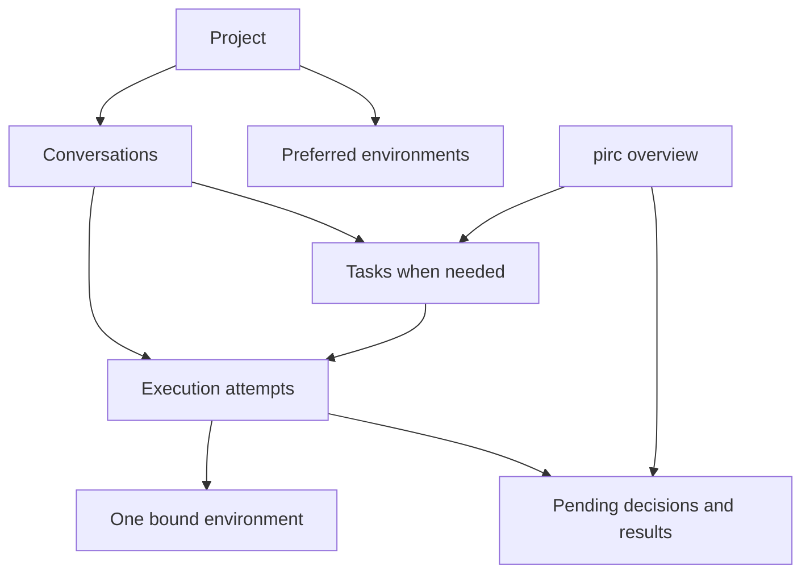

# Unified conversations, projects and an independent App

[Plans](README.md) · [Workspace modes](modes.md) · [Mobile](mobile.md) · [Assistant contracts](../docs/architecture/assistant-memory.md) · [Checkpoints](checkpoints.md)

Status: architecture and workflow proposal, 2026-10-23. The user authorized
planning only. No implementation, schema migration, deployment, remote push or
release is authorized by this plan. Proposed defaults below are reviewable design
choices, not claims about shipped behavior or approval to change security policy.

## Agreed direction and priority

- Merge the user-facing Chat and Work experience. A conversation can be ordinary
  chat, research or work without asking the user to choose a separate product area.
- Organize conversations in projects; distinguish organization from execution.
- Make the App a complete, independent client of the backend. Normal use must
  not require a desktop Web session to remain open or approve routine actions.
- Give pirc a stable assistant entry point that can discover relevant matters,
  propose work and coordinate agents within the user's granted authority.
  Proactive suggestions are wanted; frequent, repetitive interruptions are not.
- Define the domain relationships and user journeys before designing new screens
  or expanding UI parity. Web and App should implement the same behavior contract.
- Keep Flutter Web as an evaluation option. Replacing the existing Web client,
  rewriting transport and changing the native-content requirement are not decided.

Security and data-loss fixes remain important. Existing mobile compatibility and
physical-device acceptance gaps remain recorded, not silently closed by this
architecture proposal. The initial App scope remains Android; iOS transport is
outside the previously agreed scope.

## Current behavior: evidence and constraints

These are implementation facts to account for, not the target architecture:

- [Workspace modes](../docs/guides/modes.md) currently place `assistant: full`
  workspaces in Chat and others in Work. Modes also determine prompt, tools,
  working-directory behavior and feature access; the split is more than navigation.
- `crates/pirc-protocol/src/mode.rs` rejects full assistant capability with a
  workspace working directory, and rejects a mode that is both delegator and
  delegation target. Do not remove those checks just to merge the tabs.
- Projects, directory workspaces and their links currently have different
  lifecycle and permission rules. Project links are preferences, not permissions.
- [Assistant contracts](../docs/architecture/assistant-memory.md) separate global
  assistant memory from repository handoffs and protect provenance. Moving a
  conversation must not rewrite memory origins or widen what an agent can read.
- Android's `lib/live/gateway.dart` calls a Kotlin bridge. Native `PircApi.kt`
  directly requests Gateway session snapshots and commands; `EventStream.kt`
  opens authenticated Gateway event streams. An open Web page is not a relay.
- `core/Pairing.kt` consumes a pairing link created through Web. Gateway
  `management.rs` requires a browser identity to approve native management grants.
  These are genuine Web-dependent setup/administration steps today.
- `GatewayRuntime.kt` refreshes snapshots and checks session control leases.
  Another device holding a lease, an unreachable Gateway and an offline Node are
  different conditions; the UI must distinguish them. Reported switching/connection
  problems have not been reproduced as part of this planning pass.
- Gateway `push.rs` supports browser and phone delivery. Transport implementation
  does not establish successful real-device background delivery; existing remote
  push acceptance remains open.

## Domain model: proposed relationships

Names here describe product concepts, not approved database tables or API names.
Do not reuse today's overloaded `workspace` or `session` identifiers as if these
new relationships already existed.

| Concept               | Responsibility                                                                          | Relationship and lifetime                                                                                                                                       |
| --------------------- | --------------------------------------------------------------------------------------- | --------------------------------------------------------------------------------------------------------------------------------------------------------------- |
| Project               | Organize conversations, reference material, instructions and preferred environments     | One owner; zero or more conversations and environment links. It need not have a repository or directory.                                                        |
| Conversation          | Stable user-visible dialogue and its attributed messages/results                        | Belongs to the owner and optionally one project. Can have no task or several tasks. Survives an agent restart or execution change.                              |
| Task                  | Track a requested objective, decisions, dependencies, progress and deliverables         | Has one originating conversation, with links from other views. Can have child tasks and several execution attempts. Viewing it from pirc does not duplicate it. |
| Execution environment | Identify the actual Node, directory/worktree or scratch area and supported capabilities | Linked from zero or more projects. Availability and authorized access are separate from project membership. An environment is not a device UI.                  |
| Execution attempt     | Record a concrete agent run against a task or a normal conversation turn                | Belongs to one conversation and optionally one task. Has one explicit environment binding and an authority snapshot; restart/retry remains attributable.        |
| Pending decision      | Represent a specific proposal or confirmation awaiting the user                         | References its task/run and revision. Has a durable pending/handled/expired state shared by all clients.                                                        |

Important boundaries:

1. A project is not a filesystem directory, sandbox or new private-memory scope.
   Project-only memory remains shelved in [Plans](README.md); reopening it needs
   a separate decision. Project instructions remain explicit context inputs.
2. A folder move changes organization, not filesystem location or authority.
   Historical instructions, upload ownership, memory provenance and execution
   bindings do not change. Future context changes require an explicit transition;
   until migration semantics exist, block unsupported moves rather than relabel
   protected resources as belonging to the destination project.
3. A conversation retains its visible history when work begins. Backend execution
   contexts may differ; do not copy all assistant memory or credentials into a
   repository agent to preserve the appearance of continuity.
4. Each task has one canonical identity. A retry is a new attempt, not a new
   unrelated task. An agent's session ID is not the task ID.
5. One execution attempt cannot silently change directory, Node or authority.
   A different target starts a new attempt after the necessary user decision.
   A revoked grant still takes effect; an authority snapshot is not permanent access.
6. Browsing any project or task does not grant read access to its contents or
   permission to instruct its agent. Backend ownership and policy checks apply.

### Drafts, tasks and execution states

- **Conversation:** local draft → first accepted message → persisted conversation
  → archived or explicitly deleted. Opening New, leaving, or opening another
  empty draft does not create a server session or allocate a worktree.
- A first-send request has a stable idempotency identity. Retries, uploads and
  interrupted creation must not create duplicate conversations or orphaned
  permanent attachments. An unsent message remains visibly a draft.
- **Task:** proposed → ready → running → waiting for user / blocked → awaiting
  review → completed; canceled and failed remain distinguishable. Ordinary chat
  does not require task creation. Explicit user acceptance, where required, is
  separate from an agent reporting that it is finished.
- **Attempt:** queued → starting → running → succeeded / failed / stopped;
  disconnect can leave outcome unknown. Do not treat lost connectivity as success
  or blindly retry a possibly completed side effect.
- **Environment:** available, offline, incompatible or access denied. These do
  not erase the conversation or imply that its task was canceled.

Exact persisted state names and transitions require a later contract review.

## Primary user journeys

### 1. Chat without configuring a project

1. Open New conversation, enter a message and send.
2. Use an available authorized default scratch/chat environment; choosing a
   filesystem directory is unnecessary. If execution is unavailable, preserve
   the draft and explain which service is missing.
3. Chat normally. A brief question does not create a task card or delegation.
4. Optionally organize the conversation into a project under the move rules above.

### 2. Discuss, then work in the same conversation

1. Open a project conversation and discuss the change.
2. Ask the agent to implement it. Resolve the intended environment from the
   explicit choice or an unambiguous, authorized project default.
3. If several targets are plausible, ask once with readable device/directory
   choices. Never guess a remote target or silently widen permissions.
4. Show the selected environment and granted operation scope in the conversation.
   Use the established approval policy; no extra dialog is needed merely because
   the UI previously called this Work.
5. Start the task/attempt, keeping progress, questions and results in this dialogue.
   Detailed execution logs are accessible without forcing a navigation change.
6. Show changed files, tests, outstanding issues and any requested acceptance.

The contract guarantees one user-visible dialogue, not a single privileged agent
process. How a chat turn hands context to an execution agent remains a design
checkpoint before implementation; preserve source attribution and tool ownership.

### 3. Work directly, without going through pirc

1. Open a known environment or project and start a conversation there.
2. Send the work request directly; pirc is not a compulsory intermediary.
3. The task can appear in the shared overview without creating a second session.
4. If pirc is allowed to coordinate that task, show its role. Direct user
   instructions supersede conflicting pending assistant instructions.

### 4. Ask pirc to coordinate several tasks

1. Give pirc an objective or accept one of its suggestions.
2. Review scope/targets when existing grants do not already authorize them.
3. Create canonical tasks with dependencies and named execution environments.
4. Run independent tasks concurrently only where authority and isolation permit.
   Reuse existing delegation mechanisms rather than introducing a competing queue.
5. Collect decisions in the pirc inbox. Open any task to communicate directly
   with its agent; responses and status stay attached to that task.
6. Aggregate meaningful results without copying every tool event into pirc's chat.

### 5. Take over, switch devices, and return control

- Opening a conversation is viewing, not automatic takeover. Reading must not
  require the current controller to be online.
- Before a conflicting command, show who/what currently controls the execution
  and offer explicit takeover. Fence stale commands using a backend generation.
- User takeover suspends conflicting pirc dispatch for that task. It does not
  silently kill running tools; show whether work continues, pauses or is stopping.
- Resuming assistant coordination is explicit. Another browser tab opening must
  not silently reclaim it.
- Every decision has one backend outcome. Duplicate submissions return the
  current handled state. Web and App show where/when it was handled when known.
- Device command control, assistant coordination authority and filesystem writer
  isolation are distinct; one lease must not be assumed to solve all three.

### 6. Recover work or change an environment

- Opening another project or moving a conversation does not move a running agent.
- A changed environment needs a new attributed attempt with an explicit handoff.
- Checkpoint recovery continues to create an independent recovery workspace and
  its own blank recovery conversation. The source may link to it, but must not
  implicitly inherit source memory writers or replay commands into the recovery.
- Never reset, overwrite or clean the original directory or later user changes.
  Parallel writers require isolation or conflict handling; checkpoints alone are
  not a lock against editors, shell processes or another Node.

## pirc assistant: proactive but bounded

Proposed presentation: one stable assistant entry point with an overview,
pending decisions and task-specific discussion threads. It is not a second
unstructured collection of interchangeable Chat sessions. A continuous persona
must not require an infinite transcript containing every agent's raw output.

Separate these authorities:

- **Observe:** which projects, tasks, calendar/source data and history may be read.
- **Suggest:** create a sourced recommendation without starting its proposed work.
- **Execute:** dispatch, modify, schedule, contact external systems or publish only
  within explicitly granted scope and the existing operation approval policy.

Observation itself has limits: no scanning arbitrary files, accounts or new
sources merely to find something useful. Retrieved content and other agents'
messages remain data, not user permission. Unapproved suggestions expire or stay
pending; silence, dismissal and notification delivery never authorize execution.

The backend stores the suggestion, supporting evidence, revision, related tasks
and disposition. Event/rule filters should trigger bounded analysis, with budgets
and backoff, rather than a model continuously rereading every conversation.
Assistant inference runs on an available authorized execution service; a Gateway
alone is not an agent runtime. Show unavailable/stale status when it cannot run.

Notification policy proposal:

| Category                                               | Default treatment                                            |
| ------------------------------------------------------ | ------------------------------------------------------------ |
| Decision required, blocker or user-marked urgent event | Prompt notification subject to the user's preferences        |
| Ordinary completion or useful nonurgent suggestion     | Group in a digest/inbox                                      |
| Tool progress or unchanged state                       | Update the task silently                                     |
| Dismissed or snoozed suggestion                        | Stay quiet until the chosen time or a material new condition |

Include per-category controls, quiet hours, deduplication and a visible reason
for each suggestion. Proactive monitoring/analysis has a configurable budget and
can be stopped independently of ordinary chat. Exact defaults remain open.

## Independent App and shared backend contract

The App is an equal client, not a remote control for an open Web page. Web and
App both connect to Gateway; Node execution and durable coordination continue
independently of client visibility. A web login/identity-provider page opened on
the phone is compatible with this goal; requiring an already logged-in desktop
Web session is not.

### Identity and management

- Design native sign-in/bootstrap, reauthentication, credential renewal, recovery
  and revocation without requiring another device's Web UI. Keep the existing
  pairing path as an optional onboarding method during migration.
- Authorize management by verified identity, scope and required reauthentication,
  not by client platform alone. Do not simply grant all existing device tokens
  provider-credential or device-management privileges.
- The current browser-approved short-lived grant is an existing security decision
  to replace deliberately. Select the authentication mechanism and migration
  policy before implementing; do not infer approval to weaken it from this plan.

### State, commands and connection recovery

- Gateway exposes canonical task/decision state and recoverable account-level
  changes. Nodes remain authorities for execution/files; this plan does not
  require moving all transcripts or files into Gateway storage.
- Use versioned snapshots plus resumable events; detect missing history and
  resync. Session switching cannot depend on a Web client's local state.
- Cache already-read conversations locally by account. Show cached content,
  freshness and reconnect state; retain drafts and navigation during failures.
  Account changes/revocation must not expose another account's cache or drafts.
- Resolve mutations with idempotency keys, current revisions and authorization.
  Reconcile unknown outcomes instead of claiming exactly-once side effects.
- Offline viewing/drafting is allowed for cached data. First-version destructive
  or approval commands are not silently queued for later execution; revalidate
  state and authority when the user submits after reconnecting.
- Distinguish Gateway unreachable, Node offline, expired credentials, unavailable
  environment and control held elsewhere. Provide a relevant next action.

### Durable inbox and notification delivery

- Store the event/decision before notification delivery. A push is a wake-up hint
  and deep link, not the only copy of the assistant's message or an authorization.
- Web closing must not stop dispatch. App suspension must not stop backend work.
  Reopening the App reconciles unread/handled state even if push was lost.
- Retire local prompts/notifications when resolution is received. An offline
  device cannot be guaranteed immediate retraction; tapping a stale notification
  must fetch the current state and refuse duplicate execution.
- Gateway and required Nodes must still be available. A sleeping laptop hosting
  them remains a deployment limitation. Always-on coordination and phone OS push
  behavior need separate deployment/device acceptance.

## Flutter Web: evaluation only

A shared Flutter client could reduce duplicate UI and state logic. It is not
required to remove browser dependencies, and it cannot fix backend availability,
permissions or ordering bugs by itself. No Web replacement is approved here.

After the domain/behavior contract is agreed, evaluate a thin vertical slice:

- Login and direct Gateway transport, reconnect and two-device confirmation.
- Long conversation scrolling, selectable text, code highlighting and file views.
- Mobile CJK IME, desktop keyboard shortcuts, terminal resize/input and focus.
- Deep links, browser navigation, accessibility and phone/tablet/desktop layouts.
- Large histories, startup/download cost and sustained rendering responsiveness.
- Platform adapters for storage, notifications, files and native Kotlin services;
  existing method channels cannot simply run in a browser.

Compare keeping the existing Web client against sharing Flutter data/state/UI,
using the same workflows and fixtures. Set acceptance budgets before the spike;
do not invent a migration estimate without measuring these difficult surfaces.

Application UI reuse is separate from rendering agent-generated HTML/JavaScript.
Keep the current native-content requirement and explicit unsupported cases.
Structured result cards/forms may be evaluated later; this plan does not silently
replace arbitrary content with simplified output or authorize WebView fallback.

## Migration and compatibility constraints

- Map existing Chat projects, directory workspaces and sessions to the new
  concepts without resetting IDs, breaking deep links or moving user files.
  Define aliasing if new conversation/task IDs are needed.
- Old sessions remain readable and controllable with their original authority.
  Do not restart running agents or assign new tools just because navigation changed.
- Preserve memory provenance, deletion/forget semantics, uploads and project
  ownership. Moving a conversation must not reinterpret which prior project or
  conversation created a memory. Define cross-project move/deletion behavior
  before enabling that operation; global memory policy is unchanged.
- Preserve pending approvals, schedule/calendar targets, delegation references
  and checkpoint recovery provenance. Migration must not duplicate scheduled
  runs, replay a command or resume a stopped task.
- Plan version negotiation and supported Gateway/Node/client combinations for
  the transition. App updates and browser cached versions will not be simultaneous.
- Define restart-safe migration and a tested compatible fallback before changing
  storage; UI rollback is not permission to downgrade a migrated database.
- Present existing work in unified navigation first; migrate execution semantics
  incrementally. Avoid a simultaneous renderer rewrite, authentication cutover
  and task-storage migration.

## Design stages and later implementation gates

All unchecked work is future work; no stage grants implementation authority.

### A. Relationship and workflow review — current priority

- [x] Record the user's direction and separate present behavior from proposals.
- [x] Draft concept relationships, lifecycle boundaries and primary journeys.
- [x] Define independent-App criteria and keep Flutter Web optional.
- [ ] Review the draft with the user, especially context transitions, project
      moves, task creation and direct control versus pirc coordination.
- [ ] Inventory existing API/storage identities against each proposed concept and
      resolve incompatible lifecycle/permission rules before a schema proposal.

### B. Shared contracts and transition design

- [ ] Specify task/attempt/decision transitions, command fencing and event recovery.
- [ ] Specify native identity/bootstrap, renewal and scoped management transitions.
- [ ] Specify safe context handoffs, memory provenance and deletion/move behavior.
- [ ] Define migration/version compatibility, staged rollout and fallback criteria.
- [ ] Sketch Web and App journeys in the existing design language; do not copy
      current Chat/Work navigation simply to preserve screenshot parity.

### C. Implementation proposal, only after approval

- [ ] Propose incremental changes: unified navigation and stable conversation
      identity, then environment-bound execution and canonical task tracking.
- [ ] Propose App setup/synchronization independence as a parallel contract concern,
      with mobile-only acceptance for every delivered flow.
- [ ] Add pirc overview and durable decisions before expanding proactive discovery.
- [ ] Add scoped observation, quiet suggestions and authorized coordination.
- [ ] Evaluate Flutter Web separately; retain the current Web until acceptance
      supports an explicit migration decision.

## Acceptance scenarios to design and later verify

No scenario below has been executed by this documentation task.

| Scenario                                       | Required outcome                                                                                      |
| ---------------------------------------------- | ----------------------------------------------------------------------------------------------------- |
| Open/abandon several empty drafts              | No permanent sessions or allocated worktrees; first-send retries create only one conversation         |
| Discuss, then implement                        | Same visible conversation; explicit environment and authority; no blanket assistant-memory transfer   |
| Plain project without a repository             | Normal chat/files organization without forcing directory or Node selection                            |
| Move conversation / change default environment | Running bindings, historical provenance and permissions unchanged; unsupported moves refused          |
| Multiple agents and an external editor         | No hidden overwrite; isolated attempts or explicit conflicts; checkpoints preserve later user changes |
| User takes over a pirc-managed task            | Stale assistant commands fenced; running work status shown; no silent reclaim                         |
| All desktop Web pages closed                   | Phone can sign in, create/continue work, answer decisions and perform authorized management           |
| App suspended / notification missed            | Backend tasks persist; phone reconciles inbox/status when opened; real push tested separately         |
| Same confirmation on two devices               | One recorded outcome; duplicate is shown as handled; stale notifications cannot execute it again      |
| Network fails during send or approval          | Draft/outcome preserved; reconnect reconciles status without blind replay                             |
| Gateway works but Node is offline              | Overview/cached state remains useful; affected execution clearly unavailable                          |
| Credential revoked / account switched          | Authority ends and account data is isolated; no stale credential retry loop                           |
| Suggestion ignored or snoozed                  | No execution, repeated nagging or automatic widening of observation scope                             |
| Upgrade existing data                          | Links, memories, schedules, approvals and recoveries remain attributable; no duplicate work           |

## Decisions still open

Recommended defaults are proposals to review, not blockers to writing this plan:

1. **Execution handoff:** how to preserve conversation continuity across different
   agent contexts. Recommend explicit attributed handoffs and bounded context,
   rather than mutating a privileged process into a repository executor.
2. **Project structure and moves:** nesting depth and cross-project context/file
   transfer semantics. Recommend a simple initial organization model; no implicit
   filesystem moves or memory ownership changes.
3. **Task creation:** when an ordinary request becomes tracked work. Recommend
   explicit user requests and clearly announced long/background work, without a
   mandatory task form for every message.
4. **Native identity:** mechanism, management reauthentication and renewal policy.
   Preserve security while removing the required desktop-Web step.
5. **Proactivity:** initial observation scopes, analysis budget, digest frequency
   and quiet-hour defaults. Recommend opt-in scopes and bounded event-driven work.
6. **Flutter Web:** retain as evaluation until the difficult interaction surfaces
   pass agreed criteria. No framework migration is necessary to begin domain design.
